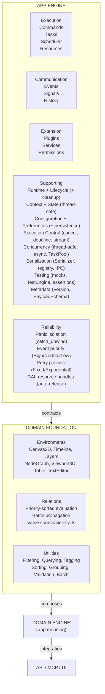
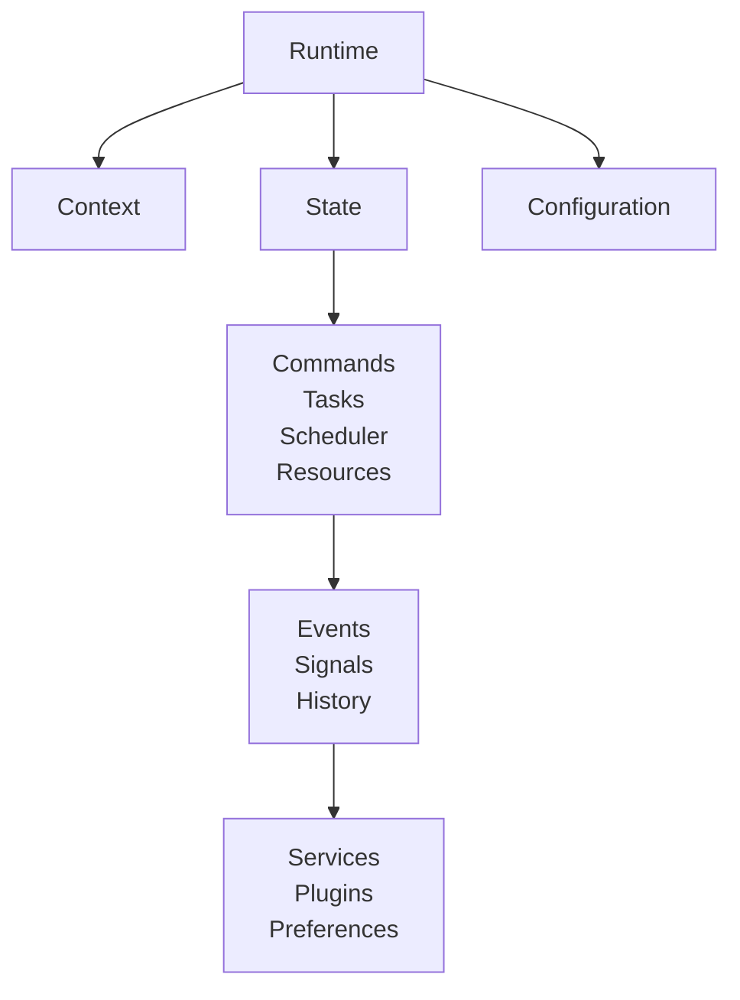
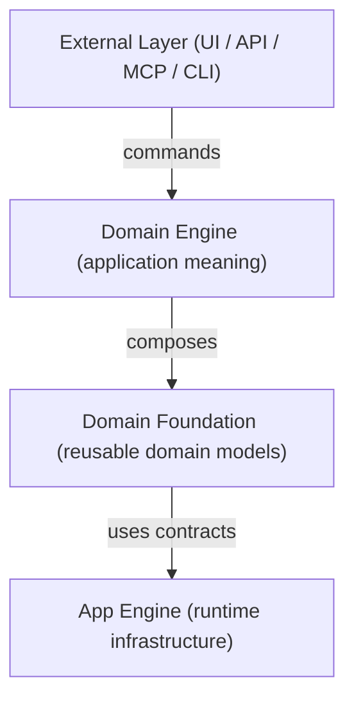

# AppShell
app shell with ready to use app engine
https://unique-digital-resources.github.io/AppShell-Documentation/

---

**Warning**: It is still in the early stages of development.

---

<p align="center">
  <h1 align="center">⚙️ AppShell</h1>
  <p align="center">
    A dependency-free application runtime and domain foundation for Rust.<br>
    App Engine (runtime infrastructure) + Domain Foundation (reusable domain models) — all in one coherent library.
  </p>
</p>

<p align="center">
  <a href="#features">Features</a> ·
  <a href="#quick-start">Quick Start</a> ·
  <a href="#architecture">Architecture</a> ·
  <a href="#guides">Guides</a>
</p>

---

## What Is This?

AppShell is a **two-layer library** for building Rust applications:

1. **App Engine** — generic application runtime infrastructure (lifecycle, commands, tasks, scheduling, events, signals, history, resources, services, plugins, configuration) without knowing what your application does.
2. **Domain Foundation** — reusable, headless domain models (Canvas2D, Timeline, Layers, NodeGraph, Viewport3D, Table, TextEditor, Relations, Utilities) that sit between the App Engine and your application-specific Domain Engine.



**Zero external dependencies by default.** Optional `tokio` for async. Optional `serde` for serialization.

---

## Comparison

| Feature | App Engine | Domain Foundation | bevy_app | tokio | iced | tauri |
|---|---|---|---|---|---|---|
| Lifecycle | ✅ 5-state | — | ✅ | ❌ | ❌ | ❌ |
| Commands | ✅ | — | ❌ | ❌ | ❌ | ❌ |
| Tasks | ✅ | — | ❌ | ✅ | ❌ | ❌ |
| Scheduler | ✅ | — | ❌ | ✅ (async) | ❌ | ❌ |
| Events | ✅ priority + isolation | — | ❌ | ❌ | ❌ | ❌ |
| Signals | ✅ thread-safe | — | ❌ | ❌ | ✅ | ❌ |
| History | ✅ undo/redo/replay | — | ❌ | ❌ | ❌ | ❌ |
| Resources | ✅ RAII + deps | — | ❌ | ❌ | ❌ | ❌ |
| Services | ✅ panic-isolated | — | ✅ | ❌ | ❌ | ❌ |
| Plugins | ✅ permissions | — | ✅ | ❌ | ❌ | ✅ |
| Config | ✅ persistent | — | ❌ | ❌ | ❌ | ✅ |
| Persistence | ✅ file/memory | — | ❌ | ❌ | ❌ | ❌ |
| Serialization | ✅ zero deps | ✅ optional serde | ❌ | ❌ | ❌ | ❌ |
| Concurrency | ✅ Send + Sync | ✅ Send + Sync | ✅ | ✅ | ❌ | ❌ |
| Async | ✅ optional tokio | — | ❌ | ✅ | ❌ | ❌ |
| Panic isolation | ✅ all handlers | — | ❌ | ❌ | ❌ | ❌ |
| 2D Canvas | — | ✅ headless | ❌ | ❌ | ❌ | ❌ |
| Timeline | — | ✅ headless | ❌ | ❌ | ❌ | ❌ |
| Layers | — | ✅ hierarchy | ❌ | ❌ | ❌ | ❌ |
| NodeGraph | — | ✅ + Canvas2D | ❌ | ❌ | ❌ | ❌ |
| Viewport3D | — | ✅ headless | ❌ | ❌ | ❌ | ❌ |
| Table | — | ✅ + merged cells | ❌ | ❌ | ❌ | ❌ |
| TextEditor | — | ✅ Unicode | ❌ | ❌ | ❌ | ❌ |
| Relations | — | ✅ priority + batch | ❌ | ❌ | ❌ | ❌ |
| Undoable ops | — | ✅ all operations | ❌ | ❌ | ❌ | ❌ |
| Dependencies | zero by default | zero by default | many | tokio | many | many |

---

## Features

### App Engine — Execution Systems

| System | What It Does |
|---|---|
| **Commands** | Application intents — "do X." Registered, executed, panic-isolated. |
| **Tasks** | Managed work with lifecycle: `Pending → Running → Completed/Failed/Cancelled`. Cancellation, deadlines, progress streaming. |
| **Scheduler** | Decides *when* tasks run: immediate, delayed, interval, triggered. Priority queue. Retry policies with fixed/exponential backoff. |
| **Resources** | Load, cache, track, and release generic data. RAII handles auto-release on drop. Dependency tracking. Thread-safe. |

### App Engine — Communication Systems

| System | What It Does |
|---|---|
| **Events** | "Something happened." One-to-many, priority-ordered, panic-isolated. Serialized payload support for IPC. |
| **Signals** | "Something changed." Lightweight, thread-safe. Progress streaming from task handlers. |
| **History** | Ordered operations with undo/redo/replay/transactions. Persistence-ready. |

### App Engine — Extension Systems

| System | What It Does |
|---|---|
| **Services** | Long-lived capabilities that start/stop with the app. Panic-isolated lifecycle. |
| **Plugins** | Extension packages contributing commands, tasks, resources, services, handlers. Permission-controlled. Dynamic loader stub for `.so`/`.dll`. |

### App Engine — Foundation Systems

| System | What It Does |
|---|---|
| **Runtime + Lifecycle** | Owns the application lifetime. Cancels tasks on stop. Unloads resources on dispose. |
| **Context** | Identity hierarchy: `Application → Session → Execution`. |
| **State** | Generic key-value state store with validated transitions. Thread-safe. |
| **Configuration** | Persistent settings. File/memory backends. Change notifications. Thread-safe. |
| **Preferences** | User-facing settings. Thread-safe. |
| **EngineRef** | Read-only bundle of subsystems passed to handlers. Handlers can publish events, load resources, write config, submit to scheduler. |
| **Execution Control** | `CancellationToken`, `Deadline`, `TaskOutputChannel`. |
| **Persistence** | `StorageBackend` trait with `FileStorageBackend` and `MemoryStorageBackend`. |
| **Serialization** | `Serializer` trait + `SerializationRegistry`. Serialized bytes on all payloads for IPC. Zero external deps. |
| **Concurrency** | All managers `Send + Sync`. `TaskPool`. Optional `AsyncRuntime` (tokio). |
| **Panic Isolation** | All handler calls wrapped in `catch_unwind`. Mutex not poisoned. |
| **Testing** | `MockCommandExecutor`, `MockEventBus`, `MockSignalBus`, `TestEngine`, assertion helpers. |
| **Metadata** | `Version`, `PayloadSchema` on all definitions. |

### Domain Foundation — Environments

| Environment | What It Does |
|---|---|
| **Canvas2D** | Arbitrary 2D spatial organization with objects, transforms, z-ordering, spatial queries. |
| **Timeline** | Temporal organization with tracks, clips, keyframes, interpolation, overlap constraints. |
| **Layers** | Hierarchical organization with parent-child, visibility inheritance, reparenting. |
| **NodeGraph** | Graph connectivity with ports, edges, type matching, topological sort. Composes Canvas2D. |
| **Viewport3D** | 3D spatial organization with Euler angles, parent-child transforms, spatial queries. |
| **Table** | Tabular data with rows, columns, cells, merged cells, ordering, swap operations. |
| **TextEditor** | Headless text editing with Unicode positions, ranges, search/replace, line/column. |

### Domain Foundation — Relations

| Feature | What It Does |
|---|---|
| **Definitions** | Declarative relation metadata: endpoints, trigger, propagation mode, priority. |
| **Evaluation** | Apply developer-supplied effect closures when source properties change. |
| **Propagation** | Direct or cascading with cycle protection and max depth. |
| **Batch** | Accumulate multiple property changes and propagate together. |
| **Value Source/Sink** | Traits for bridging Domain Engine state to evaluation engine. |

### Domain Foundation — Utilities

| Utility | What It Does |
|---|---|
| **Filtering** | Composable predicates (AND/OR/NOT) over any data type. |
| **Querying** | Named, reusable queries built on filtering. |
| **Tagging** | Tags and tag sets with deterministic iteration (BTreeSet). |
| **Sorting** | Criteria-based ordering, in-place or non-mutating. |
| **Grouping** | Group by key, with deterministic sorted output. |
| **Validation** | Rules, multi-rule validation, collect all failures. |
| **Batch** | Multi-object operations via trait or closure. |

---

## Quick Start

### App Engine

```rust
use app_shell::app_engine::*;
use std::any::Any;

// --- Your command handler ---
struct GreetCommand;

impl CommandHandler for GreetCommand {
    fn execute(
        &self,
        input: &CommandInput,
        _: &CommandContext,
        engine: &EngineRef,
    ) -> Result<CommandResult, CommandError> {
        let name: &String = input.get::<String>()
            .ok_or_else(|| CommandError::InvalidArguments("expected name".to_string()))?;

        engine.event_bus.publish(
            &Event::new("greet.done").with_source("GreetCommand")
        );

        Ok(CommandResult::success_with(format!("Hello, {}!", name)))
    }
}

// --- Main ---
fn main() {
    let mut engine: AppEngine = Bootstrap::create().expect("bootstrap failed");

    engine.command_executor_mut().register(
        CommandDefinition::new("app.greet", "Greet", "Greet someone"),
        Box::new(GreetCommand),
    ).unwrap();

    engine.initialize().unwrap();
    engine.start().unwrap();

    let cmd = Command::new(
        "app.greet",
        CommandContext::new(ExecutionId::new()),
        CommandInput::new("World".to_string()),
    );
    let result = engine.execute_command(&cmd).unwrap();
    println!("{}", result.output::<String>().unwrap());

    engine.stop().unwrap();
    engine.dispose().unwrap();
}
```

### Domain Foundation

```rust
use app_shell::domain_engine::DomainEngine;
use app_shell::domain_foundation::environments::canvas_2d::*;

let mut engine = DomainEngine::new();

// Create a canvas object
let id = engine.execute_canvas(CanvasOperation::Create {
    transform: Transform::from_translation(Vec2::new(100.0, 200.0)),
}).unwrap();

// Move it
engine.execute_canvas(CanvasOperation::Move {
    id,
    translation: Vec2::new(50.0, 50.0),
}).unwrap();

// Undo
engine.undo().unwrap();
assert_eq!(
    engine.canvas().get(id).unwrap().transform.translation,
    Vec2::new(100.0, 200.0),
);

// Transactions
engine.begin_transaction();
engine.execute_canvas(CanvasOperation::Create { transform: Transform::identity() }).unwrap();
engine.execute_canvas(CanvasOperation::Create { transform: Transform::identity() }).unwrap();
engine.commit_transaction();

// Undo both as one unit
engine.undo().unwrap();
assert_eq!(engine.canvas().len(), 0);
```

---

## Architecture



### Dependency Direction

```text
Domain Engine  ──→  Domain Foundation  ──→  App Engine  ──→  (nothing)
App Engine     ✗→   Domain Foundation
Domain Engine  ✗→   App Engine (directly)
App Engine     ✗→   UI / API / MCP
```

### Layered Architecture



Each layer knows only the layer below it. The App Engine never imports domain types. The Domain Foundation never imports UI types.

---

## Installation

Add to your `Cargo.toml`:

```toml
[dependencies]
app_shell = { path = "path/to/AppShell" }

# Optional: async runtime
app_shell = { path = "path/to/AppShell", features = ["async-runtime"] }

# Optional: serialization
app_shell = { path = "path/to/AppShell", features = ["serde"] }
```

### Features

| Feature | Description |
|---|---|
| `default` | Zero external dependencies. All systems included (sync only). |
| `async-runtime` | Adds `tokio` for async task execution via `AsyncTaskHandler`. |
| `serde` | Adds `serde` derives on all serializable Domain Foundation types. |

---

## Key Properties

| Property | App Engine | Domain Foundation |
|---|---|---|
| **Dependency-free** | ✅ Zero external crates by default | ✅ Zero external crates by default |
| **Thread-safe** | ✅ All managers are `Send + Sync` | ✅ All environments are `Send + Sync` |
| **Panic-isolated** | ✅ All handler calls wrapped in `catch_unwind` | — |
| **RAII resources** | ✅ Handles auto-release on drop | — |
| **Backward compatible** | ✅ Default permissions = `FULL_ACCESS` | — |
| **Headless** | ✅ Runs without UI, API, or MCP | ✅ No UI, rendering, or input |
| **Serializable** | ✅ `Serializer` trait, zero deps | ✅ Optional `serde` feature |
| **Persistent** | ✅ `StorageBackend` trait, file + memory | — |
| **Testable** | ✅ Mocks, `TestEngine`, assertion helpers | ✅ 414 tests + proptest + benchmarks |
| **Versioned** | ✅ `Version`, `PayloadSchema` on all definitions | — |
| **Async-ready** | ✅ Optional `tokio` integration | — |
| **Composable** | — | ✅ Environments compose concretely |
| **Undoable operations** | — | ✅ Every operation carries undo data |
| **Unicode-aware** | — | ✅ TextEditor uses Unicode scalar value positions |
| **Priority-sorted relations** | — | ✅ Higher priority relations fire first |
| **Cycle-safe** | — | ✅ Propagator + Layer/Viewport3D reject cycles |

---

## Subsystem Summary

```mermaid
flowchart TD
    subgraph APPSHELL["APPSHELL"]
        subgraph AE["APP ENGINE"]
            EX["Execution"]
            CO["Communication"]
            EN["Extension"]
            FO["Foundation"]
            RE["Reliability"]

            EX --> EX1["Commands (intent → execution, panic-isolated)"]
            EX --> EX2["Tasks (managed work, cancel, deadline, progress)"]
            EX --> EX3["Scheduler (when work runs, retry, triggers)"]
            EX --> EX4["Resources (load, cache, RAII handles, dependencies)"]

            CO --> CO1["Events (one-to-many, priority, panic-isolated)"]
            CO --> CO2["Signals (lightweight change notifications)"]
            CO --> CO3["History (undo/redo/replay/transactions)"]

            EN --> EN1["Services (long-lived, panic-isolated lifecycle)"]
            EN --> EN2["Plugins (extension packages, permission-controlled)"]

            FO --> FO1["Runtime + Lifecycle (+ cleanup on stop/dispose)"]
            FO --> FO2["Context (Application → Session → Execution)"]
            FO --> FO3["State (generic key-value, thread-safe)"]
            FO --> FO4["Configuration (persistent, thread-safe, change notifications)"]
            FO --> FO5["Preferences (user-facing, thread-safe)"]
            FO --> FO6["EngineRef (handler capabilities)"]
            FO --> FO7["Execution Control (cancel, deadline, stream)"]
            FO --> FO8["Persistence (StorageBackend trait)"]
            FO --> FO9["Serialization (Serializer trait, registry)"]
            FO --> FO10["Concurrency (TaskPool, AsyncRuntime)"]
            FO --> FO11["Testing (mocks, TestEngine)"]
            FO --> FO12["Metadata (Version, PayloadSchema)"]

            RE --> RE1["Panic Isolation (catch_unwind on all handlers)"]
            RE --> RE2["Event Priority (High/Normal/Low)"]
            RE --> RE3["Retry Policies (Fixed/Exponential)"]
            RE --> RE4["RAII Handles (auto-release on drop)"]
        end

        subgraph DF["DOMAIN FOUNDATION"]
            ENV["Environments"]
            REL["Relations"]
            UTI["Utilities"]

            ENV --> E1["Canvas2D (objects, transforms, z-order, spatial queries)"]
            ENV --> E2["Timeline (tracks, clips, keyframes, interpolation)"]
            ENV --> E3["Layers (hierarchy, visibility inheritance, reparenting)"]
            ENV --> E4["NodeGraph (ports, edges, type matching, topo sort)"]
            ENV --> E5["Viewport3D (3D transforms, parent-child, spatial queries)"]
            ENV --> E6["Table (rows, columns, cells, merged cells, ordering)"]
            ENV --> E7["TextEditor (Unicode positions, ranges, search/replace)"]

            REL --> R1["Definitions (endpoints, trigger, propagation, priority)"]
            REL --> R2["Evaluation (effect closures, mutable value store)"]
            REL --> R3["Propagation (Direct, Cascading, cycle protection)"]
            REL --> R4["Batch (accumulate, commit, rollback)"]
            REL --> R5["Value Source/Sink (bridge Domain Engine state)"]

            UTI --> U1["Filtering (AND/OR/NOT composable predicates)"]
            UTI --> U2["Querying (named, reusable queries)"]
            UTI --> U3["Tagging (BTreeSet, deterministic order)"]
            UTI --> U4["Sorting (criteria-based ordering)"]
            UTI --> U5["Grouping (group by key, sorted output)"]
            UTI --> U6["Validation (rules, multi-rule, collect failures)"]
            UTI --> U7["Batch (multi-object operations)"]
        end
    end

    AE -->|"contracts"| DF
    DF -->|"composes"| DE["DOMAIN ENGINE (app meaning)"]
```



---

## When to Use

✅ **Use AppShell when**:
-	You need managed execution (commands, tasks, scheduling)
-	You need undo/redo with transactions
-	You need reusable domain models (2D canvas, timeline, layers, node graph, table, text editor)
-	You need property propagation between objects (relations)
-	You need plugin extensibility with permission control
-	You need decoupled communication (events/signals)
-	You need resource management with RAII handles
-	You need long-lived services with panic isolation
-	You need thread-safe managers (`Send + Sync`)
-	You need async execution (optional tokio)
-	You need serialization for IPC or persistence (zero deps or serde)
-	You want stable contracts between runtime, domain models, and domain logic

❌ **Don't use AppShell if:**
-	Your app is a simple script
-	You have no lifecycle/undo/extensibility/domain-model needs
-	You don't need domain/UI/API separation

---

## License

Apache-2.0

---

## Contributing

(Not Yet) ~~Pull requests welcome. See the [architecture guide](app_engine_docs/02-architecture.md) before contributing — clean boundaries are the core value proposition.~~

---


## Guides

### App Engine — Core Architecture

| # | Guide | Topic |
|---|---|---|
| 01 | [Overview](app_engine_docs/01-overview.md) | What App Engine is, what it provides, what it doesn't |
| 02 | [Architecture](app_engine_docs/02-architecture.md) | Layering, boundaries, subsystem ownership |
| 03 | [Bootstrap & Lifecycle](app_engine_docs/03-bootstrap-and-lifecycle.md) | Creating, running, shutting down |
| 04 | [Context & State](app_engine_docs/04-context-and-state.md) | Identity hierarchy, state management |
| 05 | [Commands & Tasks](app_engine_docs/05-commands-and-tasks.md) | Intents, managed work, registration, execution |
| 06 | [Scheduling & Communication](app_engine_docs/06-scheduling-and-communication.md) | Scheduler, events, signals |
| 07 | [History & Resources](app_engine_docs/07-history-and-resources.md) | Undo/redo, RAII handles, dependencies |
| 08 | [Services & Plugins](app_engine_docs/08-services-and-plugins.md) | Long-lived capabilities, extensions, permissions |
| 09 | [Domain Engine Integration](app_engine_docs/09-domain-engine-integration.md) | How to build your domain layer |
| 10 | [Application Integration](app_engine_docs/10-application-integration.md) | UI, API, MCP, CLI, headless |

### App Engine — Advanced Features

| # | Guide | Topic |
|---|---|---|
| 11 | [Handler Capabilities](app_engine_docs/11-handler-capabilities.md) | EngineRef, what handlers can access |
| 12 | [Execution Control](app_engine_docs/12-execution-control.md) | Cancellation, deadlines, progress streaming |
| 13 | [Persistence & Serialization](app_engine_docs/13-persistence-and-serialization.md) | Storage backends, Serializer trait, IPC |
| 14 | [Concurrency & Async](app_engine_docs/14-concurrency-and-async.md) | Thread safety, TaskPool, AsyncRuntime |
| 15 | [Communication & Reliability](app_engine_docs/15-communication-reliability.md) | Priority, panic isolation, retry |
| 16 | [Testing & Metadata](app_engine_docs/16-testing-and-metadata.md) | Mocks, TestEngine, Version, PayloadSchema |
| 17 | [Plugin Security](app_engine_docs/17-plugin-security.md) | Permissions, PermissionCheckedEngineRef |

### App Engine — Reference

| # | Guide | Topic |
|---|---|---|
| 18 | [Public API Reference](app_engine_docs/18-public-api-reference.md) | Complete type/trait listing |
| 19 | [Error Reference](app_engine_docs/19-error-reference.md) | All error types and variants |
| 20 | [Quick Start](app_engine_docs/20-quick-start.md) | 5-minute getting started |

### Domain Foundation — Overview

| # | Guide | Topic |
|---|---|---|
| 01 | [Overview](domain_docs/01-overview.md) | What Domain Foundation is, what it provides, what it doesn't |
| 02 | [Architecture](domain_docs/02-architecture.md) | Layering, composition rules, dependency direction |
| 03 | [Environments](domain_docs/03-environments.md) | All 7 environments at a glance |

### Domain Foundation — Environments

| # | Guide | Topic |
|---|---|---|
| 04 | [Canvas2D](domain_docs/04-canvas-2d.md) | 2D spatial: objects, transforms, z-order, spatial queries |
| 05 | [Timeline](domain_docs/05-timeline.md) | Temporal: tracks, clips, keyframes, interpolation, overlap |
| 06 | [Layers](domain_docs/06-layers.md) | Hierarchy: parent-child, visibility, locked, reparenting |
| 07 | [NodeGraph](domain_docs/07-node-graph.md) | Graph: nodes, ports, edges, type matching, topo sort, Canvas2D composition |
| 08 | [Viewport3D](domain_docs/08-viewport-3d.md) | 3D spatial: Euler angles, parent-child, spatial queries |
| 09 | [Table](domain_docs/09-table.md) | Tabular: rows, columns, cells, merged cells, ordering |
| 10 | [TextEditor](domain_docs/10-text-editor.md) | Text: Unicode positions, ranges, search/replace, line/column |

### Domain Foundation — Systems

| # | Guide | Topic |
|---|---|---|
| 11 | [Relations](domain_docs/11-relations.md) | Definitions, evaluation, propagation, batch, value source/sink |
| 12 | [Utilities](domain_docs/12-utilities.md) | Filtering, querying, tagging, sorting, grouping, validation, batch |

### Domain Foundation — Integration

| # | Guide | Topic |
|---|---|---|
| 13 | [Domain Engine Integration](domain_docs/13-domain-engine-integration.md) | How DomainEngine composes all environments + App Engine |
| 14 | [App Engine Integration](domain_docs/14-app-engine-integration.md) | Command handlers, EngineRef, history, events, signals |
| 15 | [Operations & Undo](domain_docs/15-operations-and-undo.md) | Operation pattern, outcomes, undo/redo, transactions, compound ops |
| 16 | [Serialization](domain_docs/16-serialization.md) | serde feature, round-trip, known limitations |

### Domain Foundation — Reference

| # | Guide | Topic |
|---|---|---|
| 17 | [Testing](domain_docs/17-testing.md) | Model, operation, integration, composition, acceptance, concurrency, proptest, stress |
| 18 | [Public API Reference](domain_docs/18-public-api-reference.md) | Complete type/trait listing |
| 19 | [Error Reference](domain_docs/19-error-reference.md) | All error types and variants |
| 20 | [Quick Start](domain_docs/20-quick-start.md) | 5-minute getting started with Domain Foundation |

---

<p align="center">
  <sub>Built with ❤️ in Rust. Zero dependencies. No compromise.</sub>
</p>
