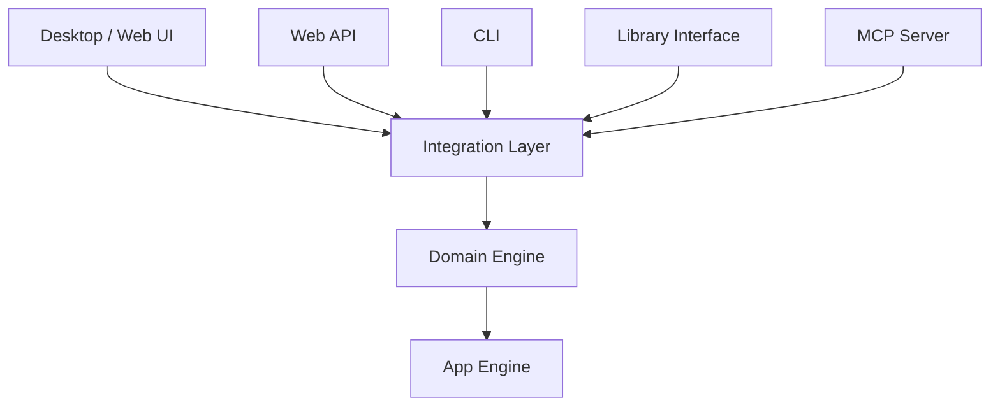
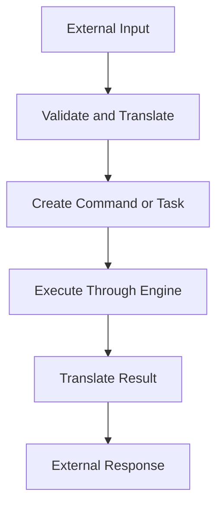
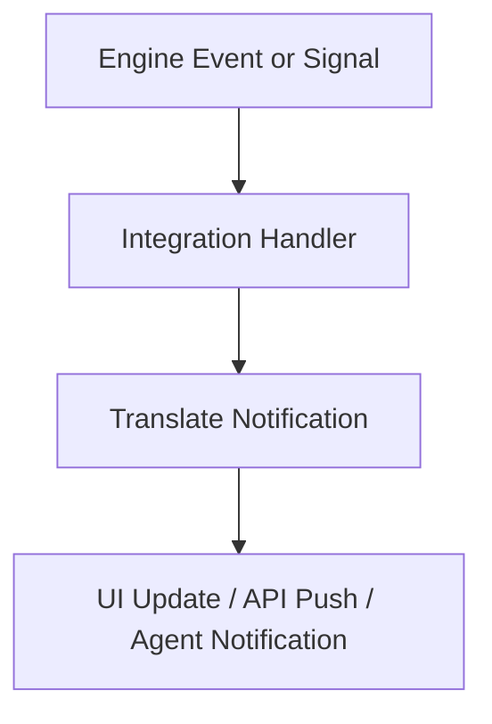
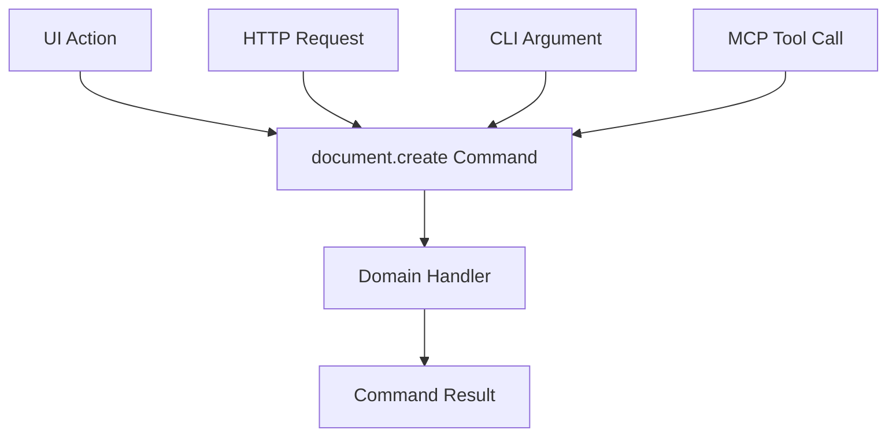
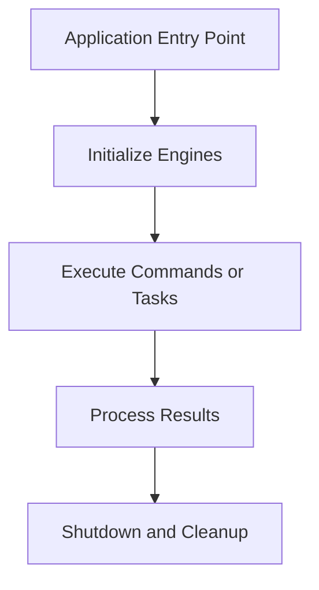

# Application Integration

## Overview

Application integration defines how external interfaces interact with the App Engine and Domain Engine. These interfaces may include a desktop UI, web API, command-line interface (CLI), embedded library, or Model Context Protocol (MCP) server.

The integration layer translates external inputs into application operations and translates their results, events, and signals into outputs that external consumers can understand.

The engines remain independent of the interfaces that use them.

> **Warning — Theoretical Design**
>
> This page describes the proposed architecture and possible integration approaches. All code snippets, diagrams, API examples, and integration scenarios are theoretical illustrations, not verified implementations. They do not establish that the described interfaces, methods, types, or integrations currently exist or work as shown. Actual implementations must be checked against the source code and updated as the architecture evolves.

## Architecture

The integration layer connects external interfaces to the application engines without making those engines dependent on a particular interface.



Each component has a distinct responsibility:

- **Integration layer:** Translates external inputs and outputs into the application's internal contracts.
- **Domain Engine:** Defines application-specific concepts, rules, and operations.
- **App Engine:** Provides general runtime infrastructure, including commands, tasks, events, signals, and lifecycle management.
- **External interfaces:** Provide the means through which users, programs, or agents interact with the application.

The integration layer is an architectural boundary, not a requirement to implement every interface in a single application.

## Integration Workflow

The proposed integration workflow has two directions: receiving requests and communicating results.

### External input to application operation



A request enters through an external interface, where it is validated and translated into an appropriate command or task. The relevant engine executes the operation, and the integration layer converts the result into the format expected by the caller.

For example, a UI button, HTTP request, CLI argument, or MCP tool call could request the same document-creation operation.

### Application events to external consumers



Events and signals provide a potential mechanism for communicating changes and execution progress to external consumers.

The integration layer determines how these notifications are delivered. A desktop interface might refresh a view, a web API might publish a WebSocket message, and an MCP server might send a supported notification.

The specific notification mechanisms depend on the interface implementation.

## Integration Approaches

Different interfaces can expose the same underlying application capabilities while adapting their communication to their respective environments.

### Desktop UI

A desktop interface translates user interactions into application operations and presents their results.

Typical responsibilities include:

- Translating button clicks, menu actions, and keyboard shortcuts into commands.
- Displaying command results and errors.
- Presenting task progress through signals.
- Updating views in response to relevant events.
- Reading and modifying user preferences through the appropriate application interfaces.

The UI owns presentation and interaction. Application rules should remain in the Domain Engine rather than being duplicated in UI event handlers.

### Web API

A web API exposes application operations to remote or local clients through a defined request-response contract.

Typical responsibilities include:

- Validating incoming requests.
- Mapping requests to commands or tasks.
- Translating results and errors into response formats.
- Applying appropriate authentication and authorization.
- Delivering updates through a supported mechanism when real-time communication is required.

HTTP endpoints and WebSocket communication are possible implementation choices, not mandatory App Engine dependencies.

### Command-Line Interface

A CLI provides a programmatic interface for terminal users, shell scripts, and automated workflows.

A CLI could translate arguments into commands or tasks, display their results, and return meaningful process exit codes.

For example, a future application might expose operations resembling:

```text
app document create "My Document"
app project export --format pdf
app command list
```

These commands are illustrative. They do not represent an existing executable or verified command syntax.

### Library Interface

A library interface allows another program to embed the application without requiring a separate UI or network server.

A library wrapper could expose selected operations through a stable public API while managing engine initialization, execution, error handling, and shutdown.

The wrapper should expose intentional application capabilities rather than requiring consumers to depend on internal engine details.

Foreign-function interfaces (FFI) or other language bindings could be considered separately if cross-language embedding becomes a requirement.

### Model Context Protocol (MCP)

An MCP integration could expose selected application capabilities to compatible AI clients through tools and other supported protocol features.

For example, an MCP server could:

- Describe available application operations.
- Validate tool inputs.
- Translate tool calls into commands or tasks.
- Return structured operation results and errors.
- Expose appropriate notifications or resources where supported.

The MCP integration should act as a protocol adapter rather than implementing application-specific rules independently.

MCP support is an optional integration approach. It does not imply that the application contains a built-in AI model or that an MCP server has already been implemented.

## Integration Boundaries

The following principles define the intended separation between the integration layer and the engines.

### 1. Keep application rules out of integration handlers

Integration handlers translate requests; they should not independently implement domain behavior. Application-specific rules belong in the Domain Engine.

### 2. Reuse application operations

Where multiple interfaces need the same capability, they should use the same underlying command or task contract rather than implementing separate versions of the operation.

### 3. Keep engines independent of external interfaces

The App Engine should not need to know whether an operation originated from a UI, API, CLI, library, or MCP client.

Likewise, the Domain Engine should define application behavior without depending on a particular presentation or transport mechanism.

### 4. Translate outputs at the boundary

Commands, tasks, events, and signals are internal application contracts. Each integration layer is responsible for translating them into suitable external responses and notifications.

### 5. Treat security as part of the integration design

External interfaces must validate inputs and enforce the appropriate access restrictions. Remote endpoints and agent-facing tools should expose only authorized capabilities.

The required authentication, authorization, and permission checks depend on the deployment and interface.

## Example: A Shared Operation

Consider a hypothetical `document.create` operation.

The following diagram illustrates how multiple interfaces could reuse the same operation.



Each interface would validate its input and construct the appropriate command. The command would then be handled by the Domain Engine, and the resulting output would be translated for the original caller.

For example, the UI might display the new document's identifier, an HTTP endpoint might return it in a JSON response, and an MCP tool might return it as structured content.

This example illustrates the intended architecture only. The command, handler, types, and integrations must be verified or implemented before this workflow can be considered functional.

## Relationship to Headless Operation

Application logic does not inherently require a graphical interface.

A headless application can use the engines directly to perform automated operations, batch processing, or background work. An external interface is needed only when the application requires a particular means of interaction or communication.



A future headless implementation could run without a desktop UI, web API, or MCP server. Whether a particular workflow can run headlessly depends on its implementation and dependencies.

## Conclusion

Application integration provides the boundary between the application's internal capabilities and the interfaces through which those capabilities are accessed.

The intended architecture separates three concerns:

- The **App Engine** provides general runtime infrastructure.
- The **Domain Engine** provides application-specific behavior.
- The **Integration Layer** adapts external interfaces to the engines' contracts.

This separation allows different interfaces to reuse application capabilities while keeping transport, presentation, and protocol-specific concerns outside the engines.

The architecture described here establishes a design direction, not proof of a completed integration implementation.

## Next Steps

1. **Verify the engine contracts:** Check the actual App Engine and Domain Engine APIs, including command execution, task management, events, signals, and lifecycle operations.
2. **Define the integration boundary:** Specify how external inputs, results, errors, and notifications are represented and translated.
3. **Implement one integration path:** Select a minimal interface and connect it to an existing, verified application operation.
4. **Test the complete workflow:** Verify input validation, execution, result translation, error handling, and lifecycle cleanup.
5. **Expand integrations incrementally:** Add other interfaces only when their requirements and contracts are defined, reusing existing application operations where appropriate.
6. **Update the documentation:** Replace theoretical examples with verified implementations as they become available.

## Guide Index

| # | File | Topic |
|---|---|---|
| 01 | [01-overview.md](01-overview.md) | What App Engine Is |
| 02 | [02-architecture.md](02-architecture.md) | Architecture and Boundaries |
| 03 | [03-bootstrap-and-lifecycle.md](03-bootstrap-and-lifecycle.md) | Creating and Running an App |
| 04 | [04-context-and-state.md](04-context-and-state.md) | Context and State |
| 05 | [05-commands-and-tasks.md](05-commands-and-tasks.md) | Application Operations |
| 06 | [06-scheduling-and-communication.md](06-scheduling-and-communication.md) | Scheduling, Events, and Signals |
| 07 | [07-history-and-resources.md](07-history-and-resources.md) | History and Resources |
| 08 | [08-services-and-plugins.md](08-services-and-plugins.md) | Services and Plugins |
| 09 | [09-domain-engine-integration.md](09-domain-engine-integration.md) | Domain Engine Integration |
| 10 | [10-application-integration.md](10-application-integration.md) | Application Integration |
