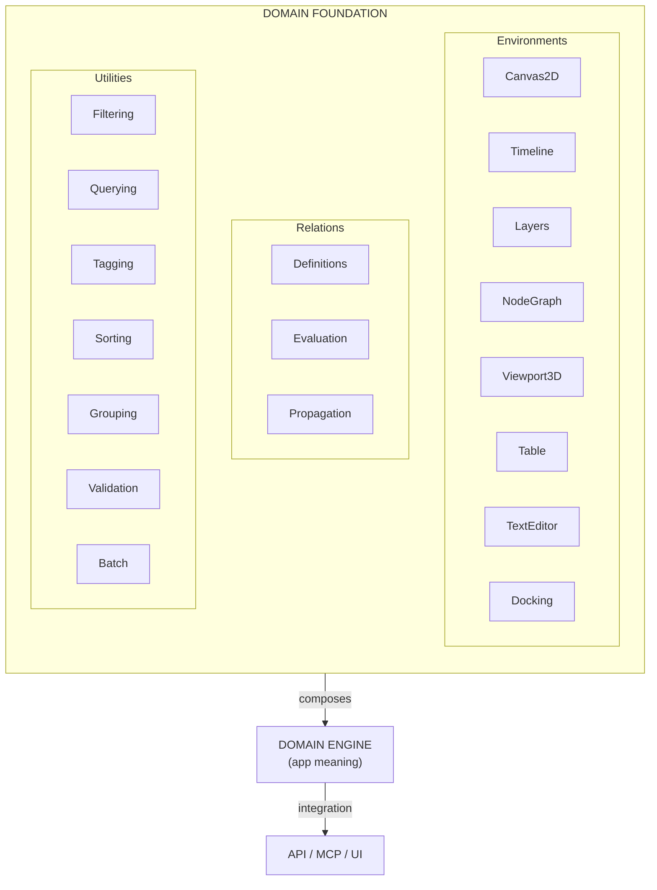
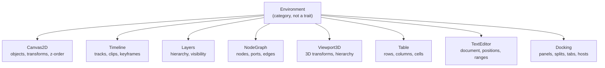
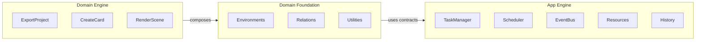
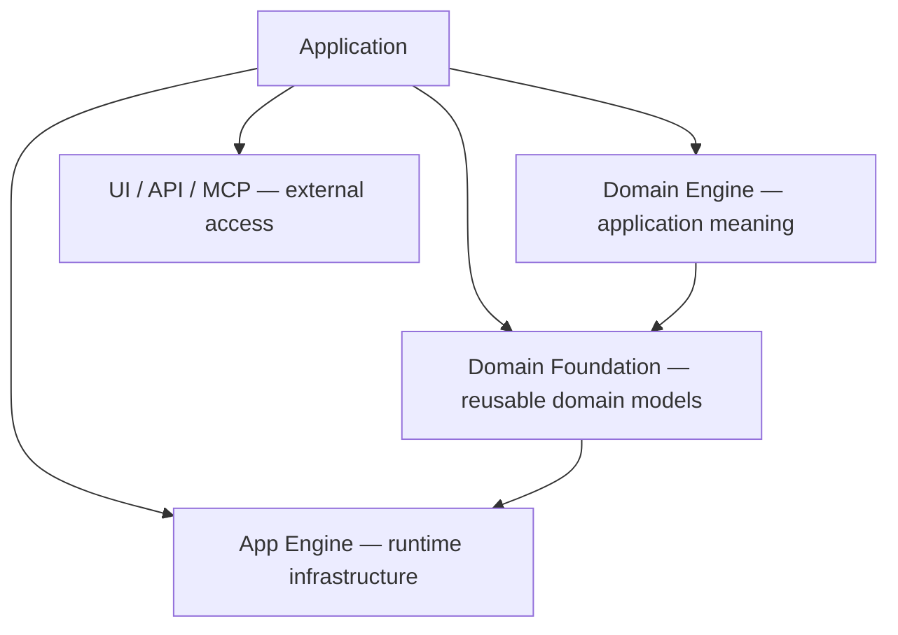

# Domain Foundation Overview

## What Domain Foundation Is

The **Domain Foundation** is a reusable domain capability library. It provides headless models for common domain organization patterns — 2D/3D spatial editing, timelines, layer hierarchies, node graphs, tables, text editing, docking layouts — plus a relation system for property propagation and optional utilities for filtering, tagging, querying, and more.

It sits **between** the generic App Engine (runtime infrastructure) and application-specific Domain Engines (domain meaning). The foundation defines *how objects are organized* and *how changes propagate*; it never defines *what the objects mean*.



**Zero external dependencies by default.** Optional `serde` for serialization.

---

## What Domain Foundation Provides

### Environments

| Environment | Purpose |
|---|---|
| **Canvas2D** | Arbitrary 2D spatial organization with objects, transforms, z-ordering, and spatial queries. |
| **Timeline** | Temporal organization with tracks, clips, keyframes, interpolation modes, and overlap constraints. |
| **Layers** | Hierarchical organization with parent-child relationships, visibility inheritance, and reparenting. |
| **NodeGraph** | Graph connectivity with ports, edges, type matching, connection limits, and topological sort. Composes Canvas2D for spatial placement. |
| **Viewport3D** | 3D spatial organization with Euler angles, parent-child transform hierarchy, and spatial queries. |
| **Table** | Tabular data with rows, columns, cells, merged cells, ordering, and swap operations. |
| **TextEditor** | Headless text editing with Unicode scalar value positions, ranges, search/replace, and line/column mapping. |
| **Docking** | Dockable panel layouts: panels, splits, tab groups, embed hosts — placements, splitter/region/floating sizing, and whole-layout integrity, fully headless. |

### Relations

| Feature | Purpose |
|---|---|
| **Definitions** | Declarative relation metadata: endpoints, trigger, propagation mode, priority. |
| **Evaluation** | Apply developer-supplied effect closures when source properties change. |
| **Propagation** | Direct or cascading propagation with cycle protection and max depth. |
| **Batch** | Accumulate multiple property changes and propagate them together. |
| **Value Source/Sink** | Traits for bridging environment state to the relation evaluation engine. |

### Utilities

| Utility | Purpose |
|---|---|
| **Filtering** | Composable predicates (AND/OR/NOT) over any data type. |
| **Querying** | Named, reusable queries built on filtering. |
| **Tagging** | Tags and tag sets with deterministic iteration order (BTreeSet). |
| **Sorting** | Criteria-based ordering, in-place or non-mutating. |
| **Grouping** | Group by key, with deterministic sorted output. |
| **Validation** | Rules and results, multi-rule validation, collect all failures. |
| **Batch** | Multi-object operations via trait or closure. |

---

## What Domain Foundation Does NOT Provide

| Concern | Who owns it |
|---|---|
| **Application meaning** (what "export project" means) | Domain Engine |
| **Domain state** (which document is open, what's selected) | Domain Engine |
| **UI** (rendering, widgets, input handling, windows) | UI Layer |
| **API/MCP** (HTTP endpoints, AI agent contracts) | Integration Layer |
| **Execution infrastructure** (commands, tasks, scheduling) | App Engine |
| **Persistence** (file I/O, database) | App Engine / External |
| **Rendering** (GPU, OpenGL, Vulkan, Wayland) | UI Layer |
| **Syntax highlighting** | Domain Engine (if needed) |
| **Formula evaluation** | Domain Engine (via Relations) |
| **Graph evaluation/dataflow** | Domain Engine (depends on port types) |

The Domain Foundation is deliberately **semantic-agnostic**. It knows that a `Canvas` has `Objects` with `Transforms`, but it does not know whether those objects are rectangles, images, or text.

---

## No Universal Abstractions

The Domain Foundation deliberately does **not** introduce:

- A universal `Environment` trait
- An `OrderedEnvironment` base for Timeline, Layers, Table
- A `Geometry Foundation` or `Selection Foundation`
- A `Graph Foundation` or `Ordering Foundation`

Each environment owns its own types, errors, and operations. This is a deliberate design choice: **composition over artificial generalization**.



A concept should become reusable **only when it has a real, meaningful boundary** — not because two environments look superficially similar in their UI representation.

---

## App Engine vs Domain Foundation vs Domain Engine



| Layer | Responsibility | Knows about |
|---|---|---|
| **Domain Engine** | What the application *does* (domain objects, rules, operations) | Foundation + App Engine |
| **Domain Foundation** | How objects are *organized* and how changes *propagate* | App Engine (history, events) |
| **App Engine** | How work is *managed, scheduled, communicated* | Nothing above it |

**Dependency direction**: `Domain Engine → Domain Foundation → App Engine` (never the reverse).

---

## Comparison

| Feature | Domain Foundation | bevy_ecs | iced | tauri |
|---|---|---|---|---|
| 2D Canvas | ✅ headless | ❌ | ❌ | ❌ |
| Timeline | ✅ headless | ❌ | ❌ | ❌ |
| Layers | ✅ hierarchy + inheritance | ❌ | ❌ | ❌ |
| NodeGraph | ✅ + Canvas2D composition | ❌ | ❌ | ❌ |
| Viewport3D | ✅ headless | ❌ | ❌ | ❌ |
| Table | ✅ + merged cells | ❌ | ❌ | ❌ |
| TextEditor | ✅ Unicode-aware | ❌ | ❌ | ❌ |
| Docking | ✅ headless layouts | ❌ | ❌ | ❌ |
| Relations | ✅ priority + batch + cascading | ❌ | ❌ | ❌ |
| Filtering | ✅ composable AND/OR/NOT | ❌ | ❌ | ❌ |
| Undoable operations | ✅ all operations | ❌ | ❌ | ❌ |
| Thread-safe | ✅ Send + Sync | ✅ | ❌ | ❌ |
| Headless | ✅ no UI | ✅ | ❌ | ❌ |
| Serde support | ✅ optional feature | ❌ | ❌ | ❌ |
| Dependencies | zero by default | many | many | many |

---

## Minimal Example

```rust
use app_shell::domain_engine::DomainEngine;
use app_shell::domain_foundation::environments::canvas_2d::*;

let mut engine = DomainEngine::new();

// Create a canvas object
let id = engine.execute_canvas(CanvasOperation::Create {
    transform: Transform::from_translation(Vec2::new(100.0, 200.0)),
}).unwrap();

// Move it
engine.execute_canvas(CanvasOperation::Move {
    id,
    translation: Vec2::new(50.0, 50.0),
}).unwrap();

// Undo — restores the original position
engine.undo().unwrap();
assert_eq!(
    engine.canvas().get(id).unwrap().transform.translation,
    Vec2::new(100.0, 200.0),
);
```

No UI, no rendering, no input handling — just the headless domain model with undo/redo.

---

## Core Vocabulary

| Term | Definition |
|---|---|
| **Environment** | A headless domain model for a particular kind of organization (Canvas2D, Timeline, etc.). No shared base trait. |
| **Operation** | A value-type enum describing a single environment-level change. Carries undo data in its outcome. |
| **Outcome** | The result of applying an operation. Contains enough state to construct the inverse. |
| **Relation** | A declarative description of how a change in one property affects another. |
| **RelationDefinition** | Metadata: source/target endpoints, trigger, propagation mode, priority, effect closure. |
| **PropagationMode** | `Direct` (stop after one hop) or `Cascading` (re-evaluate transitively). |
| **PropertyValueSource** | Trait for bridging Domain Engine state to the relation evaluation engine. |
| **Utility** | An optional capability (filtering, tagging, etc.) that operates over generic types. |
| **DomainEngine** | The composition root that wraps environments with App Engine history, events, and signals. |
| **Compound operation** | A cross-environment undoable unit using transactions. |
| **SignalBus** | Real-time notification channel. DomainEngine emits signals on every operation. |

---

## Architecture at a Glance



The Domain Foundation is the **middle layer** — it provides reusable domain models that Domain Engines compose, and it uses the App Engine's history, events, and signals for execution infrastructure.

---

## Key Properties

| Property | Status |
|---|---|
| **Dependency-free** | ✅ Zero external crates by default |
| **Optional serde** | ✅ `serde` feature for serialization |
| **Thread-safe** | ✅ All environments are `Send + Sync` |
| **Headless** | ✅ No UI, rendering, or input handling |
| **Composable** | ✅ Environments compose concretely (NodeGraph + Canvas2D) |
| **Optional utilities** | ✅ Utilities are not mandatory dependencies |
| **Undoable operations** | ✅ Every operation carries undo data |
| **Unicode-aware** | ✅ TextEditor uses Unicode scalar value positions |
| **Priority-sorted relations** | ✅ Higher priority relations fire first |
| **Cycle-safe** | ✅ Propagator breaks cycles; Layer/Viewport3D reject cyclic parents |
| **Testable** | ✅ 414 tests + proptest + benchmarks |

---

## Next Steps

- [02-architecture.md](02-architecture.md) — Architecture, dependency direction, composition rules.
- [03-environments.md](03-environments.md) — All 8 environments at a glance.
- [21-docking.md](21-docking.md) — Docking deep dive: panels, splits, tab groups, embed hosts.
- [11-relations.md](11-relations.md) — Relations system deep dive.
- [13-domain-engine-integration.md](13-domain-engine-integration.md) — How the DomainEngine composes everything.
- [20-quick-start.md](20-quick-start.md) — 5-minute getting started guide.