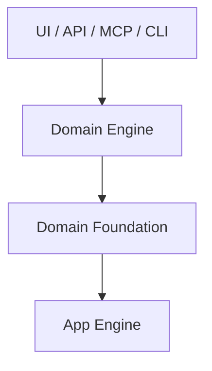
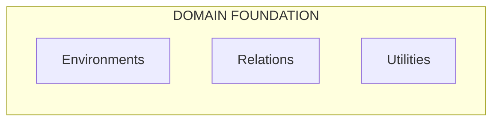
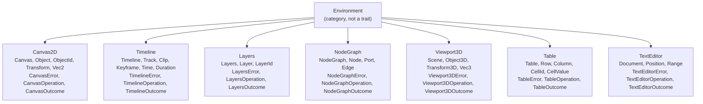
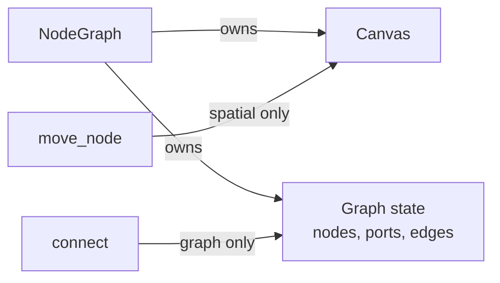
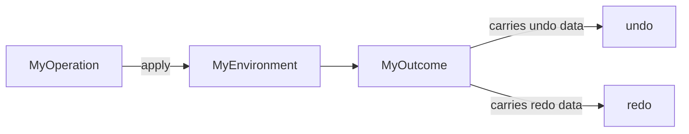
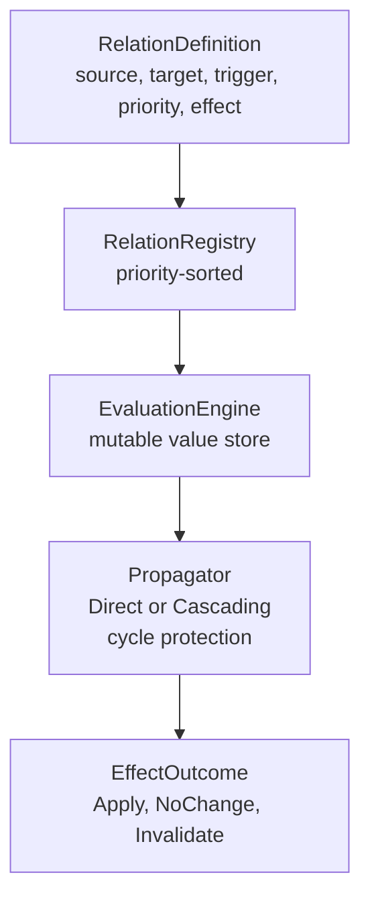
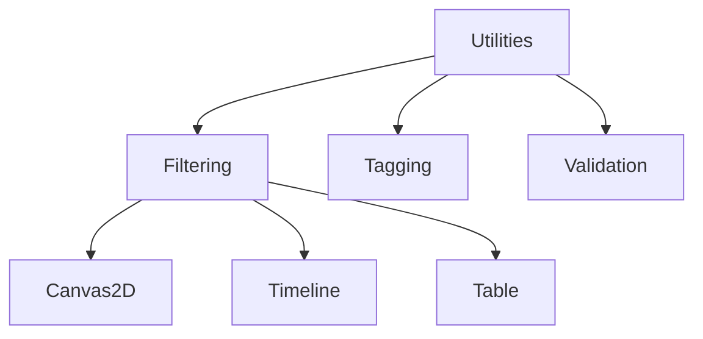
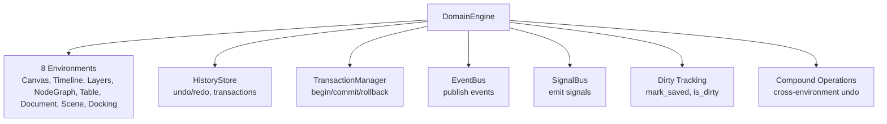

# Architecture

## Layered Architecture



Each layer knows only the layer below it.

### Dependency Direction

```text
Domain Engine  ──→  Domain Foundation  ──→  App Engine  ──→  (nothing)
App Engine     ✗→   Domain Foundation
Domain Engine  ✗→   App Engine (directly)
App Engine     ✗→   UI / API / MCP
```

The App Engine never imports domain types. The Domain Foundation never imports UI types. The Domain Engine never imports App Engine internals — it uses only the public contracts (HistoryStore, EventBus, SignalBus, TransactionManager).

---

## Three Categories

The Domain Foundation is organised into three independent categories:



| Category | Question it answers | Depends on |
|---|---|---|
| **Environments** | How are these objects organized/edited here? | App Engine (history, events) |
| **Relations** | How does a change in one thing affect another? | Nothing (standalone) |
| **Utilities** | What optional reusable capability do I want? | Nothing (generic) |

A Domain Engine composes the categories it needs. A simple text editor might use only `TextEditor` + `Relations`. A vector editor might use `Canvas2D` + `Layers` + `Relations` + `Filtering`. The categories are independently meaningful.

---

## No Universal Abstractions

The most important design principle in the Domain Foundation: **do not create abstractions based on superficial similarity**.

### What we don't do

| Abstraction | Why not |
|---|---|
| `Environment` trait | Environments have nothing in common except the operation pattern (which is a convention, not a trait). |
| `OrderedEnvironment` base | Timeline, Layers, and Table all involve "ordering," but their ordering semantics are completely different. |
| `SpatialEnvironment` base | Canvas2D and Viewport3D both have "transforms," but 2D and 3D transforms are different types. |
| `Geometry Foundation` | Geometry is rendering-adjacent and application-specific. |
| `Selection Foundation` | Selection is a UI concern. |

### What we do instead

Each environment owns its own types:



A concept should become reusable only when it has a **real, meaningful boundary**:

```text
Actual shared semantics → real reuse → extract abstraction
Theoretical similarity → no reuse → don't abstract
```

---

## Composition Between Environments

Environments may compose other environments when their semantics genuinely require it. The only composition in the foundation is:



### How it works

`NodeGraph` owns a `Canvas` instance. When creating a node, it creates a canvas object for spatial placement. When moving a node, it moves the canvas object. When connecting ports, it creates edges — this has nothing to do with the canvas.

**Graph connectivity and spatial state are separate concerns.** Moving a node doesn't affect edges; connecting ports doesn't affect positions. This is the composition principle in action.

```rust
// NodeGraph owns a Canvas internally
pub struct NodeGraph {
    nodes: HashMap<NodeId, Node>,
    ports: HashMap<PortId, Port>,
    edges: HashMap<EdgeId, Edge>,
    canvas: Canvas,              // ← composition
    next_node_id: u64,
    // ...
}

// Each Node links to its spatial representation
pub struct Node {
    pub id: NodeId,
    pub name: String,
    pub canvas_object: Option<ObjectId>,  // ← link to Canvas2D
    // ...
}
```

---

## Operation Pattern

Every environment follows the same operation convention (but not a shared trait):



```rust
// Operation enum — value-type intent
pub enum CanvasOperation {
    Create { transform: Transform },
    Move { id: ObjectId, translation: Vec2 },
    Remove { id: ObjectId },
    // ...
}

// Outcome enum — result with undo data
pub enum CanvasOutcome {
    Created { id: ObjectId },
    Moved { id: ObjectId, previous: Transform },
    Removed { object: Object },
    // ...
}

// Apply method
impl CanvasOperation {
    pub fn apply(self, canvas: &mut Canvas) -> Result<CanvasOutcome, CanvasError>;
}
```

Each outcome carries enough state to construct the inverse:

| Outcome | Undo action |
|---|---|
| `Created { id }` | Remove the created object |
| `Moved { previous }` | Restore the previous transform |
| `Removed { object }` | Re-insert the removed object (via `insert_object`) |
| `MovedForward { previous_index }` | `canvas.reorder(id, previous_index)` |
| `Duplicated { new_id }` | Remove the duplicate |

The `redo` method re-applies the original operation. For `Create`, it uses `insert_object` (not `create_object`) to preserve the original id.

---

## Relations Architecture



### Key design decisions

| Decision | Rationale |
|---|---|
| **Priority-sorted** | Higher priority relations fire first when multiple share the same source. |
| **Mutable value store** | Outcomes are applied during evaluation so cascading relations see updated values. |
| **Cycle protection** | Each relation is evaluated at most once per propagation pass. |
| **Batch propagation** | Accumulate changes, propagate deduplicated, or rollback without propagating. |
| **Effect closures** | The foundation calls the closure but never inspects what it does. Meaning stays in the Domain Engine. |
| **Value Source/Sink traits** | Bridge Domain Engine state to the evaluation engine without manual sync. |

### Independence from environments

The relation system has **no knowledge** of any environment's concrete types. All addressing is via opaque `PropertyId` values (`ObjectId` + property index). The relation system can relate properties on Canvas2D objects, Timeline clips, or any other domain object — it doesn't know or care.

---

## Utilities Architecture

Utilities are **orthogonal** to environments and relations:



### Key rules

1. **Utilities operate over generic `T`** — no imports from `environments` or `relations`.
2. **Environments do not import utilities** — a Canvas2D doesn't know filtering exists.
3. **Utilities are individually usable** — a Domain Engine chooses which to compose.
4. **Utilities do not own data meaning** — they process data supplied to them.

```rust
// Filtering works over ANY type
pub fn filter<'a, T, C: FilterCriteria<T>>(
    items: &'a [T],
    criteria: &C,
) -> Vec<&'a T> {
    items.iter().filter(|item| criteria.matches(item)).collect()
}

// Can filter Canvas2D objects, Timeline clips, Table rows, integers, strings...
```

---

## DomainEngine Architecture

The `DomainEngine` is the composition root that wraps all environments with App Engine infrastructure:



### What the DomainEngine does

1. **Executes operations** on any environment (`execute_canvas`, `execute_timeline`, etc.)
2. **Records history** entries with transaction ids for compound undo
3. **Publishes events** via `EventBus` (for logging, history, plugins)
4. **Emits signals** via `SignalBus` (for real-time UI updates)
5. **Tracks dirty state** (`mark_saved()` / `is_dirty()`)
6. **Auto-rolls back** on error during a transaction
7. **Supports compound operations** (cross-environment undoable units)
8. **Registers command handlers** with the App Engine's `CommandExecutor`

### What the DomainEngine does NOT do

- Define application-specific object types (that's the Domain Engine's job)
- Define domain rules (e.g., "width must be positive")
- Render anything
- Handle user input

---

## Serde Support

All serializable types have conditional serde derives behind a feature flag:

```rust
#[cfg_attr(feature = "serde", derive(serde::Serialize, serde::Deserialize))]
#[cfg_attr(feature = "serde", serde(transparent))]  // for newtypes
pub struct ObjectId(u64);
```

Enable with:

```toml
[dependencies]
app_shell = { path = "...", features = ["serde"] }
```

### Known limitations

| Limitation | Reason |
|---|---|
| `RelationDefinition::effect` deserializes as no-op | Closures can't be serialized. `default_effect()` returns `Arc::new(\|_\| EffectOutcome::NoChange)`. |
| `Table`'s `HashMap<CellId, _>` can't serialize to JSON | `serde_json` requires string keys. Would need a custom serializer. |
| `Viewport3D::world_transform` only composes translations | Proper 3D transform composition requires matrix multiplication. |
| `HistoryStore` can't truncate old entries | App Engine's `HistoryStore` has no `truncate_old` method. Undo limit checks but can't trim. |

---

## Module Structure

```text
src/domain_foundation/
├── lib.rs
├── mod.rs
├── environments/
│   ├── mod.rs
│   ├── canvas_2d/           # 2D spatial (objects, transforms, z-order)
│   ├── timeline/            # Temporal (tracks, clips, keyframes)
│   ├── layers/             # Hierarchy (parent-child, visibility)
│   ├── node_graph/         # Graph (nodes, ports, edges, + Canvas2D)
│   ├── viewport_3d/        # 3D spatial (transforms, parent-child)
│   ├── table/              # Tabular (rows, columns, cells, merged)
│   └── text_editor/        # Text (Unicode positions, ranges, search)
├── relations/
│   ├── definition.rs       # RelationDefinition, builder, effect closures
│   ├── endpoint.rs         # PropertyId, Endpoint, EndpointRole
│   ├── registry.rs         # RelationRegistry (priority-sorted)
│   ├── evaluation.rs       # EvaluationEngine, EvaluationContext, batch
│   ├── propagation.rs     # Propagator (Direct, Cascading, cycle-safe)
│   ├── dependency.rs       # DependencyGraph
│   ├── invalidation.rs     # InvalidationTracker
│   ├── relation.rs         # RelationId, Relation
│   └── error.rs            # RelationError
├── utilities/
│   ├── filtering/          # FilterCriteria (AND/OR/NOT), filter()
│   ├── querying/           # Query, evaluate()
│   ├── tagging/            # Tag, TagSet (BTreeSet)
│   ├── sorting/            # SortCriteria, sort(), sorted()
│   ├── grouping/           # GroupCriteria, group_by(), group_sorted()
│   ├── validation/         # ValidationRule, ValidationResult, validate_with_rules()
│   └── batch/              # BatchOperation, apply_batch()
└── testing/
    ├── mod.rs
    └── fixtures.rs         # Shared test data
```

---

## Next Steps

- [03-environments.md](03-environments.md) — All 8 environments at a glance.
- [04-canvas-2d.md](04-canvas-2d.md) — Canvas2D deep dive.
- [11-relations.md](11-relations.md) — Relations system deep dive.
- [13-domain-engine-integration.md](13-domain-engine-integration.md) — How the DomainEngine composes everything.
- [15-operations-and-undo.md](15-operations-and-undo.md) — Operations and undo/redo patterns.