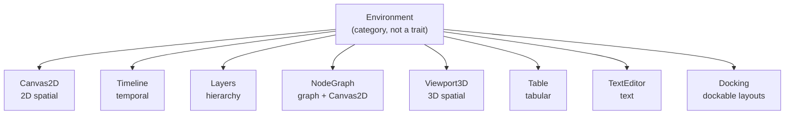
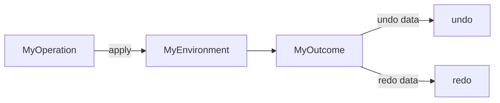
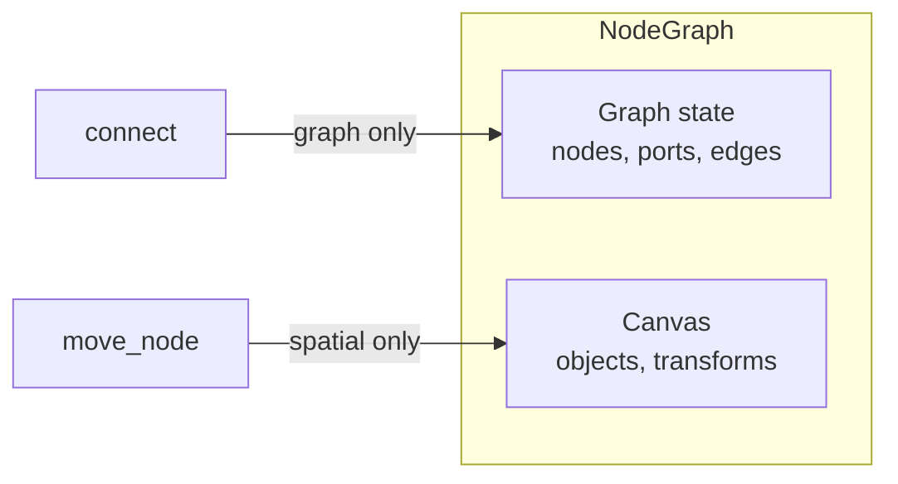

# Environments

An **Environment** is a reusable, headless model for a particular kind of domain organization or editing context. It is **not** a UI component — it defines the semantic model behind the interactions.

---

## All Environments at a Glance



| Environment | Key Types | Operations | Key Queries |
|---|---|---|---|
| **Canvas2D** | `Canvas`, `Object`, `ObjectId`, `Transform`, `Vec2` | Create, Move, Transform, Remove, MoveToFront/Back, MoveForward/Backward, Reorder, Duplicate, Clear | `objects_in_bounds`, `draw_order`, `iter_ordered` |
| **Timeline** | `Timeline`, `Track`, `Clip`, `Keyframe`, `Time`, `Duration` | CreateTrack, InsertClip, MoveClip, TrimClip, SplitClip, AddKeyframe, SetKeyframeValue, Clear | `clips_at(time)`, `keyframes_in_range`, `clip.contains(time)`, `move_track` |
| **Layers** | `Layers`, `Layer`, `LayerId` | CreateLayer, CreateChild, RemoveLayer, SetVisibility, SetLocked, ReorderSibling, Reparent, DuplicateLayer, Clear | `effective_visibility`, `effective_locked`, `layer_path`, `move_up/down` |
| **NodeGraph** | `NodeGraph`, `Node`, `Port`, `Edge` | CreateNode, AddInputPort, AddOutputPort, Connect, Disconnect, RenamePort, DuplicateNode, Clear | `topological_sort`, `has_cycles`, `is_connected`, `edges_between`, `input_edge_count` |
| **Viewport3D** | `Scene`, `Object3D`, `Transform3D`, `Vec3` | Create, Move, Rotate, Scale, Transform, Remove, SetParent, Clear | `objects_in_bounds`, `children`, `root_objects`, `world_transform` |
| **Table** | `Table`, `Row`, `Column`, `CellId`, `CellValue` | InsertRow/Column, SetCellValue, ClearCell, MoveRow/Column, Rename, MergeCells, UnmergeCells, ClearTable | `swap_rows/columns`, `is_merged`, `master_cell` |
| **TextEditor** | `Document`, `Position`, `Range` | Insert, Delete, Replace, Clear, Append, DeleteLine, ReplaceLine | `find`, `find_all`, `replace_all`, `line_count`, `line_col_at`, `byte_count`, `lines()` |
| **Docking** | `DockLayout`, `Dock`, `DockId`, `DockRole`, `DockSlot` | CreatePanel, CreateEmbedHost, InsertBeside, TabJoin, ReorderTab, SetActiveTab, Remove, ResizeSiblings, SetDockCollapsed, Embed, PromoteHost, ResizeRegion, SetFloatingRect | `placement`, `path`, `descendants`, `is_descendant`, `validate`, `normalize`, `depth` |

---

## Operation Convention

Every environment follows the same value-type operation pattern:



```rust
// Operation enum — value-type intent
pub enum CanvasOperation {
    Create { transform: Transform },
    Move { id: ObjectId, translation: Vec2 },
    Remove { id: ObjectId },
}

// Outcome enum — result with undo data
pub enum CanvasOutcome {
    Created { id: ObjectId },
    Moved { id: ObjectId, previous: Transform },
    Removed { object: Object },
}

// Apply method
impl CanvasOperation {
    pub fn apply(self, canvas: &mut Canvas) -> Result<CanvasOutcome, CanvasError>;
}
```

Each outcome carries enough state to construct the inverse:

| Outcome | Undo action |
|---|---|
| `Created { id }` | Remove the created object |
| `Moved { previous }` | Restore the previous transform |
| `Removed { object }` | Re-insert the removed object |
| `MovedForward { previous_index }` | `reorder(id, previous_index)` |
| `Duplicated { new_id }` | Remove the duplicate |

---

## No Shared Base Trait

Environments do **not** share a common base trait. Each owns its own types, errors, and operations.

```text
Environment (category, not a trait)
   ├── Canvas2D        (Canvas, CanvasError, CanvasOperation, CanvasOutcome)
   ├── Timeline        (Timeline, TimelineError, TimelineOperation, TimelineOutcome)
   ├── Layers          (Layers, LayersError, LayersOperation, LayersOutcome)
   ├── NodeGraph       (NodeGraph, NodeGraphError, NodeGraphOperation, NodeGraphOutcome)
   ├── Viewport3D     (Scene, Viewport3DError, Viewport3DOperation, Viewport3DOutcome)
   ├── Table           (Table, TableError, TableOperation, TableOutcome)
   ├── TextEditor     (Document, TextEditorError, TextEditorOperation, TextEditorOutcome)
   └── Docking         (DockLayout, DockingError, DockingOperation, DockingOutcome)
```

This is deliberate. Forcing a universal `Environment` trait would create an abstraction based on superficial similarity, not genuine reuse. See [02-architecture.md](02-architecture.md) for the full rationale.

---

## Composition

`NodeGraph` composes `Canvas2D` for spatial placement:



Graph connectivity and spatial state are separate concerns:

- Moving a node changes spatial state only — edges are untouched.
- Connecting ports changes graph state only — positions are untouched.
- Removing a node cascades to its ports, connected edges, **and** the canvas object.

Each `Node` stores a `canvas_object: Option<ObjectId>` linking its graph identity to its spatial representation.

---

## Traits on Environments

All environments derive:

| Trait | Purpose |
|---|---|
| `Debug` | Standard debug output |
| `Clone` | Full deep clone |
| `PartialEq` | Value-based equality (for tests) |
| `Default` | Empty construction |
| `IntoIterator` | `for item in &env` syntax |

Additionally:

| Environment | Extra traits |
|---|---|
| Canvas2D | `Extend<Object>` (batch insert) |
| TextEditor | `Document: IntoIterator<Item = char>` |
| Docking | No `IntoIterator` (no map-order guarantees) — iterate via `iter()` / `all_docks()` |
| TagSet | `IntoIterator<Item = &Tag>` (BTreeSet, sorted) |

All serializable types also have conditional `serde::Serialize` / `serde::Deserialize` derives behind the `serde` feature flag.

---

## Clear Method

Every environment has a `clear()` method that removes all contents while preserving the id counter (so previously-issued ids remain unique):

```rust
let mut canvas = Canvas::new();
let id = canvas.create_object(Transform::identity());
canvas.clear();

let new_id = canvas.create_object(Transform::identity());
assert_ne!(id, new_id);  // Ids don't collide
```

---

## Headless by Construction

No environment imports or depends on:

- Rendering engines (GPU, OpenGL, Vulkan)
- UI frameworks (Tauri, iced, egui)
- Input handling (mouse, keyboard, touch)
- Window management
- Animation systems
- Camera or viewport logic

The UI owns all of these. The environment owns the semantic model behind the interactions.

---

## Next Steps

- [04-canvas-2d.md](04-canvas-2d.md) — Canvas2D deep dive: objects, transforms, z-ordering, spatial queries.
- [05-timeline.md](05-timeline.md) — Timeline deep dive: tracks, clips, keyframes, interpolation.
- [07-node-graph.md](07-node-graph.md) — NodeGraph deep dive: ports, edges, topological sort, Canvas2D composition.
- [21-docking.md](21-docking.md) — Docking deep dive: placements, splits, tab groups, embed hosts.
- [15-operations-and-undo.md](15-operations-and-undo.md) — Operations and undo/redo patterns.