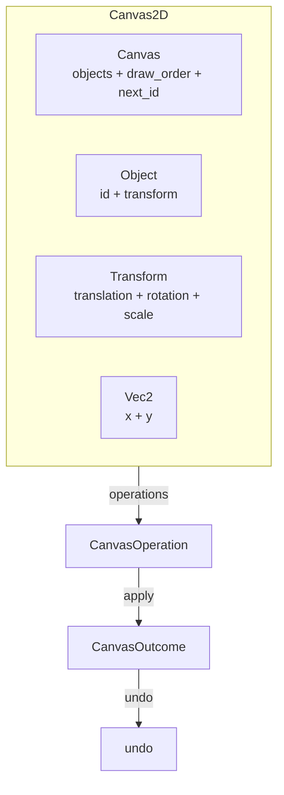

# Canvas2D

Headless 2D spatial editing model. Provides objects, transforms, z-ordering, and spatial queries without imposing any UI layout, coordinate-system orientation, or rendering.

---

## Overview



---

## Key Types

| Type | Fields | Purpose |
|---|---|---|
| `Canvas` | `objects: HashMap<ObjectId, Object>`, `draw_order: Vec<ObjectId>`, `next_id: u64` | Container owning all objects |
| `Object` | `id: ObjectId`, `transform: Transform` | Spatial entity |
| `ObjectId` | `u64` (opaque) | Stable, opaque identifier |
| `Transform` | `translation: Vec2`, `rotation: f64`, `scale: Vec2` | Decomposed 2D transform |
| `Vec2` | `x: f64`, `y: f64` | 2D vector |
| `CanvasError` | `ObjectNotFound { id }` | Error type |
| `CanvasOperation` | 11 variants | Value-type operation intent |
| `CanvasOutcome` | 11 variants | Result with undo data |

---

## Canvas Methods

### Object management

| Method | Returns | Description |
|---|---|---|
| `create_object(transform)` | `ObjectId` | Create a new object, append to draw order |
| `insert_object(object)` | `()` | Restore an object with its original id (for undo) |
| `remove_object(id)` | `Result<Object, CanvasError>` | Remove an object from storage and draw order |
| `duplicate_object(id, offset)` | `Result<ObjectId, CanvasError>` | Create a copy at an offset |
| `clear()` | `()` | Remove all objects (id counter preserved) |

### Queries

| Method | Returns | Description |
|---|---|---|
| `get(id)` | `Option<&Object>` | Look up by id |
| `get_mut(id)` | `Option<&mut Object>` | Mutable lookup |
| `contains(id)` | `bool` | Existence check |
| `len()` | `usize` | Object count |
| `is_empty()` | `bool` | Whether canvas is empty |
| `iter()` | `impl Iterator<Item = &Object>` | Iterate (unordered) |
| `iter_ordered()` | `impl Iterator<Item = &Object>` | Iterate in draw order (back to front) |
| `draw_order()` | `&[ObjectId]` | Z-order slice (back to front) |
| `objects_in_bounds(min, max)` | `Vec<&Object>` | Spatial query by translation bounds |

### Transform mutations

| Method | Returns | Description |
|---|---|---|
| `set_transform(id, transform)` | `Result<Transform, CanvasError>` | Replace whole transform, returns previous |
| `set_translation(id, translation)` | `Result<Transform, CanvasError>` | Set translation only, preserve rotation/scale |

### Z-ordering

| Method | Returns | Description |
|---|---|---|
| `move_to_front(id)` | `Result<(), CanvasError>` | Move to topmost (end of draw order) |
| `move_to_back(id)` | `Result<(), CanvasError>` | Move to bottommost (start of draw order) |
| `move_forward(id)` | `Result<(), CanvasError>` | Swap with next (toward front) |
| `move_backward(id)` | `Result<(), CanvasError>` | Swap with previous (toward back) |
| `reorder(id, new_index)` | `Result<(), CanvasError>` | Move to specific draw-order index |

---

## Z-Ordering

The canvas maintains a `draw_order: Vec<ObjectId>` separate from the `HashMap` storage. This allows O(1) lookup by id while preserving a defined render order.

```text
draw_order: [ObjectId(0), ObjectId(2), ObjectId(1)]
                 ↑ back              ↑ front
              rendered first     rendered last
```

- `create_object` appends to the front (topmost).
- `remove_object` removes from both storage and draw order.
- `insert_object` (for undo) restores to draw order if not already present.
- `move_to_front` / `move_to_back` / `move_forward` / `move_backward` / `reorder` manipulate the draw order.

---

## Vec2 Math

| Method | Returns | Description |
|---|---|---|
| `dot(other)` | `f64` | Dot product |
| `length()` | `f64` | Euclidean magnitude |
| `normalize()` | `Vec2` | Unit vector (zero if length is zero) |
| `lerp(other, t)` | `Vec2` | Linear interpolation (`t=0` = self, `t=1` = other) |
| `rotate(angle)` | `Vec2` | Rotate by radians (counter-clockwise) |
| `angle_to(other)` | `f64` | Signed angle to other (radians) |

Operators: `Add`, `Sub`, `Mul<f64>`, `AddAssign`, `SubAssign`, `MulAssign`.

---

## Transform

| Method | Description |
|---|---|
| `identity()` | No translation, no rotation, unit scale |
| `from_translation(v)` | Translation only |
| `from_rotation(r)` | Rotation only (radians) |
| `from_scale(v)` | Scale only |
| `with_translation(v)` | Builder: set translation |
| `with_rotation(r)` | Builder: set rotation |
| `with_scale(v)` | Builder: set scale |

The foundation does **not** perform matrix composition or `apply_to_point`. Domain Engines that need world transforms from local transforms implement composition externally.

---

## Operations

| Operation | Outcome | Undo |
|---|---|---|
| `Create { transform }` | `Created { id }` | Remove the created object |
| `Move { id, translation }` | `Moved { id, previous }` | Restore previous transform |
| `Transform { id, transform }` | `Transformed { id, previous }` | Restore previous transform |
| `Remove { id }` | `Removed { object }` | Re-insert via `insert_object` |
| `MoveToFront { id }` | `MovedToFront { id, previous_index }` | `reorder(id, previous_index)` |
| `MoveToBack { id }` | `MovedToBack { id, previous_index }` | `reorder(id, previous_index)` |
| `MoveForward { id }` | `MovedForward { id, previous_index }` | `reorder(id, previous_index)` |
| `MoveBackward { id }` | `MovedBackward { id, previous_index }` | `reorder(id, previous_index)` |
| `Reorder { id, new_index }` | `Reordered { id, previous_index }` | `reorder(id, previous_index)` |
| `Duplicate { id, offset }` | `Duplicated { source, new_id }` | Remove `new_id` |
| `Clear` | `Cleared { count }` | *(limited — no stored objects to restore)* |

---

## IntoIterator and Extend

```rust
// Iterate over objects
for obj in &canvas {
    println!("{:?}", obj.transform.translation);
}

// Batch insert
let objects = vec![obj1, obj2, obj3];
canvas.extend(objects);
```

---

## Spatial Queries

```rust
// Find all objects whose translation falls within bounds
let found = canvas.objects_in_bounds(
    Vec2::new(0.0, 0.0),
    Vec2::new(100.0, 100.0),
);
assert_eq!(found.len(), 3);
```

Bounds are inclusive min, exclusive max on each axis. The query is O(n) — a spatial index (quadtree/BVH) would be needed for large-scale performance.

---

## Example

```rust
use app_shell::domain_foundation::environments::canvas_2d::*;

let mut canvas = Canvas::new();

// Create objects
let a = canvas.create_object(Transform::from_translation(Vec2::new(0.0, 0.0)));
let b = canvas.create_object(Transform::from_translation(Vec2::new(100.0, 0.0)));
let c = canvas.create_object(Transform::from_translation(Vec2::new(200.0, 0.0)));

// Z-ordering: c is frontmost
assert_eq!(canvas.draw_order(), &[a, b, c]);

// Move b to front
canvas.move_to_front(b).unwrap();
assert_eq!(canvas.draw_order(), &[a, c, b]);

// Spatial query: objects with x in [0, 150)
let right = canvas.objects_in_bounds(
    Vec2::new(0.0, 0.0),
    Vec2::new(150.0, 100.0),
);
assert_eq!(right.len(), 2); // a and c

// Duplicate a
let dup = canvas.duplicate_object(a, Vec2::new(10.0, 10.0)).unwrap();
assert_eq!(canvas.len(), 4);
assert_ne!(dup, a);

// Vec2 math
let v = Vec2::new(3.0, 4.0);
assert_eq!(v.length(), 5.0);
assert!((v.normalize().length() - 1.0).abs() < 1e-10);
```

---

## What Canvas2D Does NOT Own

| Concern | Owner |
|---|---|
| Application-specific data (color, shape type, name) | Domain Engine |
| Rendering (drawing, hit testing, selection) | UI Layer |
| Parent-child spatial transforms (group transforms) | Domain Engine (via Layers) |
| Matrix composition | Domain Engine |
| Bounding box computation per object | Domain Engine |

---

## Next Steps

- [05-timeline.md](05-timeline.md) — Timeline environment.
- [07-node-graph.md](07-node-graph.md) — NodeGraph (composes Canvas2D).
- [15-operations-and-undo.md](15-operations-and-undo.md) — Operations and undo/redo patterns.
- [13-domain-engine-integration.md](13-domain-engine-integration.md) — How DomainEngine wraps Canvas2D.