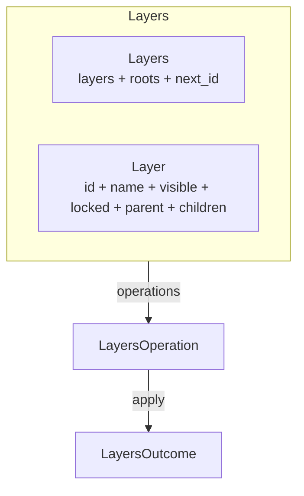

# Layers

Headless hierarchy model. Provides layers with parent-child relationships, visibility inheritance, lock inheritance, and reparenting with cycle detection — without imposing compositing properties (opacity, blend mode) or rendering.

---

## Overview



---

## Key Types

| Type | Fields | Purpose |
|---|---|---|
| `Layers` | `layers: HashMap<LayerId, Layer>`, `roots: Vec<LayerId>`, `next_id: u64` | Container owning all layers |
| `Layer` | `id`, `name`, `visible`, `locked`, `parent: Option<LayerId>`, `children: Vec<LayerId>` | Hierarchy node |
| `LayerId` | `u64` (opaque) | Stable, opaque identifier |
| `LayersError` | `LayerNotFound`, `InvalidSiblingIndex`, `CycleDetected` | Error type |
| `LayersOperation` | 10 variants | Value-type operation intent |
| `LayersOutcome` | 10 variants | Result with undo data |

---

## Layers Methods

### Layer management

| Method | Returns | Description |
|---|---|---|
| `create_layer(name)` | `LayerId` | Create a root layer |
| `create_child(parent, name)` | `Result<LayerId, LayersError>` | Create a child of an existing layer |
| `insert_layer(layer)` | `LayerId` | Restore a layer (for undo) |
| `remove_layer(id)` | `Result<Vec<Layer>, LayersError>` | Remove layer and all descendants (returns all removed) |
| `duplicate_layer(id)` | `Result<LayerId, LayersError>` | Duplicate as a new root (copies name, visible, locked) |
| `clear()` | `()` | Remove all layers (id counter preserved) |

### Access

| Method | Returns | Description |
|---|---|---|
| `layer(id)` | `Option<&Layer>` | Read access |
| `roots()` | `&[LayerId]` | Root layer ids (ordered) |
| `root_count()` | `usize` | Number of root layers |
| `len()` | `usize` | Total layer count |
| `is_empty()` | `bool` | Whether hierarchy is empty |
| `contains(id)` | `bool` | Existence check |

### Property mutations

| Method | Returns | Description |
|---|---|---|
| `set_visibility(id, visible)` | `Result<bool, LayersError>` | Set visible flag, returns previous |
| `set_locked(id, locked)` | `Result<bool, LayersError>` | Set locked flag, returns previous |
| `rename(id, name)` | `Result<String, LayersError>` | Set name, returns previous |

### Ordering

| Method | Returns | Description |
|---|---|---|
| `reorder_sibling(id, new_index)` | `Result<usize, LayersError>` | Move within siblings, returns previous index |
| `move_up(id)` | `Result<bool, LayersError>` | Move forward one position (returns `false` if at front) |
| `move_down(id)` | `Result<bool, LayersError>` | Move backward one position (returns `false` if at back) |

### Hierarchy

| Method | Returns | Description |
|---|---|---|
| `reparent(id, new_parent)` | `Result<Option<LayerId>, LayersError>` | Move to different parent (`None` = root), returns previous parent |
| `is_descendant(maybe_descendant, ancestor)` | `bool` | Check if one layer is a descendant of another |
| `descendants(id)` | `Vec<LayerId>` | All descendants (BFS, not including self) |
| `depth()` | `usize` | Maximum hierarchy depth |
| `layer_path(id)` | `Vec<LayerId>` | Path from root to this layer (root first, leaf last) |

### Inheritance

| Method | Returns | Description |
|---|---|---|
| `effective_visibility(id)` | `bool` | Visible only if self AND all ancestors are visible |
| `effective_locked(id)` | `bool` | Locked if self OR any ancestor is locked |

---

## Inheritance Semantics

### Visibility (AND semantics)

A layer is **effectively visible** only if it AND all its ancestors are visible. Hiding a parent hides all children.

```text
Root (visible=true)
  └── Child (visible=true)
        └── Grandchild (visible=true)

effective_visibility(Grandchild) = true

Set Root.visible = false

effective_visibility(Grandchild) = false  ← inherited
effective_visibility(Child) = false       ← inherited
effective_visibility(Root) = false
```

### Locked (OR semantics)

A layer is **effectively locked** if it OR any ancestor is locked. Locking a parent locks all children.

```text
Root (locked=false)
  └── Child (locked=false)
        └── Grandchild (locked=false)

effective_locked(Grandchild) = false

Set Child.locked = true

effective_locked(Grandchild) = true   ← inherited
effective_locked(Child) = true
effective_locked(Root) = false
```

---

## Reparenting with Cycle Detection

`reparent(id, new_parent)` moves a layer to a different parent. It rejects:

1. **Self-parenting**: `id == new_parent`
2. **Cycles**: `new_parent` is a descendant of `id`

```rust
let root = layers.create_layer("Root".into());
let child = layers.create_child(root, "Child".into()).unwrap();

// This would create a cycle: root becomes a child of its own child
let err = layers.reparent(root, Some(child)).unwrap_err();
assert!(matches!(err, LayersError::CycleDetected { .. }));
```

---

## Remove Cascade

Removing a layer removes it AND all its descendants:

```text
Before: Root → Child → Grandchild

remove_layer(Root) → returns [Root, Child, Grandchild]

After: (empty)
```

The returned `Vec<Layer>` contains all removed layers in BFS order (parent before children). For undo, re-insert them in order via `insert_layer()`.

---

## Sibling Ordering

Each parent maintains an ordered `children: Vec<LayerId>`. Root layers are tracked in `roots: Vec<LayerId>`.

- `reorder_sibling(id, new_index)` — move to a specific position
- `move_up(id)` — swap with the previous sibling (toward front)
- `move_down(id)` — swap with the next sibling (toward back)

Both `move_up` and `move_down` return `Ok(false)` if already at the boundary.

---

## Operations

| Operation | Outcome | Undo |
|---|---|---|
| `CreateLayer { name }` | `LayerCreated { id }` | Remove the layer |
| `CreateChild { parent, name }` | `LayerCreated { id }` | Remove the layer |
| `RemoveLayer { id }` | `LayerRemoved { layers }` | Re-insert all layers via `insert_layer` |
| `RenameLayer { id, name }` | `LayerRenamed { previous_name }` | Restore previous name |
| `SetVisibility { id, visible }` | `VisibilityChanged { previous_visible }` | Restore previous |
| `SetLocked { id, locked }` | `LockedChanged { previous_locked }` | Restore previous |
| `ReorderSibling { id, new_index }` | `SiblingReordered { previous_index }` | Restore previous index |
| `Reparent { id, new_parent }` | `Reparented { previous_parent }` | Restore previous parent |
| `DuplicateLayer { id }` | `LayerDuplicated { source, new_id }` | Remove the duplicate |
| `Clear` | `Cleared` | *(limited — no stored layers to restore)* |

---

## Example

```rust
use app_shell::domain_foundation::environments::layers::*;

let mut layers = Layers::new();

// Create hierarchy
let root = layers.create_layer("Scene".into());
let child_a = layers.create_child(root, "Background".into()).unwrap();
let child_b = layers.create_child(root, "Foreground".into()).unwrap();
let grandchild = layers.create_child(child_b, "Overlay".into()).unwrap();

assert_eq!(layers.layer(root).unwrap().child_count(), 2);
assert_eq!(layers.layer_path(grandchild), vec![root, child_b, grandchild]);

// Hide the root — all descendants become effectively invisible
layers.set_visibility(root, false).unwrap();
assert!(!layers.effective_visibility(grandchild));

// Lock child_b — grandchild becomes effectively locked
layers.set_visibility(root, true).unwrap();
layers.set_locked(child_b, true).unwrap();
assert!(layers.effective_locked(grandchild));
assert!(!layers.effective_locked(child_a));

// Move child_b to front
layers.move_up(child_b).unwrap();
assert_eq!(layers.layer(root).unwrap().children(), &[child_b, child_a]);

// Duplicate root as a new root
let dup = layers.duplicate_layer(root).unwrap();
assert!(layers.layer(dup).unwrap().is_root());
assert_eq!(layers.layer(dup).unwrap().name, "Scene");
```

---

## What Layers Does NOT Own

| Concern | Owner |
|---|---|
| Compositing properties (opacity, blend mode, masks) | Domain Engine |
| Rendering (draw order, compositing pipeline) | UI Layer |
| Layer thumbnails | UI Layer |
| Blend modes | Domain Engine |
| Layer effects (drop shadow, glow) | Domain Engine |
| Drag-and-drop reordering | UI Layer |

Visibility and locked state are included because they affect whether operations are *meaningful* (e.g., you shouldn't move objects on a hidden layer). Compositing properties are excluded because they affect *how things look*, which is a rendering concern.

---

## Next Steps

- [07-node-graph.md](07-node-graph.md) — NodeGraph (composes Canvas2D).
- [11-relations.md](11-relations.md) — Relations (can define hierarchy dependencies).
- [13-domain-engine-integration.md](13-domain-engine-integration.md) — How DomainEngine wraps Layers.
- [15-operations-and-undo.md](15-operations-and-undo.md) — Operations and undo/redo patterns.