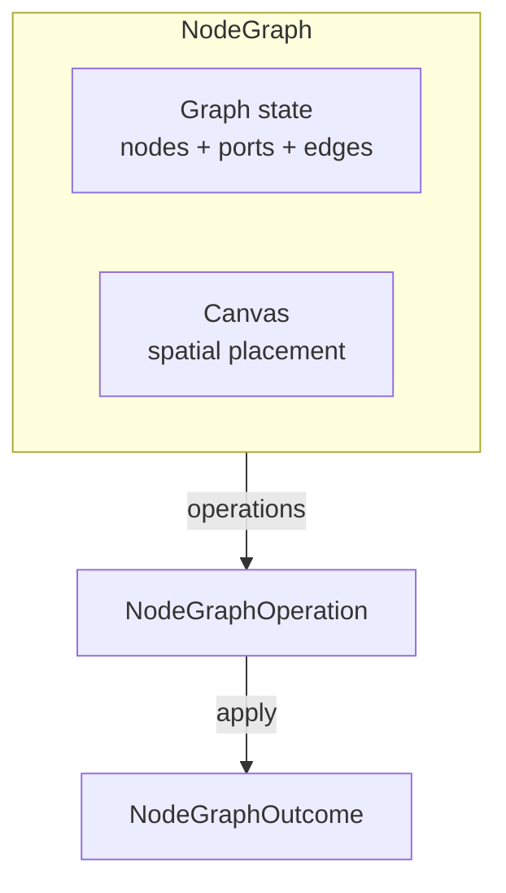
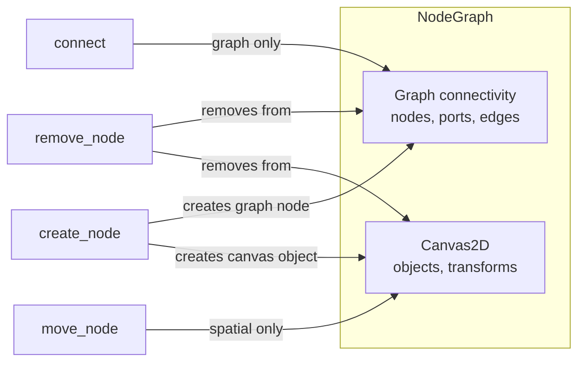

# NodeGraph

Headless graph editing model with spatial placement composed from Canvas2D. Provides nodes, input/output ports, edges, connection validation, and graph traversal — without any rendering or dataflow evaluation.

---

## Overview



---

## Composition with Canvas2D

`NodeGraph` owns a `Canvas` instance for spatial placement. This is the only cross-environment composition in the foundation:



**Graph connectivity and spatial state are separate concerns:**

- Moving a node changes spatial state only — edges are untouched.
- Connecting ports changes graph state only — positions are untouched.
- Removing a node cascades to its ports, connected edges, **and** the canvas object.

Each `Node` stores `canvas_object: Option<ObjectId>` linking its graph identity to its spatial representation.

---

## Key Types

| Type | Fields | Purpose |
|---|---|---|
| `NodeGraph` | `nodes`, `ports`, `edges`, `canvas`, id counters | Container owning graph state + Canvas2D |
| `Node` | `id`, `name`, `canvas_object: Option<ObjectId>`, `input_ports`, `output_ports` | Graph entity with optional spatial placement |
| `Port` | `id`, `node`, `direction`, `name`, `type_name`, `max_inputs` | Connection point on a node |
| `Edge` | `id`, `source: PortId`, `target: PortId` | Directed connection from output to input |
| `PortDirection` | `Input`, `Output` | Direction of data flow |
| `NodeId` | `u64` (opaque) | Stable node identifier |
| `PortId` | `u64` (opaque) | Stable port identifier |
| `EdgeId` | `u64` (opaque) | Stable edge identifier |
| `NodeGraphError` | 12 variants | Error type |
| `NodeRemovedData` | `node`, `ports`, `edges`, `canvas_object` | Undo data for node removal |
| `PortRemovedData` | `port`, `edges` | Undo data for port removal |

---

## NodeGraph Methods

### Node management

| Method | Returns | Description |
|---|---|---|
| `create_node(name, transform)` | `NodeId` | Create node with spatial placement (canvas object) |
| `insert_node(node, canvas_object)` | `NodeId` | Restore a node (for undo) |
| `remove_node(id)` | `Result<NodeRemovedData, NodeGraphError>` | Remove node + ports + edges + canvas object |
| `duplicate_node(id)` | `Result<NodeId, NodeGraphError>` | Duplicate node (no ports/edges), copy canvas object |
| `rename_node(id, name)` | `Result<String, NodeGraphError>` | Rename, returns previous |
| `node(id)` | `Option<&Node>` | Read access |
| `node_count()` | `usize` | Number of nodes |
| `contains_node(id)` | `bool` | Existence check |
| `nodes()` | `impl Iterator<Item = &Node>` | Iterate all nodes |
| `clear()` | `()` | Remove everything (including canvas) |

### Spatial (delegates to Canvas2D)

| Method | Returns | Description |
|---|---|---|
| `move_node(id, translation)` | `Result<Transform, NodeGraphError>` | Move node's canvas object |
| `set_node_transform(id, transform)` | `Result<Transform, NodeGraphError>` | Replace transform wholesale |
| `node_transform(id)` | `Result<Transform, NodeGraphError>` | Read current transform |
| `canvas()` | `&Canvas` | Access the internal Canvas2D |

### Port management

| Method | Returns | Description |
|---|---|---|
| `add_input_port(node, name, type_name)` | `Result<PortId, NodeGraphError>` | Add an input port |
| `add_output_port(node, name, type_name)` | `Result<PortId, NodeGraphError>` | Add an output port |
| `insert_port(port)` | `PortId` | Restore a port (for undo) |
| `remove_port(id)` | `Result<PortRemovedData, NodeGraphError>` | Remove port + connected edges |
| `rename_port(id, name)` | `Result<String, NodeGraphError>` | Rename port, returns previous |
| `port(id)` | `Option<&Port>` | Read access |
| `port_mut(id)` | `Option<&mut Port>` | Mutable access |
| `port_count()` | `usize` | Total port count |
| `ports()` | `impl Iterator<Item = &Port>` | Iterate all ports |

### Edge management

| Method | Returns | Description |
|---|---|---|
| `connect(source, target)` | `Result<EdgeId, NodeGraphError>` | Create edge (with validation) |
| `insert_edge(edge)` | `EdgeId` | Restore an edge (for undo) |
| `disconnect(id)` | `Result<Edge, NodeGraphError>` | Remove edge |
| `edge(id)` | `Option<&Edge>` | Read access |
| `edge_count()` | `usize` | Number of edges |
| `edges()` | `impl Iterator<Item = &Edge>` | Iterate all edges |

### Queries

| Method | Returns | Description |
|---|---|---|
| `edges_on_port(port)` | `impl Iterator<Item = &Edge>` | Edges connected to a port (as source or target) |
| `edges_between(src_node, tgt_node)` | `impl Iterator<Item = &Edge>` | Edges from one node to another |
| `is_connected(source, target)` | `bool` | Whether a direct edge exists |
| `input_edge_count(port)` | `usize` | Number of edges targeting this port |

### Graph traversal

| Method | Returns | Description |
|---|---|---|
| `topological_sort()` | `Result<Vec<NodeId>, NodeGraphError>` | Nodes in dependency order (sources first) |
| `has_cycles()` | `bool` | Whether the graph contains any cycles |

---

## Connection Validation

`connect(source, target)` validates the following rules before creating an edge:

| Rule | Error | Description |
|---|---|---|
| Both ports exist | `PortNotFound` | Source and target must be in the registry |
| Source is output | `SourceNotOutput` | The source port must have `PortDirection::Output` |
| Target is input | `TargetNotInput` | The target port must have `PortDirection::Input` |
| Different nodes | `SameNode` | Source and target must be on different nodes |
| Type match | `TypeMismatch` | `source.type_name` must equal `target.type_name` |
| No duplicate | `DuplicateEdge` | An edge with the same source + target must not already exist |
| Connection limit | `MaxInputsExceeded` | If `target.max_inputs > 0`, existing connections must be below the limit |

Type matching is **exact string comparison**. The foundation does not support type hierarchies or conversions. A Domain Engine that needs "float → double" compatibility implements it externally.

---

## Connection Policy

Each input port has a `max_inputs: u32` field:

| Value | Behavior |
|---|---|
| `0` | Unlimited connections (default) |
| `1` | Single connection only (fan-in = 1) |
| `N` | Maximum N connections |

Set via the builder:

```rust
let port = Port::new(id, node, PortDirection::Input, "value".into(), "float".into())
    .with_max_inputs(1);  // Only one edge can target this port
```

Or mutate directly:

```rust
graph.port_mut(port_id).unwrap().max_inputs = 1;
```

---

## Topological Sort

```rust
let sorted = graph.topological_sort()?;
// sorted[0] = first node (no dependencies)
// sorted[last] = last node (depends on everything above)
```

Uses Kahn's algorithm (BFS from zero-in-degree nodes). Returns `CycleInGraph` error if the graph contains a cycle.

`has_cycles()` is a convenience that calls `topological_sort()` and checks for an error.

---

## Remove Cascade

Removing a node cascades to:

1. All its ports (input and output)
2. All edges connected to any of those ports
3. The canvas object (spatial representation)

```text
Node A (out_port_1, in_port_1)
  ├── Edge: out_port_1 → Node B.in_port
  └── Edge: Node C.out_port → in_port_1

remove_node(A) → removes: Node A, out_port_1, in_port_1, both edges, canvas object
```

`NodeRemovedData` carries all removed items for undo.

---

## Operations

| Operation | Outcome | Undo |
|---|---|---|
| `CreateNode { name, transform }` | `NodeCreated { id }` | Remove node + canvas object |
| `RemoveNode { id }` | `NodeRemoved(data)` | Re-insert node, ports, edges, canvas object |
| `RenameNode { id, name }` | `NodeRenamed { previous_name }` | Restore previous name |
| `MoveNode { id, translation }` | `NodeMoved { previous_transform }` | Restore previous transform |
| `SetNodeTransform { id, transform }` | `NodeTransformSet { previous_transform }` | Restore previous transform |
| `AddInputPort { node, name, type_name }` | `PortAdded { id }` | Remove the port |
| `AddOutputPort { node, name, type_name }` | `PortAdded { id }` | Remove the port |
| `RemovePort { id }` | `PortRemoved(data)` | Re-insert port + edges |
| `Connect { source, target }` | `Connected { id }` | Disconnect the edge |
| `Disconnect { id }` | `Disconnected { edge }` | Re-insert the edge |
| `RenamePort { id, name }` | `PortRenamed { previous_name }` | Restore previous name |
| `DuplicateNode { id }` | `NodeDuplicated { source, new_id }` | Remove the duplicate |
| `Clear` | `Cleared { node_count }` | *(limited — no stored nodes to restore)* |

---

## Example

```rust
use app_shell::domain_foundation::environments::node_graph::*;
use app_shell::domain_foundation::environments::canvas_2d::{Transform, Vec2};

let mut graph = NodeGraph::new();

// Create nodes with spatial placement
let source = graph.create_node("Source".into(), Transform::from_translation(Vec2::new(0.0, 0.0)));
let sink = graph.create_node("Sink".into(), Transform::from_translation(Vec2::new(200.0, 0.0)));

// Add ports
let out_port = graph.add_output_port(source, "value".into(), "float".into()).unwrap();
let in_port = graph.add_input_port(sink, "value".into(), "float".into()).unwrap();

// Connect (type "float" matches)
let edge_id = graph.connect(out_port, in_port).unwrap();

// Graph has 2 nodes, 2 ports, 1 edge
assert_eq!(graph.node_count(), 2);
assert_eq!(graph.port_count(), 2);
assert_eq!(graph.edge_count(), 1);

// Spatial state: 2 canvas objects
assert_eq!(graph.canvas().len(), 2);

// Move source — spatial only, graph untouched
graph.move_node(source, Vec2::new(50.0, 50.0)).unwrap();
assert_eq!(graph.node_transform(source).unwrap().translation, Vec2::new(50.0, 50.0));
assert_eq!(graph.edge_count(), 1); // Still 1 edge

// Topological sort: source before sink
let sorted = graph.topological_sort().unwrap();
assert_eq!(sorted[0], source);
assert_eq!(sorted[1], sink);

// No cycles
assert!(!graph.has_cycles());
```

---

## What NodeGraph Does NOT Own

| Concern | Owner |
|---|---|
| Graph evaluation / dataflow (pushing values through edges) | Domain Engine (depends on port data types) |
| Port default values | Domain Engine |
| Subgraphs / node groups | Domain Engine |
| Rendering (node boxes, edge curves, port circles) | UI Layer |
| Input handling (drag nodes, draw edges) | UI Layer |
| Type hierarchies (float → double) | Domain Engine |
| Graph layout algorithms (auto-arrange) | Domain Engine / External |

The foundation provides the **structure** (nodes, ports, edges, validation, traversal). The Domain Engine provides the **evaluation** (what values flow through the edges).

---

## Next Steps

- [08-viewport-3d.md](08-viewport-3d.md) — Viewport3D environment.
- [04-canvas-2d.md](04-canvas-2d.md) — Canvas2D (composed by NodeGraph).
- [11-relations.md](11-relations.md) — Relations (can define port→port value propagation).
- [13-domain-engine-integration.md](13-domain-engine-integration.md) — How DomainEngine wraps NodeGraph.