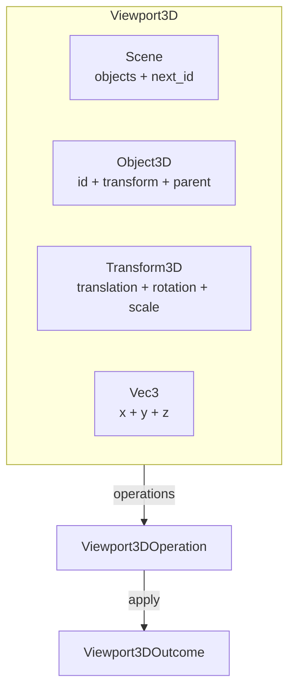

# Viewport3D

Headless 3D spatial editing model. Provides objects, transforms (Euler angles), parent-child hierarchy, and spatial queries — without any renderer, camera, or projection.

---

## Overview



---

## Key Types

| Type | Fields | Purpose |
|---|---|---|
| `Scene` | `objects: HashMap<ObjectId3D, Object3D>`, `next_id: u64` | Container owning all 3D objects |
| `Object3D` | `id`, `transform: Transform3D`, `parent: Option<ObjectId3D>` | 3D spatial entity with optional parent |
| `Transform3D` | `translation: Vec3`, `rotation: Vec3`, `scale: Vec3` | Decomposed 3D transform |
| `Vec3` | `x: f64`, `y: f64`, `z: f64` | 3D vector |
| `ObjectId3D` | `u64` (opaque) | Stable, opaque identifier |
| `Viewport3DError` | `ObjectNotFound`, `CannotBeOwnParent`, `ParentNotFound` | Error type |
| `Viewport3DOperation` | 8 variants | Value-type operation intent |
| `Viewport3DOutcome` | 8 variants | Result with undo data |

---

## Scene Methods

### Object management

| Method | Returns | Description |
|---|---|---|
| `create_object(transform)` | `ObjectId3D` | Create a new root object |
| `insert_object(object)` | `()` | Restore an object with its original id (for undo) |
| `remove_object(id)` | `Result<Object3D, Viewport3DError>` | Remove an object |
| `clear()` | `()` | Remove all objects (id counter preserved) |

### Access

| Method | Returns | Description |
|---|---|---|
| `get(id)` | `Option<&Object3D>` | Read access |
| `get_mut(id)` | `Option<&mut Object3D>` | Mutable access |
| `contains(id)` | `bool` | Existence check |
| `len()` | `usize` | Object count |
| `is_empty()` | `bool` | Whether scene is empty |
| `iter()` | `impl Iterator<Item = &Object3D>` | Iterate all objects |

### Transform mutations

| Method | Returns | Description |
|---|---|---|
| `set_transform(id, transform)` | `Result<Transform3D, Viewport3DError>` | Replace whole transform, returns previous |
| `set_translation(id, translation)` | `Result<Transform3D, Viewport3DError>` | Set translation only, preserve rotation/scale |
| `set_rotation(id, rotation)` | `Result<Transform3D, Viewport3DError>` | Set rotation only, preserve translation/scale |
| `set_scale(id, scale)` | `Result<Transform3D, Viewport3DError>` | Set scale only, preserve translation/rotation |

### Hierarchy

| Method | Returns | Description |
|---|---|---|
| `set_parent(id, parent)` | `Result<(), Viewport3DError>` | Set parent (`None` = root), rejects cycles |
| `world_transform(id)` | `Result<Transform3D, Viewport3DError>` | Compose transforms up the parent chain |
| `children(id)` | `Vec<&Object3D>` | Direct children of an object |
| `root_objects()` | `Vec<&Object3D>` | All root objects (parent == None) |

### Spatial queries

| Method | Returns | Description |
|---|---|---|
| `objects_in_bounds(min, max)` | `Vec<&Object3D>` | Objects whose translation falls in 3D bounds |

---

## Parent-Child Hierarchy

Objects can have a parent for transform inheritance:

```mermaid
flowchart TD
    ROOT[Root Object<br/>translation: (10, 0, 0)] --> CHILD[Child Object<br/>translation: (5, 0, 0)]
    CHILD --> GRANDCHILD[Grandchild Object<br/>translation: (1, 0, 0)]
```

`set_parent(id, parent)` establishes the hierarchy. It rejects:

1. **Self-parenting**: `id == parent` → `CannotBeOwnParent`
2. **Cycles**: `parent` is a descendant of `id` → `CannotBeOwnParent`
3. **Missing parent**: `parent` doesn't exist → `ParentNotFound`

---

## World Transform

`world_transform(id)` composes transforms by walking up the parent chain:

```rust
let world = scene.world_transform(grandchild)?;
// world.translation = root.translation + child.translation + grandchild.translation
//                  = (10, 0, 0) + (5, 0, 0) + (1, 0, 0) = (16, 0, 0)
```

!!! warning "Known limitation"
    `world_transform` currently composes **translations only**. Proper 3D transform composition requires matrix multiplication (including rotation and scale), which is rendering-adjacent and intentionally excluded. A Domain Engine that needs full 3D transform composition implements it externally.

---

## Vec3 Math

| Method | Returns | Description |
|---|---|---|
| `dot(other)` | `f64` | Dot product |
| `cross(other)` | `Vec3` | Cross product |
| `length()` | `f64` | Euclidean magnitude |
| `normalised()` | `Vec3` | Unit vector (zero if length is zero) |
| `lerp(other, t)` | `Vec3` | Linear interpolation (`t=0` = self, `t=1` = other) |
| `distance_to(other)` | `f64` | Euclidean distance to other |

Operators: `Add`, `Sub`, `Mul<f64>`, `AddAssign`, `SubAssign`, `MulAssign`.

---

## Transform3D

| Method | Description |
|---|---|
| `identity()` | No translation, no rotation, unit scale |
| `from_translation(v)` | Translation only |
| `from_rotation(v)` | Rotation only (Euler angles: pitch, yaw, roll in radians) |
| `from_scale(v)` | Scale only |
| `with_translation(v)` | Builder: set translation |
| `with_rotation(v)` | Builder: set rotation |
| `with_scale(v)` | Builder: set scale |

Rotation is stored as Euler angles (`Vec3` of pitch, yaw, roll in radians). The foundation does not provide quaternion support. A Domain Engine that needs quaternion interpolation (to avoid gimbal lock) adds it externally.

---

## Operations

| Operation | Outcome | Undo |
|---|---|---|
| `Create { transform }` | `Created { id }` | Remove the created object |
| `Move { id, translation }` | `Moved { previous }` | Restore previous transform |
| `Rotate { id, rotation }` | `Rotated { previous }` | Restore previous transform |
| `Scale { id, scale }` | `Scaled { previous }` | Restore previous transform |
| `Transform { id, transform }` | `Transformed { previous }` | Restore previous transform |
| `Remove { id }` | `Removed { object }` | Re-insert via `insert_object` |
| `SetParent { id, parent }` | `ParentSet { previous_parent }` | Restore previous parent |
| `Clear` | `Cleared { count }` | *(limited — no stored objects to restore)* |

---

## Example

```rust
use app_shell::domain_foundation::environments::viewport_3d::*;

let mut scene = Scene::new();

// Create hierarchy
let root = scene.create_object(Transform3D::from_translation(Vec3::new(10.0, 0.0, 0.0)));
let child = scene.create_object(Transform3D::from_translation(Vec3::new(5.0, 0.0, 0.0)));
let grandchild = scene.create_object(Transform3D::from_translation(Vec3::new(1.0, 0.0, 0.0)));

scene.set_parent(child, Some(root)).unwrap();
scene.set_parent(grandchild, Some(child)).unwrap();

// World transform composes translations
let world = scene.world_transform(grandchild).unwrap();
assert_eq!(world.translation, Vec3::new(16.0, 0.0, 0.0));

// Children and roots
assert_eq!(scene.children(root).len(), 1);
assert_eq!(scene.root_objects().len(), 1); // only root

// Cycle detection
let err = scene.set_parent(root, Some(grandchild)).unwrap_err();
assert!(matches!(err, Viewport3DError::CannotBeOwnParent { .. }));

// Spatial query
let found = scene.objects_in_bounds(
    Vec3::new(-10.0, -10.0, -10.0),
    Vec3::new(20.0, 10.0, 10.0),
);
assert_eq!(found.len(), 3); // all three objects

// Vec3 math
let a = Vec3::new(0.0, 0.0, 0.0);
let b = Vec3::new(3.0, 4.0, 0.0);
assert!((a.distance_to(b) - 5.0).abs() < 1e-10);
```

---

## What Viewport3D Does NOT Own

| Concern | Owner |
|---|---|
| Camera, projection, frustum, viewport | UI Layer / Domain Engine |
| Rendering (mesh, material, shader, lighting) | UI Layer |
| Quaternion rotation | Domain Engine (if needed) |
| Full matrix transform composition | Domain Engine |
| Bounding volume hierarchy (BVH) | Domain Engine / External |
| Animation / skeletal transforms | Domain Engine |
| Scene graph (beyond parent-child) | Domain Engine |

The foundation provides **spatial state** (position, rotation, scale, hierarchy). The UI provides **visual presentation** (camera, rendering, lighting).

---

## Next Steps

- [09-table.md](09-table.md) — Table environment.
- [04-canvas-2d.md](04-canvas-2d.md) — Canvas2D (2D counterpart).
- [13-domain-engine-integration.md](13-domain-engine-integration.md) — How DomainEngine wraps Viewport3D.
- [15-operations-and-undo.md](15-operations-and-undo.md) — Operations and undo/redo patterns.