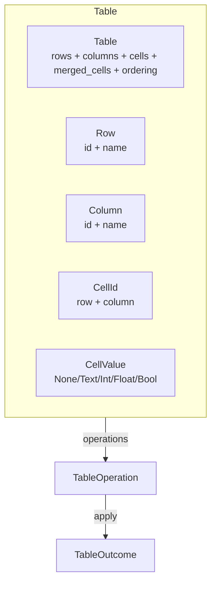

# Table

Headless tabular data model. Provides rows, columns, cells, merged cells, ordering, and swap operations — without any grid rendering, formula engine, or cell type constraints.

---

## Overview



---

## Key Types

| Type | Fields | Purpose |
|---|---|---|
| `Table` | `rows`, `columns`, `row_order`, `column_order`, `cells`, `merged_cells`, id counters | Container owning all tabular data |
| `Row` | `id: RowId`, `name: Option<String>` | Row definition with optional name |
| `Column` | `id: ColumnId`, `name: Option<String>` | Column definition with optional name |
| `CellId` | `row: RowId`, `column: ColumnId` | Composite cell address (carries both row and column) |
| `CellValue` | `None`, `Text(String)`, `Int(i64)`, `Float(f64)`, `Bool(bool)` | Value stored in a cell |
| `RowId` | `u64` (opaque) | Stable row identifier |
| `ColumnId` | `u64` (opaque) | Stable column identifier |
| `TableError` | `RowNotFound`, `ColumnNotFound`, `InvalidRowIndex`, `InvalidColumnIndex` | Error type |
| `TableOperation` | 13 variants | Value-type operation intent |
| `TableOutcome` | 13 variants | Result with undo data |

---

## Table Methods

### Row management

| Method | Returns | Description |
|---|---|---|
| `insert_row(name)` | `RowId` | Add a row (appended to `row_order`) |
| `restore_row(row, cells)` | `RowId` | Restore a row and its cells (for undo) |
| `remove_row(id)` | `Result<(Row, Vec<(CellId, CellValue)>), TableError>` | Remove row + all its cells, returns both |
| `rename_row(id, name)` | `Result<Option<String>, TableError>` | Rename, returns previous name |
| `move_row(id, new_index)` | `Result<usize, TableError>` | Reorder row, returns previous index |
| `swap_rows(a, b)` | `()` | Swap two rows by position |
| `row(id)` | `Option<&Row>` | Read access |
| `rows()` | `impl Iterator<Item = &Row>` | Iterate rows in order |
| `row_ids()` | `&[RowId]` | Ordered row ids |
| `row_count()` | `usize` | Number of rows |
| `contains_row(id)` | `bool` | Existence check |

### Column management

| Method | Returns | Description |
|---|---|---|
| `insert_column(name)` | `ColumnId` | Add a column (appended to `column_order`) |
| `restore_column(column, cells)` | `ColumnId` | Restore a column and its cells (for undo) |
| `remove_column(id)` | `Result<(Column, Vec<(CellId, CellValue)>), TableError>` | Remove column + all its cells |
| `rename_column(id, name)` | `Result<Option<String>, TableError>` | Rename, returns previous name |
| `move_column(id, new_index)` | `Result<usize, TableError>` | Reorder column, returns previous index |
| `swap_columns(a, b)` | `()` | Swap two columns by position |
| `column(id)` | `Option<&Column>` | Read access |
| `columns()` | `impl Iterator<Item = &Column>` | Iterate columns in order |
| `column_ids()` | `&[ColumnId]` | Ordered column ids |
| `column_count()` | `usize` | Number of columns |
| `contains_column(id)` | `bool` | Existence check |

### Cell management

| Method | Returns | Description |
|---|---|---|
| `set_cell_value(row, column, value)` | `Result<CellValue, TableError>` | Set cell value, returns previous |
| `clear_cell(row, column)` | `Result<CellValue, TableError>` | Clear cell (set to `None`), returns previous |
| `cell(row, column)` | `&CellValue` | Get cell value (`None` if unset or missing) |
| `cell_by_id(id)` | `&CellValue` | Get cell by `CellId` |
| `cell_count()` | `usize` | Number of set cells |

### Merged cells

| Method | Returns | Description |
|---|---|---|
| `merge_cells(from, to)` | `Result<(), TableError>` | Merge a rectangular region; top-left becomes master |
| `unmerge_cells(master)` | `Result<(), TableError>` | Unmerge all cells merged into `master` |
| `is_merged(id)` | `bool` | Whether a cell is merged into another |
| `master_cell(id)` | `CellId` | The master cell (self if not merged) |

### Other

| Method | Returns | Description |
|---|---|---|
| `clear()` | `()` | Remove all rows, columns, cells, merges (id counters preserved) |
| `is_empty()` | `bool` | Whether table has no rows AND no columns |
| `len()` | `usize` | Same as `cell_count()` |

---

## CellId Design

`CellId` is a composite struct carrying both `RowId` and `ColumnId`:

```rust
pub struct CellId {
    pub row: RowId,
    pub column: ColumnId,
}
```

This means given a `CellId`, you can immediately find both its row and column without a separate lookup. This is used by `remove_row` (which scans `cells` by `CellId.row`) and `merge_cells` (which constructs `CellId`s from the row/column ordering).

---

## Row and Column Ordering

Rows and columns have a defined order via `row_order: Vec<RowId>` and `column_order: Vec<ColumnId>`, separate from the `HashMap` storage. This allows:

- O(1) lookup by id (`HashMap`)
- Defined iteration order (`Vec`)
- Reordering (`move_row`, `move_column`)
- Swapping (`swap_rows`, `swap_columns`)

```rust
let mut table = Table::new();
let r1 = table.insert_row(Some("Header".into()));
let r2 = table.insert_row(Some("Data 1".into()));
let r3 = table.insert_row(Some("Data 2".into()));

assert_eq!(table.row_ids(), &[r1, r2, r3]);

table.swap_rows(0, 2); // swap by position
assert_eq!(table.row_ids(), &[r3, r2, r1]);
```

---

## Merged Cells

Merge a rectangular region from `from` (top-left) to `to` (bottom-right). The top-left cell becomes the **master**; all others are marked as merged:

```text
Before merge:          After merge_cells(from=(r1,c1), to=(r2,c2)):
┌───┬───┬───┐         ┌───┬───┬───┐
│ A │ B │ C │         │       │ C │
├───┼───┼───┤   →     ├───────┼───┤
│ D │ E │ F │         │       │ F │
└───┴───┴───┘         └───────┴───┘
  ↑   ↑   ↑             ↑       ↑
 r1c1 r1c2 r1c3       master   r1c3
```

- `is_merged(r1c2)` → `true`
- `is_merged(r1c1)` → `false` (master is not "merged")
- `master_cell(r2c2)` → `r1c1`

`unmerge_cells(master)` frees all cells merged into that master.

---

## CellValue

```rust
pub enum CellValue {
    None,           // Empty / unset
    Text(String),   // Text content
    Int(i64),       // Integer
    Float(f64),     // Floating point
    Bool(bool),     // Boolean
}
```

Every cell accepts any `CellValue`. The Table does **not** enforce per-column type constraints. A Domain Engine that needs "column A only accepts Int" uses the [validation utility](12-utilities.md#validation) to enforce that rule.

Cell formulas and calculation dependencies are **not** part of the Table environment. A Domain Engine can define cell dependencies using the [Relations system](11-relations.md).

---

## Operations

| Operation | Outcome | Undo |
|---|---|---|
| `InsertRow { name }` | `RowInserted { id }` | Remove the row |
| `InsertColumn { name }` | `ColumnInserted { id }` | Remove the column |
| `RemoveRow { id }` | `RowRemoved { row, cells }` | Restore row + cells |
| `RemoveColumn { id }` | `ColumnRemoved { column, cells }` | Restore column + cells |
| `SetCellValue { row, column, value }` | `CellValueSet { previous }` | Restore previous value |
| `ClearCell { row, column }` | `CellCleared { previous }` | Restore previous value |
| `MoveRow { id, new_index }` | `RowMoved { previous_index }` | Restore previous index |
| `MoveColumn { id, new_index }` | `ColumnMoved { previous_index }` | Restore previous index |
| `RenameRow { id, name }` | `RowRenamed { previous_name }` | Restore previous name |
| `RenameColumn { id, name }` | `ColumnRenamed { previous_name }` | Restore previous name |
| `MergeCells { from, to }` | `CellsMerged` | Unmerge |
| `UnmergeCells { master }` | `CellsUnmerged` | Re-merge |
| `ClearTable` | `TableCleared` | *(limited — no stored data to restore)* |

---

## IntoIterator

```rust
// Iterate over cells: (CellId, CellValue)
for (cell_id, value) in &table {
    println!("{:?} = {:?}", cell_id, value);
}
```

---

## Example

```rust
use app_shell::domain_foundation::environments::table::*;

let mut table = Table::new();

// Create structure
let header = table.insert_row(Some("Name".into()));
let row1 = table.insert_row(Some("Alice".into()));
let row2 = table.insert_row(Some("Bob".into()));
let name_col = table.insert_column(Some("Name".into()));
let age_col = table.insert_column(Some("Age".into()));

// Set cell values
table.set_cell_value(header, name_col, CellValue::Text("Name".into())).unwrap();
table.set_cell_value(header, age_col, CellValue::Text("Age".into())).unwrap();
table.set_cell_value(row1, age_col, CellValue::Int(30)).unwrap();
table.set_cell_value(row2, age_col, CellValue::Int(25)).unwrap();

assert_eq!(table.cell_count(), 4);
assert_eq!(table.cell(row1, age_col), &CellValue::Int(30));

// Merge cells
table.merge_cells(
    CellId { row: header, column: name_col },
    CellId { row: header, column: age_col },
).unwrap();
assert!(table.is_merged(CellId { row: header, column: age_col }));

// Swap rows
table.swap_rows(1, 2);
assert_eq!(table.row_ids(), &[header, row2, row1]);
```

---

## What Table Does NOT Own

| Concern | Owner |
|---|---|
| Column type constraints (e.g., "column A = Int only") | Domain Engine (via validation utility) |
| Cell formulas / calculation dependencies | Domain Engine (via Relations) |
| Grid rendering, cell editors, headers | UI Layer |
| Frozen rows/columns | UI Layer |
| Column width / row height | UI Layer |
| CSV import/export | Domain Engine / External |
| Data validation rules | Domain Engine (via validation utility) |
| Sorting by column | Domain Engine (via sorting utility) |
| Filtering visible rows | Domain Engine (via filtering utility) |

---

## Next Steps

- [10-text-editor.md](10-text-editor.md) — TextEditor environment.
- [11-relations.md](11-relations.md) — Relations (can define cell dependencies).
- [12-utilities.md](12-utilities.md) — Utilities (filtering, sorting, validation for tables).
- [13-domain-engine-integration.md](13-domain-engine-integration.md) — How DomainEngine wraps Table.