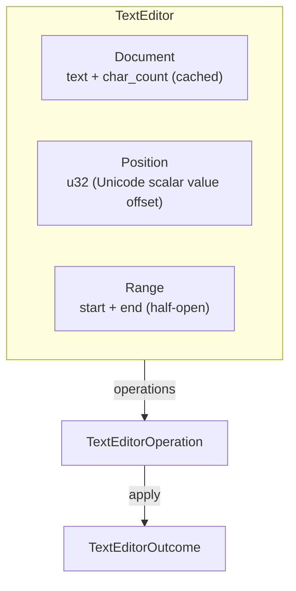

# TextEditor

Headless text editing model with Unicode scalar value positions, ranges, search/replace, and line/column mapping — without any editor widget, syntax highlighting, or input handling.

---

## Overview



---

## Indexing Convention: Unicode Scalar Values

Positions are **character offsets**, not UTF-8 byte offsets. The document's `len()` returns the count of Unicode scalar values (code points), matching Rust's `str::chars()`.

```text
Document: "héllo"
Positions: 0  1  2  3  4  5
            h  é  l  l  o
```

- Position 0 is before the first character.
- Position `len()` is after the last character.
- Valid positions are `0..=len()`.
- Multibyte characters (é, emoji, CJK) each occupy exactly **one** position.

`é` is 2 bytes in UTF-8 but counts as 1 position. `😀` is 4 bytes in UTF-8 but also 1 position.

---

## Key Types

| Type | Fields | Purpose |
|---|---|---|
| `Document` | `text: String`, `char_count: u32` (cached) | Text content with O(1) length |
| `Position` | `u32` (opaque) | Character offset into the document |
| `Range` | `start: Position`, `end: Position` | Half-open span `[start, end)` |
| `TextEditorError` | `PositionOutOfBounds`, `InvalidRange` | Error type |
| `TextEditorOperation` | 7 variants | Value-type operation intent |
| `TextEditorOutcome` | 7 variants | Result with undo data |

---

## Document Methods

### Content access

| Method | Returns | Description |
|---|---|---|
| `text()` | `&str` | Full text content |
| `len()` | `u32` | Character count — **O(1)** (cached) |
| `is_empty()` | `bool` | Whether document is empty |
| `byte_count()` | `usize` | UTF-8 byte length |
| `char_at(pos)` | `Option<char>` | Character at position |
| `substring(range)` | `Option<&str>` | Substring for a range |
| `lines()` | `impl Iterator<Item = &str>` | Iterate lines (split by `\n`, no trailing newline) |
| `line_count()` | `u32` | Number of lines |
| `line_col_at(pos)` | `Option<(u32, u32)>` | Convert position to (line, column), 0-indexed |

### Editing

| Method | Returns | Description |
|---|---|---|
| `insert(pos, text)` | `Result<Range, TextEditorError>` | Insert text at position, returns inserted range |
| `append(text)` | `Range` | Insert at end (convenience) |
| `delete(range)` | `Result<String, TextEditorError>` | Delete range, returns deleted text |
| `replace(range, text)` | `Result<String, TextEditorError>` | Replace range, returns previous text |
| `clear()` | `String` | Clear all text, returns previous content |

### Search / replace

| Method | Returns | Description |
|---|---|---|
| `find(needle, from)` | `Option<Range>` | First occurrence from position |
| `find_all(needle)` | `Vec<Range>` | All occurrences |
| `replace_all(needle, replacement)` | `usize` | Replace all, returns count |

### Construction

| Method | Description |
|---|---|
| `new()` | Empty document |
| `from_str(s)` | Create from string |

---

## O(1) Length

`Document` caches `char_count: u32` alongside `text: String`. All mutating methods keep the cache in sync:

| Method | Cache update |
|---|---|
| `insert(pos, text)` | `char_count += inserted.chars().count()` |
| `delete(range)` | `char_count -= range.len()` |
| `replace(range, text)` | `char_count = char_count - removed + added` |
| `clear()` | `char_count = 0` |
| `replace_all(...)` | `char_count = text.chars().count()` (recompute) |

`len()` returns `char_count` directly — no `chars().count()` traversal.

---

## Position and Range

### Position

| Method / Trait | Description |
|---|---|
| `new(u32)` | Construct |
| `zero()` | Position 0 |
| `as_u32()` | Read value |
| `Add<u32>` | `pos + 3` → new position |
| `Sub<u32>` | `pos - 2` → new position |
| `PartialOrd`, `Ord` | Comparison |
| `Display` | `"pos5"` |

### Range

| Method / Trait | Description |
|---|---|
| `new(start, end)` | Construct (`start <= end`) |
| `at(pos)` | Zero-length range at a position |
| `len()` | `end - start` |
| `is_empty()` | `start == end` |
| `contains(pos)` | `start <= pos < end` (half-open) |
| `overlaps(other)` | Whether two ranges share any position |
| `intersect(other)` | Intersection, or `None` if no overlap |
| `shift(n)` | Move both start and end forward by `n` |
| `From<(Position, Position)>` | `(start, end).into()` |
| `PartialOrd`, `Ord` | Sort by start, then end |

---

## Line / Column Mapping

`line_col_at(pos)` converts a character position to `(line, column)`:

```rust
let doc = Document::from_str("hello\nworld\nfoo");
assert_eq!(doc.line_count(), 3);

assert_eq!(doc.line_col_at(Position::new(0)),  Some((0, 0))); // 'h' in "hello"
assert_eq!(doc.line_col_at(Position::new(5)),  Some((0, 5))); // before \n
assert_eq!(doc.line_col_at(Position::new(6)),  Some((1, 0))); // 'w' in "world"
assert_eq!(doc.line_col_at(Position::new(11)), Some((1, 5))); // before \n
assert_eq!(doc.line_col_at(Position::new(12)), Some((2, 0))); // 'f' in "foo"
```

Line 0 is the first line. Column 0 is the start of each line. Newline characters are not counted as part of the next line.

---

## Search and Replace

```rust
let mut doc = Document::from_str("foo bar foo baz foo");

// Find all occurrences
let matches = doc.find_all("foo");
assert_eq!(matches.len(), 3);

// Find from a position
let range = doc.find("foo", Position::new(5)).unwrap();
assert_eq!(range, Range::new(Position::new(8), Position::new(11)));

// Replace all
let count = doc.replace_all("foo", "XXX");
assert_eq!(count, 3);
assert_eq!(doc.text(), "XXX bar XXX baz XXX");
```

Search works on the byte level internally (via `str::find`) but returns character-position ranges. Empty needles return an empty match at the start position.

---

## Operations

| Operation | Outcome | Undo |
|---|---|---|
| `Insert { position, text }` | `Inserted { range }` | Delete the inserted range |
| `Delete { range }` | `Deleted { range, text }` | Re-insert the deleted text |
| `Replace { range, text }` | `Replaced { range, previous_text }` | Delete new text, insert previous_text |
| `Clear` | `Cleared { previous_text }` | Re-insert previous text |
| `Append { text }` | `Appended { range }` | Delete the appended range |
| `DeleteLine { pos }` | `LineDeleted { text }` | Re-insert the deleted line |
| `ReplaceLine { pos, new_text }` | `LineReplaced { previous_text }` | Delete new text, insert previous line |

---

## IntoIterator

```rust
// Iterate over characters
for ch in &doc {
    print!("{}", ch);
}
```

`IntoIterator for &Document` yields `char` via `str::chars()`.

---

## Line Operations

### DeleteLine

Deletes the entire line containing `pos`, including the trailing newline:

```text
Before: "line1\nline2\nline3"
                       ↑ pos = 6
After:  "line1\nline3"

Deleted text: "line2\n"
```

### ReplaceLine

Replaces the line containing `pos` with new text (preserves the trailing newline):

```text
Before: "line1\nline2\nline3"
                       ↑ pos = 6
Replace with: "replaced"
After:  "line1\nreplaced\nline3"

Previous text: "line2"
```

---

## Example

```rust
use app_shell::domain_foundation::environments::text_editor::*;

let mut doc = Document::new();

// Type some text
doc.append("Hello").unwrap();
doc.append(" World").unwrap();
assert_eq!(doc.text(), "Hello World");
assert_eq!(doc.len(), 11);

// Insert at position
doc.insert(Position::new(5), ",").unwrap();
assert_eq!(doc.text(), "Hello, World");

// Search
let matches = doc.find_all("o");
assert_eq!(matches.len(), 2);

// Replace a range
let range = Range::new(Position::new(0), Position::new(5));
doc.replace(range, "Goodbye").unwrap();
assert_eq!(doc.text(), "Goodbye, World");

// Line operations
let doc2 = Document::from_str("line1\nline2\nline3");
assert_eq!(doc2.line_count(), 3);
assert_eq!(doc2.line_col_at(Position::new(7)), Some((1, 1)));

// Unicode handling
let doc3 = Document::from_str("a😀b");
assert_eq!(doc3.len(), 3); // a, 😀, b — each one position
assert_eq!(doc3.char_at(Position::new(1)), Some('😀'));
```

---

## What TextEditor Does NOT Own

| Concern | Owner |
|---|---|
| Editor widget (cursor, selection, scrolling) | UI Layer |
| Syntax highlighting / language server | Domain Engine (if needed) |
| Input handling (keyboard, IME) | UI Layer |
| Regex search | Domain Engine / External |
| Text styles (bold, italic) | Domain Engine |
| Undo/redo at document level (transaction grouping) | DomainEngine (via transactions) |
| Encoding conversion | Not needed (UTF-8 only, correct for Rust) |
| File I/O | App Engine / External |

The foundation does **not** split parsing, language support, and syntax analysis into separate systems unless real reuse justifies it. The PRD explicitly states: "Do not split parsing, language support and syntax analysis into separate systems unless real reuse justifies it."

---

## Next Steps

- [11-relations.md](11-relations.md) — Relations system.
- [12-utilities.md](12-utilities.md) — Utilities.
- [13-domain-engine-integration.md](13-domain-engine-integration.md) — How DomainEngine wraps TextEditor.
- [15-operations-and-undo.md](15-operations-and-undo.md) — Operations and undo/redo patterns.