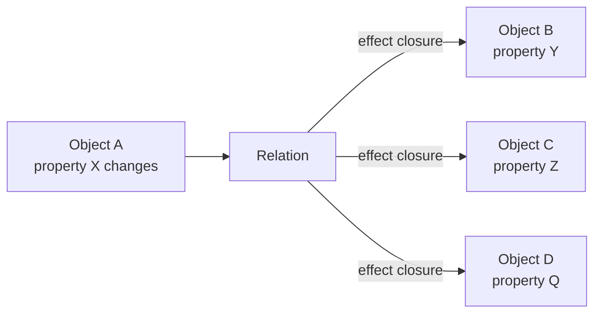
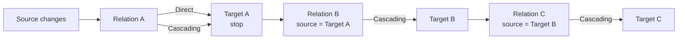

# Relations

Relations describe how changes in one object or property affect other objects or properties. This is more specific than "relations connect objects" — a relation represents **propagation, dependency, derivation, or invalidation** semantics between endpoints.

---

## Mechanism vs Meaning

| Layer | Responsibility |
|---|---|
| **Foundation** | Relation identity, endpoints, registration, evaluation, propagation, batch, value source/sink |
| **Domain Engine** | Which relations exist, what property changes, what effect occurs, when, how the result is calculated |

The relation system **never inspects** what an effect closure does — it just calls it.



The foundation provides the **mechanism**. The Domain Engine provides the **meaning**:

```text
Reusable Relation System
          +
Domain-defined relation definitions (effect closures)
          =
Application-specific behavior
```

---

## Key Types

| Type | Purpose |
|---|---|
| `PropertyId` | Opaque address: `ObjectId` + property index |
| `Endpoint` | Source or target endpoint with role |
| `EndpointRole` | `Source` or `Target` |
| `RelationId` | Opaque identifier for a registered relation |
| `RelationDefinition` | Declarative metadata + effect closure |
| `RelationDefinitionBuilder` | Builder for definitions |
| `Trigger` | `OnChange`, `OnInitialSet`, `OnInvalidation` |
| `PropagationMode` | `Direct` or `Cascading` |
| `EffectFn` | `Arc<dyn Fn(&EffectContext) -> EffectOutcome + Send + Sync>` |
| `EffectContext` | Read-only context passed to effect closures |
| `EffectOutcome` | `Apply(value)`, `NoChange`, `Invalidate` |
| `PropertyValue` | `None`, `Bool`, `Int`, `Float`, `Text`, `Bytes` |
| `RelationRegistry` | Stores definitions, priority-sorted lookup |
| `EvaluationEngine` | Evaluates individual relations, applies outcomes |
| `EvaluationContext` | External handle: set values, propagate, batch |
| `Propagator` | Drives cascading propagation with cycle protection |
| `ValueStore` | Mutable property value store |
| `PropertyValueSource` | Trait: bridge Domain Engine state to evaluation |
| `PropertyValueSink` | Trait: receive property value updates from evaluation |
| `SourcedValueStore` | Adapter wrapping a `PropertyValueSource` |
| `DependencyGraph` | Fast source/target lookup for cascade traversal |
| `RelationError` | `RelationNotFound`, `SourceMismatch`, `MaxPropagationDepthReached` |

---

## Relation Definition

```rust
let src = Endpoint::source(PropertyId::new(ObjectId::new(1), 0));
let tgt = Endpoint::target(PropertyId::new(ObjectId::new(2), 0));

let def = RelationDefinitionBuilder::new(src, tgt)
    .trigger(Trigger::OnChange)
    .propagation(PropagationMode::Cascading)
    .priority(100)
    .effect(Arc::new(|ctx: &EffectContext| {
        EffectOutcome::Apply(ctx.source_value.clone())
    }))
    .build();
```

| Field | Type | Default | Description |
|---|---|---|---|
| `source` | `Endpoint` | *(required)* | Source endpoint (triggers evaluation) |
| `target` | `Endpoint` | *(required)* | Target endpoint (receives effect) |
| `trigger` | `Trigger` | `OnChange` | When the relation fires |
| `propagation` | `PropagationMode` | `Direct` | Whether to cascade after applying |
| `priority` | `i32` | `0` | Higher fires first when multiple share a source |
| `effect` | `EffectFn` | NoChange | The closure to call during evaluation |

---

## Propagation Modes



| Mode | Behavior |
|---|---|
| `Direct` | Apply effect to immediate target, **stop** |
| `Cascading` | Apply effect, then re-evaluate any relations whose source is the target, **transitively** |

### Cycle protection

Each relation is evaluated **at most once** per propagation pass. If a cycle exists (A→B→A), the propagator's `visited` set prevents infinite loops:

```text
A → B → A (cycle)
  ↑         ↑
  visited   visited — skip, cycle broken
```

Maximum cascade depth is 256 (configurable via `Propagator::with_max_depth()`).

---

## Priority

When multiple relations share the same source property, higher priority fires first:

```rust
// Priority 100 fires before priority 0
RelationDefinitionBuilder::new(src, tgt1)
    .priority(100)
    .effect(Arc::new(|ctx| EffectOutcome::Apply(ctx.source_value.clone())))
    .build();

RelationDefinitionBuilder::new(src, tgt2)
    .priority(0)
    .effect(Arc::new(|ctx| EffectOutcome::Apply(PropertyValue::Int(0))))
    .build();
```

The `RelationRegistry` stores relations in a priority-sorted `by_source` map. The `Propagator` iterates in priority order (highest first) via `EvaluationEngine::relations_with_source()`.

If relation A (priority 100) sets target to 10 and relation B (priority 0) sets the same target to 20, the result is **20** (B fires last). Use priorities to control evaluation order when relations compete for the same target.

---

## Effect Outcomes

| Outcome | Behavior |
|---|---|
| `Apply(value)` | Write `value` to the target property in the value store |
| `NoChange` | Do nothing — no step recorded, no cascade |
| `Invalidate` | Record a step (target was invalidated), cascade if Cascading mode, but don't change the target's value |

`Invalidate` is useful for marking a target as "dirty" without computing a new value. A later relation with `Trigger::OnInvalidation` can then compute the value lazily.

---

## Evaluation

### Single propagation

```rust
let mut ctx = EvaluationContext::new(&registry);
ctx.set_value(source_property, PropertyValue::Int(42));
let steps = ctx.propagate_from(source_property)?;
// steps: Vec<PropagationStep> — each has relation_id, target, outcome
```

### How it works

1. `EvaluationContext::propagate_from(source)` creates an `EvaluationEngine` borrowing the registry and value store.
2. A `Propagator` is created with the engine.
3. `propagate_recursive(source)` finds all relations whose source is `source` (priority-sorted).
4. For each relation, `evaluate_one()` is called:
   - Reads source and target values from the store (cloned to avoid borrow conflicts)
   - Constructs `EffectContext` with the values
   - Calls the effect closure
   - **Applies the outcome to the value store immediately** (so cascading relations see updated values)
5. If the outcome is `Apply` or `Invalidate` and the propagation mode is `Cascading`, recurse from the target.
6. Each relation is visited at most once (cycle protection).

### Value store is mutable during evaluation

Outcomes are applied **inside** `evaluate_one()`, not after propagation. This ensures cascading relations see the effects of earlier relations in the same chain.

---

## Batch Propagation

Accumulate multiple property changes and propagate them together:

```rust
ctx.begin_batch();
ctx.set_value(prop_a, PropertyValue::Int(42));
ctx.set_value(prop_b, PropertyValue::Text("hello".into()));

// Changes are accumulated, not propagated yet
assert!(ctx.is_in_batch());

let steps = ctx.commit_batch()?;
// All changes propagated, deduplicated (each source property fires once)
```

| Method | Description |
|---|---|
| `begin_batch()` | Start accumulating changes without propagating |
| `commit_batch()` | Propagate all accumulated changes (deduplicated), return all steps |
| `rollback_batch()` | Discard accumulated changes without propagating |
| `is_in_batch()` | Whether currently in batch mode |

Deduplication: if the same source property is set multiple times during a batch, it propagates only once.

---

## Value Source / Sink

Bridge Domain Engine state to the evaluation engine without manual sync to a separate `ValueStore`:

```rust
pub trait PropertyValueSource {
    fn get_property_value(&self, property: PropertyId) -> PropertyValue;
}

pub trait PropertyValueSink {
    fn set_property_value(&mut self, property: PropertyId, value: PropertyValue);
}
```

`SourcedValueStore<S: PropertyValueSource>` wraps a source and provides:
- `get(property)` — reads from the source, or from local overrides
- `set(property, value)` — writes a local override
- `apply_outcome(property, outcome)` — applies an effect outcome as an override

This lets the evaluation engine read from the Domain Engine's actual state while applying outcomes as temporary overrides during propagation.

---

## Independence from Environments

The relation system has **no knowledge** of any environment's concrete types:

```text
Relations system          ←→    Canvas2D
                         ←→    Timeline
                         ←→    Layers
                         ←→    NodeGraph
                         ←→    Table
                         ←→    Any Domain Engine state
```

All addressing is via opaque `PropertyId` values (`ObjectId` + property index). The relation system can relate properties on Canvas2D objects, Timeline clips, Table cells, or any other domain object — it doesn't know or care.

A Domain Engine that wants to use relations:

1. Maps its environment objects to `ObjectId` values
2. Maps its object properties to `PropertyId` values
3. Defines `RelationDefinition`s with appropriate effect closures
4. Calls `EvaluationContext::propagate_from()` when a property changes
5. Reads results back from the value store (or implements `PropertyValueSink`)

---

## Error Handling

| Error | When | Recoverable? |
|---|---|---|
| `RelationNotFound { id }` | Relation id not in registry during evaluation | No — the relation was unregistered |
| `SourceMismatch { expected, actual }` | Source property doesn't match the relation's definition | No — wrong property passed |
| `MaxPropagationDepthReached { depth, property }` | Cascade exceeded 256 hops | No — cycle or excessively deep chain |

---

## Example

```rust
use app_shell::domain_foundation::relations::*;
use app_shell::domain_foundation::relations::definition::*;
use std::sync::Arc;

// 1. Create registry
let mut registry = RelationRegistry::new();

// 2. Define endpoints (opaque — no knowledge of Canvas2D, Timeline, etc.)
let src = Endpoint::source(PropertyId::new(ObjectId::new(1), 0));
let mid = Endpoint::target(PropertyId::new(ObjectId::new(2), 0));
let tgt = Endpoint::target(PropertyId::new(ObjectId::new(3), 0));

// 3. A → B (cascading, copy value)
registry.register(
    RelationDefinitionBuilder::new(src, mid)
        .propagation(PropagationMode::Cascading)
        .priority(10)
        .effect(Arc::new(|ctx: &EffectContext| {
            EffectOutcome::Apply(ctx.source_value.clone())
        }))
        .build(),
);

// 4. B → C (cascading, add 1)
registry.register(
    RelationDefinitionBuilder::new(mid, tgt)
        .propagation(PropagationMode::Cascading)
        .effect(Arc::new(|ctx: &EffectContext| {
            if let PropertyValue::Int(v) = ctx.source_value {
                EffectOutcome::Apply(PropertyValue::Int(*v + 1))
            } else {
                EffectOutcome::NoChange
            }
        }))
        .build(),
);

// 5. Propagate
let mut ctx = EvaluationContext::new(&registry);
ctx.set_value(PropertyId::new(ObjectId::new(1), 0), PropertyValue::Int(100));
ctx.set_value(PropertyId::new(ObjectId::new(2), 0), PropertyValue::Int(0));
ctx.set_value(PropertyId::new(ObjectId::new(3), 0), PropertyValue::Int(0));

let steps = ctx.propagate_from(PropertyId::new(ObjectId::new(1), 0)).unwrap();
assert_eq!(steps.len(), 2); // A→B and B→C

// 6. Verify results
assert_eq!(ctx.get_value(PropertyId::new(ObjectId::new(2), 0)), &PropertyValue::Int(100));
assert_eq!(ctx.get_value(PropertyId::new(ObjectId::new(3), 0)), &PropertyValue::Int(101));
```

---

## What Relations Does NOT Own

| Concern | Owner |
|---|---|
| What properties mean (width, visibility, position) | Domain Engine |
| What the effect does (copy, add, multiply, invalidate) | Domain Engine (via effect closure) |
| When to evaluate (on every change? on commit?) | Domain Engine (controls when to call `propagate_from`) |
| Type compatibility between source and target | Domain Engine (effect closure handles conversion) |
| Relation lifecycle (active/inactive toggle) | Domain Engine (register/unregister) |
| Conditional triggers (fire only if value increased) | Domain Engine (effect closure returns `NoChange`) |

---

## Next Steps

- [12-utilities.md](12-utilities.md) — Utilities (filtering, sorting, validation, etc.).
- [13-domain-engine-integration.md](13-domain-engine-integration.md) — How DomainEngine uses relations.
- [03-environments.md](03-environments.md) — All environments (relations work over their properties).
- [15-operations-and-undo.md](15-operations-and-undo.md) — Operations and undo/redo patterns.