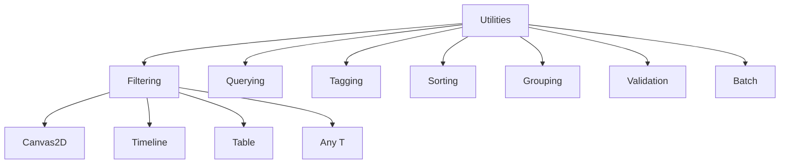

# Utilities

Optional reusable capabilities that a Domain Engine explicitly chooses to compose. Utilities are **orthogonal** to environments and relations — they operate over generic types, not domain-specific types.

---

## Orthogonality



### Three rules

1. **Utilities operate over generic `T`** — no imports from `environments` or `relations`.
2. **Environments do not import utilities** — a Canvas2D doesn't know filtering exists.
3. **Utilities do not own data meaning** — they process data supplied to them.

A Domain Engine chooses which utilities to compose. A simple text editor might use no utilities. A vector editor might use filtering + tagging. A spreadsheet might use sorting + grouping + validation.

---

## Available Utilities

| Utility | Key Types | Purpose |
|---|---|---|
| **Filtering** | `FilterCriteria`, `criteria()`, `And`, `Or`, `Not` | Composable predicates |
| **Querying** | `Query`, `evaluate()` | Named, reusable queries |
| **Tagging** | `Tag`, `TagSet` | Tags with deterministic order |
| **Sorting** | `SortCriteria`, `by()`, `sort()`, `sorted()` | Criteria-based ordering |
| **Grouping** | `GroupCriteria`, `group_by()`, `group_sorted()` | Group by key |
| **Validation** | `ValidationRule`, `ValidationResult`, `validate_all()`, `validate_with_rules()` | Rules and results |
| **Batch** | `BatchOperation`, `operation()`, `apply_batch()` | Multi-object operations |

---

## Filtering

Composable predicates with AND/OR/NOT composition:

```rust
use app_shell::domain_foundation::utilities::filtering::*;

let items = vec![1, 2, 3, 4, 5];

// Simple filter
let result = filter(&items, &criteria(|x: &i32| *x > 3));
assert_eq!(result, vec![&4, &5]);

// Composed: (x > 1) AND (x < 5)
let c = criteria(|x: &i32| *x > 1).and(criteria(|x| *x < 5));
let result = filter(&items, &c);
assert_eq!(result, vec![&2, &3, &4]);

// OR composition: x == 1 OR x == 5
let c = criteria(|x: &i32| *x == 1).or(criteria(|x| *x == 5));
let result = filter(&items, &c);
assert_eq!(result, vec![&1, &5]);

// NOT: NOT(x > 3)
let c = criteria(|x: &i32| *x > 3).not();
let result = filter(&items, &c);
assert_eq!(result, vec![&1, &2, &3]);
```

### Key types

| Type | Description |
|---|---|
| `FilterCriteria<T>` | Trait: `matches(&self, item: &T) -> bool` |
| `criteria(f)` | Create from closure |
| `And<C1, C2>` | Logical AND wrapper |
| `Or<C1, C2>` | Logical OR wrapper |
| `Not<C>` | Logical NOT wrapper |
| `FnCriteria<F>` | Closure-based criteria |

### Helper functions

| Function | Returns | Description |
|---|---|---|
| `filter(items, criteria)` | `Vec<&T>` | Filtered items |
| `count(items, criteria)` | `usize` | Count matching |
| `any(items, criteria)` | `bool` | Whether any match |
| `all(items, criteria)` | `bool` | Whether all match |

### Filtering environment data

```rust
// Filter Canvas2D objects by position
let objects: Vec<Object> = canvas.iter().copied().collect();
let right_half = filter(&objects, &criteria(|obj: &Object| {
    obj.transform.translation.x > 50.0
}));
```

The Canvas2D environment doesn't know filtering exists — the Domain Engine bridges the two.

---

## Querying

Named, reusable queries built on filtering:

```rust
use app_shell::domain_foundation::utilities::filtering::{criteria, FilterCriteria};
use app_shell::domain_foundation::utilities::querying::*;

let query = Query::new(
    "positive_numbers".to_string(),
    criteria(|x: &i32| *x > 0),
);

let items = vec![1, -2, 3, -4, 5];
let result = evaluate(&query, &items);
assert_eq!(result, vec![&1, &3, &5]);

// Check individual items
assert!(query.matches(&5));
assert!(!query.matches(&-1));
```

### Key types

| Type | Description |
|---|---|
| `Query<T>` | Named query with boxed `FilterCriteria<T>` |
| `evaluate(query, items)` | Evaluate query against items |

`Query` requires `T: 'static` (the criteria are type-erased via `Box<dyn FilterCriteria<T>>`). The only cross-utility dependency: Querying depends on Filtering (both within `utilities/`).

---

## Tagging

Tags and tag collections with **deterministic iteration order** (BTreeSet):

```rust
use app_shell::domain_foundation::utilities::tagging::*;

let mut set = TagSet::new();
set.add(Tag::new("visible"));
set.add(Tag::new("locked"));
set.add(Tag::new("selected"));

// Deterministic iteration (sorted alphabetically)
let names: Vec<&str> = (&set).into_iter().map(|t| t.as_str()).collect();
assert_eq!(names, vec!["locked", "selected", "visible"]);

// Set operations
let mut other = TagSet::new();
other.add(Tag::new("visible"));
other.add(Tag::new("archived"));

let inter = set.intersection(&other);
assert_eq!(inter.len(), 1); // "visible"

let union = set.union(&other);
assert_eq!(union.len(), 4);

assert!(set.contains_all(&other)); // false — "archived" not in set
assert!(set.contains_any(&other)); // true — "visible" in both
```

### Key types

| Type | Description |
|---|---|
| `Tag` | String newtype (`PartialEq`, `Eq`, `Ord`, `Hash`) |
| `TagSet` | `BTreeSet<Tag>` wrapper |

### Methods

| Method | Description |
|---|---|
| `add(tag)` | Insert (returns `false` if already present) |
| `remove(tag)` | Remove |
| `contains(tag)` | Existence check |
| `intersection(other)` | Tags in both sets |
| `union(other)` | All tags from both sets |
| `contains_any(other)` | Whether any tag from other is present |
| `contains_all(other)` | Whether all tags from other are present |
| `into_iter()` | Sorted iteration via `IntoIterator` |

---

## Sorting

Criteria-based ordering:

```rust
use app_shell::domain_foundation::utilities::sorting::*;

let mut items = vec![3, 1, 4, 1, 5, 9, 2, 6];

// In-place sort (ascending)
sort(&mut items, &by(|a: &i32, b: &i32| a.cmp(b)));
assert_eq!(items, vec![1, 1, 2, 3, 4, 5, 6, 9]);

// Non-mutating (descending)
let items = vec![3, 1, 4, 1, 5];
let refs = sorted(&items, &by(|a: &i32, b: &i32| b.cmp(a)));
assert_eq!(refs, vec![&5, &4, &3, &1, &1]);
// Original unchanged
assert_eq!(items, vec![3, 1, 4, 1, 5]);
```

### Key types

| Type | Description |
|---|---|
| `SortCriteria<T>` | Trait: `compare(&self, a: &T, b: &T) -> Ordering` |
| `by(f)` | Create from closure |
| `FnSortCriteria<F>` | Closure-based criteria |

---

## Grouping

Group items by key, with deterministic sorted output:

```rust
use app_shell::domain_foundation::utilities::grouping::*;
use std::collections::HashMap;

let items = vec![1, 2, 3, 4, 5, 6];

// Group by parity (HashMap — unordered)
let groups: HashMap<bool, Vec<&i32>> = group_by(&items, |x| *x % 2 == 0);
assert_eq!(groups.get(&true).unwrap().len(), 3);  // 2, 4, 6
assert_eq!(groups.get(&false).unwrap().len(), 3); // 1, 3, 5

// Sorted output (BTreeMap — deterministic order)
let sorted_groups = group_sorted(&items, |x| *x % 2 == 0);
// false group first (false < true)
```

### Key types

| Type | Description |
|---|---|
| `GroupCriteria<T>` | Trait with associated `Key` type |
| `group_by(items, f)` | Group by closure, returns `HashMap` |
| `group_sorted(items, f)` | Group by closure, returns `BTreeMap` (deterministic) |
| `group(items, criteria)` | Group by trait implementor |

---

## Validation

Reusable rules and results:

```rust
use app_shell::domain_foundation::utilities::validation::*;

// Single rule
let r = rule(|x: &i32| {
    if *x >= 0 { ValidationResult::valid() }
    else { ValidationResult::invalid("must be positive") }
});

assert!(r.validate(&5).is_valid());
assert!(r.validate(&-1).is_invalid());

// Validate all items — returns only failures
let invalids = validate_all(&[1, -2, 3, -4], &r);
assert_eq!(invalids.len(), 2);

// Multi-rule validation — collect all failures
let rules: Vec<(&str, &ValidationRule<i32>)> = vec![
    ("positive", &r),
    ("small", &rule(|x: &i32| {
        if *x < 100 { ValidationResult::valid() }
        else { ValidationResult::invalid("must be < 100") }
    })),
];
let failures = validate_with_rules(&50, rules.iter().cloned());
assert!(failures.is_empty()); // 50 is positive and < 100

let failures = validate_with_rules(&-5, rules.iter().cloned());
assert_eq!(failures.len(), 1); // fails "positive"
```

### Key types

| Type | Description |
|---|---|
| `ValidationResult` | `Valid` or `Invalid { reason: String }` |
| `ValidationRule<T>` | Trait: `validate(&self, item: &T) -> ValidationResult` |
| `rule(f)` | Create from closure |
| `validate_all(items, rule)` | Validate all items, return only failures |
| `validate_with_rules(item, rules)` | Validate one item against multiple rules |

---

## Batch

Multi-object operations:

```rust
use app_shell::domain_foundation::utilities::batch::*;

// Closure-based
let mut items = vec![1, 2, 3, 4, 5];
let op = operation(|items: &mut [i32]| {
    for item in items.iter_mut() {
        *item += 10;
    }
});
apply_batch(&op, &mut items);
assert_eq!(items, vec![11, 12, 13, 14, 15]);

// Trait-based
struct Double;
impl BatchOperation<i32> for Double {
    fn apply(&self, items: &mut [i32]) {
        for item in items.iter_mut() {
            *item *= 2;
        }
    }
}

let mut items = vec![1, 2, 3];
apply_batch(&Double, &mut items);
assert_eq!(items, vec![2, 4, 6]);
```

### Key types

| Type | Description |
|---|---|
| `BatchOperation<T>` | Trait: `apply(&self, items: &mut [T])` |
| `operation(f)` | Create from closure |
| `apply_batch(op, items)` | Apply operation to all items |
| `FnBatchOperation<F>` | Closure-based operation |

---

## What Utilities Do NOT Do

| Concern | Owner |
|---|---|
| Own the meaning of data | Domain Engine |
| Import environment types | Never (generic `T` only) |
| Persist state | Domain Engine / App Engine |
| Handle UI rendering | UI Layer |
| Define business rules | Domain Engine |

Utilities are **pure functions** — they process data supplied to them and return results. They don't own or persist anything.

---

## Next Steps

- [13-domain-engine-integration.md](13-domain-engine-integration.md) — How DomainEngine composes everything.
- [14-app-engine-integration.md](14-app-engine-integration.md) — App Engine integration.
- [03-environments.md](03-environments.md) — All environments (utilities operate over their data).
- [11-relations.md](11-relations.md) — Relations (independent of utilities).