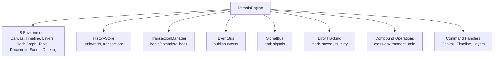

# Domain Engine Integration

The `DomainEngine` is the composition root that wraps all 8 environments with App Engine history, events, signals, and transactions. It defines **how operations are executed** — not what they mean.

---

## Architecture



---

## Environment Access

Each environment is owned by the DomainEngine and accessible via getters:

| Method | Type | Description |
|---|---|---|
| `canvas()` | `&Canvas` | Canvas2D environment |
| `timeline()` | `&Timeline` | Timeline environment |
| `layers()` | `&Layers` | Layers environment |
| `node_graph()` | `&NodeGraph` | NodeGraph environment |
| `table()` | `&Table` | Table environment |
| `document()` | `&Document` | TextEditor environment |
| `scene()` | `&Scene` | Viewport3D environment |
| `history()` | `&HistoryStore` | App Engine history |
| `event_bus()` | `&EventBus` | App Engine event bus |
| `events()` | `&[Event]` | Accumulated events for inspection |
| `transaction_manager()` | `&TransactionManager` | App Engine transaction manager |

---

## Execute Operations

Each environment has its own `execute_*` method:

```rust
// Canvas2D
engine.execute_canvas(CanvasOperation::Create {
    transform: Transform::from_translation(Vec2::new(10.0, 20.0)),
})?;

// Timeline
engine.execute_timeline(TimelineOperation::CreateTrack)?;

// Layers
engine.execute_layers(LayersOperation::CreateLayer {
    name: "Background".to_string(),
})?;

// NodeGraph
engine.execute_node_graph(NodeGraphOperation::CreateNode {
    name: "Source".to_string(),
    transform: Transform::identity(),
})?;

// Table
engine.execute_table(TableOperation::InsertRow { name: None })?;

// TextEditor
engine.execute_text_editor(TextEditorOperation::Insert {
    position: Position::new(0),
    text: "hello".to_string(),
})?;

// Viewport3D
engine.execute_viewport_3d(Viewport3DOperation::Create {
    transform: Transform3D::identity(),
})?;
```

### What each `execute_*` method does

1. Applies the operation to the environment (via `operation.apply(&mut env)`)
2. Creates a `HistoryEntry` with the operation name
3. If in a transaction, marks the entry with `.with_transaction(tx_id)`
4. Appends to `HistoryStore`
5. Publishes an `Event` via `EventBus` (e.g., `"canvas.object.created"`)
6. Emits a `Signal` via `SignalBus` (if configured, e.g., `"canvas.object.created"`)
7. If the operation fails and a transaction is active, **auto-rolls back** the entire transaction

### Backward compatibility

`execute()` is a backward-compatible alias for `execute_canvas()` that returns `Result<CanvasOutcome, CanvasError>` (not `DomainError`):

```rust
// Old API (still works)
let outcome = engine.execute(CanvasOperation::Create { ... })?;

// New API (returns DomainError for cross-environment consistency)
let outcome = engine.execute_canvas(CanvasOperation::Create { ... })?;
```

---

## Transactions

Group multiple operations into a single undoable unit:

```rust
engine.begin_transaction();
engine.execute_canvas(CanvasOperation::Create { transform: Transform::identity() })?;
engine.execute_layers(LayersOperation::CreateLayer { name: "Base".into() })?;
engine.execute_timeline(TimelineOperation::CreateTrack)?;
engine.commit_transaction();

// One undo reverses all three operations
engine.undo()?;
```

### Transaction lifecycle

| Method | Description |
|---|---|
| `begin_transaction()` | Start a transaction, returns `TransactionId` |
| `commit_transaction()` | End the transaction (entries remain in history, undo as one unit) |
| `rollback_transaction()` | Undo all operations in the transaction, remove entries from history |
| `in_transaction()` | Whether a transaction is active |

### How undo works with transactions

The `HistoryStore` checks `transaction_id` on entries. When `undo()` is called:

- If the entry has a `transaction_id`, **all entries with the same id** are undone as one unit
- If no `transaction_id`, only that single entry is undone

### Auto-rollback on error

If `execute_*` fails while a transaction is active, the DomainEngine **automatically rolls back** the transaction:

```rust
engine.begin_transaction();
engine.execute_canvas(CanvasOperation::Create { transform: Transform::identity() })?;

// This fails (object doesn't exist)
let err = engine.execute_canvas(CanvasOperation::Remove {
    id: ObjectId::from_raw(999),
}).unwrap_err();

// Transaction was auto-rolled back
assert!(!engine.in_transaction());
assert_eq!(engine.canvas().len(), 0); // Created object was undone
```

---

## Compound Operations

Cross-environment compound operations with nesting support:

```rust
let tx = engine.begin_compound();

engine.execute_canvas(CanvasOperation::Create { transform: Transform::identity() })?;
engine.execute_layers(LayersOperation::CreateLayer { name: "Group".into() })?;

// Nested compound
let tx2 = engine.begin_compound();
engine.execute_timeline(TimelineOperation::CreateTrack)?;
engine.execute_timeline(TimelineOperation::InsertClip { ... })?;
engine.commit_compound();

engine.commit_compound();

// Undo reverses everything as one unit
engine.undo()?;
```

| Method | Description |
|---|---|
| `begin_compound()` | Start (or nest) a compound operation |
| `commit_compound()` | End (or unnest) a compound operation |
| `rollback_compound()` | Roll back all operations in the compound |

Compound operations use `TransactionManager` internally. The `compound_depth` counter supports nesting. Undo reverses all operations in the outermost compound as one unit.

---

## Dirty Tracking

Track whether the document has unsaved changes:

```rust
engine.mark_saved();
assert!(!engine.is_dirty());

engine.execute_canvas(CanvasOperation::Create { transform: Transform::identity() })?;
assert!(engine.is_dirty());  // Unsaved change

engine.mark_saved();
assert!(!engine.is_dirty());

engine.undo()?;
assert!(engine.is_dirty());  // Undo creates unsaved state
```

`is_dirty()` compares `saved_position` with `history.position()`. Call `mark_saved()` after persisting state to any backend.

---

## Undo / Redo

```rust
// Execute 3 operations
engine.execute_canvas(Create { ... })?;
engine.execute_canvas(Move { ... })?;
engine.execute_canvas(Transform { ... })?;

// Undo all 3
engine.undo()?;  // undo transform
engine.undo()?;  // undo move
engine.undo()?;  // undo create
assert_eq!(engine.canvas().len(), 0);

// Redo all 3
engine.redo()?;  // redo create
engine.redo()?;  // redo move
engine.redo()?;  // redo transform
assert_eq!(engine.canvas().len(), 1);
```

### Undo implementation

Undo uses the position-based approach:

1. Record `position_before = history.position()`
2. Call `history.undo()` — returns count of undone entries
3. Record `position_after`
4. For each undone canvas operation (indices `pos_after..pos_before` in reverse), call `executed_canvas[i].undo(&mut canvas)`

### Undo publishes events

Both `undo()` and `redo()` publish events and emit signals:

- `undo()` publishes `"domain.undo"` event + signal
- `redo()` publishes `"domain.redo"` event + signal

---

## Events and Signals

Every `execute_*` call publishes:

| Channel | What | Purpose |
|---|---|---|
| `EventBus` | `Event::new("canvas.object.created")` | For logging, history, plugins |
| `SignalBus` | `Signal::new("canvas.object.created")` | For real-time UI refresh |

The `SignalBus` is optional — configure it via `with_signal_bus()`:

```rust
use std::sync::Arc;
use app_shell::app_engine::SignalBus;

let signal_bus = Arc::new(SignalBus::new());
let engine = DomainEngine::new()
    .with_signal_bus(signal_bus);
```

Events are also accumulated in `engine.events()` for inspection in tests:

```rust
engine.execute_canvas(Create { ... })?;
engine.execute_canvas(Move { ... })?;
engine.undo()?;

// 2 execute events + 1 undo event = 3 total
assert_eq!(engine.events().len(), 3);
```

---

## Undo History Limit

```rust
let engine = DomainEngine::new()
    .with_max_history(100);  // Max 100 undo entries
```

When `max_history > 0`, the DomainEngine checks the history size after each operation. If the limit is exceeded, the oldest entries should be trimmed.

!!! warning "Known limitation"
    The App Engine's `HistoryStore` does not have a `truncate_old` method. The limit is checked but cannot be enforced without modifying the App Engine. A future `HistoryStore` update would add this capability.

---

## Construction

```rust
// Default — no signal bus, unlimited history
let engine = DomainEngine::new();

// With signal bus
let engine = DomainEngine::new()
    .with_signal_bus(Arc::new(SignalBus::new()));

// With history limit
let engine = DomainEngine::new()
    .with_max_history(100);

// Both
let engine = DomainEngine::new()
    .with_signal_bus(signal_bus)
    .with_max_history(100);
```

---

## Example: Multi-Environment Application

```rust
use app_shell::domain_engine::DomainEngine;
use app_shell::domain_foundation::environments::canvas_2d::*;
use app_shell::domain_foundation::environments::layers::*;
use app_shell::domain_foundation::environments::timeline::*;

let mut engine = DomainEngine::new();

// Compound: create canvas object + layer + timeline clip
engine.begin_compound();

let obj_id = match engine.execute_canvas(CanvasOperation::Create {
    transform: Transform::from_translation(Vec2::new(100.0, 100.0)),
}).unwrap() {
    CanvasOutcome::Created { id } => id,
    _ => unreachable!(),
};

engine.execute_layers(LayersOperation::CreateLayer {
    name: "Animation".to_string(),
}).unwrap();

let track = engine.timeline().track_ids()[0];
engine.execute_timeline(TimelineOperation::InsertClip {
    track_id: track,
    start: Time::new(0.0),
    duration: Duration::new(10.0),
}).unwrap();

engine.commit_compound();

// All three undo as one unit
engine.undo().unwrap();
assert_eq!(engine.canvas().len(), 0);
assert_eq!(engine.layers().len(), 0);
```

---

## What DomainEngine Does NOT Do

| Concern | Owner |
|---|---|
| Define application-specific object types | Domain Engine (the real one, built on this) |
| Define domain rules (e.g., "width must be positive") | Domain Engine |
| Render anything | UI Layer |
| Handle user input | UI Layer |
| Persist state to files | App Engine (HistoryStore backend) |
| Define what events mean | Domain Engine / UI Layer |

The `DomainEngine` in the foundation is a **demonstration** — it proves the architecture works. A real Domain Engine (built by the application) defines what objects mean, what rules they follow, and what operations are valid.

---

## Next Steps

- [14-app-engine-integration.md](14-app-engine-integration.md) — Command handlers, EngineRef, App Engine wiring.
- [15-operations-and-undo.md](15-operations-and-undo.md) — Operations and undo/redo patterns.
- [03-environments.md](03-environments.md) — All environments.
- [20-quick-start.md](20-quick-start.md) — 5-minute getting started.