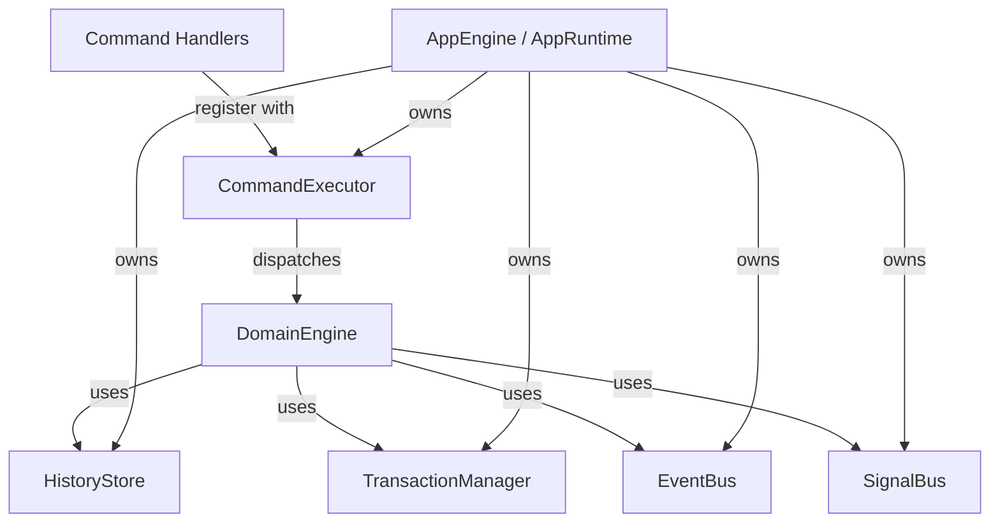
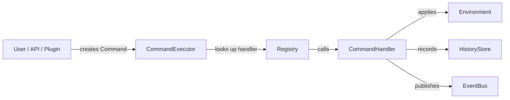

# App Engine Integration

How the Domain Foundation connects to the App Engine's execution infrastructure: commands, history, events, signals, and transactions.

---

## Architecture



The DomainEngine uses App Engine subsystems through their public APIs. The App Engine never imports domain types — it only knows about `Command`, `HistoryEntry`, `Event`, and `Signal`.

---

## App Engine Subsystems Used

| Subsystem | How DomainEngine uses it |
|---|---|
| `HistoryStore` | `append(entry)` for each operation, `undo()` / `redo()` for undo/redo, `remove_transaction(tx_id)` for rollback |
| `TransactionManager` | `begin()` / `commit()` / `rollback()` for multi-step undo |
| `EventBus` | `publish(&Event)` on every operation and undo/redo |
| `SignalBus` | `emit(&Signal)` on every operation (if configured) |
| `CommandExecutor` | `register(definition, handler)` to register domain command handlers |

All `HistoryStore` methods take `&self` (they use `Mutex` internally), so the DomainEngine doesn't need `&mut` for history operations.

---

## Command Handlers

Domain operations can be registered as App Engine commands, allowing the App Engine's `CommandExecutor` to dispatch them:



### Available command handlers

| Handler | Definition ID | Environment |
|---|---|---|
| `CanvasCommandHandler` | `"canvas.operation"` | Canvas2D |
| `TimelineCommandHandler` | `"timeline.operation"` | Timeline |
| `LayersCommandHandler` | `"layers.operation"` | Layers |

### Registering a command handler

```rust
use std::sync::{Arc, Mutex};
use app_shell::app_engine::*;
use app_shell::domain_engine::operations::CanvasCommandHandler;
use app_shell::domain_foundation::environments::canvas_2d::*;

// 1. Create shared environment state
let canvas = Arc::new(Mutex::new(Canvas::new()));

// 2. Create handler wrapping the shared state
let handler = CanvasCommandHandler::new(Arc::clone(&canvas));

// 3. Register with the App Engine's command executor
let mut engine: AppEngine = AppEngine::new()?;
engine.command_executor_mut().register(
    CanvasCommandHandler::definition(),
    Box::new(handler),
)?;

// 4. Execute a command through the App Engine
let cmd = Command::new(
    "canvas.operation",
    CommandContext::new(ExecutionId::new()),
    CommandInput::new(CanvasOperation::Create {
        transform: Transform::identity(),
    }),
);
let result = engine.execute_command(&cmd)?;
assert!(result.is_success());

// 5. Verify the canvas was modified
let canvas_guard = canvas.lock().unwrap();
assert_eq!(canvas_guard.len(), 1);
```

### How the handler works

The `CommandHandler` trait takes `&self` (immutable), but applying operations needs `&mut`. The solution: the handler wraps `Arc<Mutex<Environment>>`:

```rust
impl CommandHandler for CanvasCommandHandler {
    fn execute(
        &self,
        input: &CommandInput,
        _context: &CommandContext,
        engine: &EngineRef,
    ) -> Result<CommandResult, CommandError> {
        // 1. Extract the operation from typed input
        let operation = input
            .get::<CanvasOperation>()
            .ok_or_else(|| CommandError::ExecutionFailed("expected CanvasOperation".into()))?
            .clone();

        // 2. Apply to the shared canvas (lock + mutate)
        let outcome = {
            let mut canvas = self.canvas.lock()
                .map_err(|e| CommandError::ExecutionFailed(format!("lock: {e}")))?;
            operation.clone()
                .apply(&mut canvas)
                .map_err(|e| CommandError::ExecutionFailed(e.to_string()))?
        };

        // 3. Record in history via EngineRef
        engine.history_store.append(
            HistoryEntry::new("canvas.operation").undoable(),
        );

        // 4. Publish event via EngineRef
        engine.event_bus.publish(
            &Event::new("canvas.object.created").with_source("canvas_handler"),
        );

        // 5. Return the outcome as the command result
        Ok(CommandResult::success_with(outcome))
    }
}
```

### EngineRef

`EngineRef` is a read-only bundle of App Engine subsystems passed to handlers:

```rust
pub struct EngineRef<'a> {
    pub event_bus: &'a EventBus,
    pub signal_bus: &'a SignalBus,
    pub resource_manager: &'a ResourceManager,
    pub config_store: &'a ConfigStore,
    pub preferences: &'a Preferences,
    pub state_manager: &'a StateManager<LifecycleState>,
    pub command_executor: &'a CommandExecutor,
    pub scheduler: &'a Scheduler,
    pub history_store: &'a HistoryStore,
}
```

Handlers can:
- Publish events (`engine.event_bus.publish(...)`)
- Emit signals (`engine.signal_bus.emit(...)`)
- Append history entries (`engine.history_store.append(...)`)
- Load resources (`engine.resource_manager.load(...)`)
- Submit tasks (`engine.scheduler.submit(...)`)

The handler **cannot**:
- Register new commands (the executor is `&`, not `&mut`)
- Modify state directly (state manager is read-only)
- Access the Domain Engine (the App Engine doesn't know about it)

---

## HistoryStore Integration

### How operations are recorded

Each `execute_*` call on the DomainEngine creates a `HistoryEntry`:

```rust
let mut entry = HistoryEntry::new("canvas.create")
    .undoable();

// If in a transaction, mark the entry
if let Some(tx_id) = self.active_transaction {
    entry = entry.with_transaction(tx_id);
}

self.history.append(entry);
```

### Undo/redo

The DomainEngine calls `history.undo()` / `history.redo()` and then reverses/re-applies the canvas operations using the `ExecutedCanvasOperation` parallel list.

For non-canvas environments (Timeline, Layers, etc.), only the `HistoryStore` position changes — the actual environment state reversal must be handled by the Domain Engine (the current implementation only reverses Canvas2D operations).

### Transaction removal

`rollback_transaction()` calls `history.remove_transaction(tx_id)`:

```rust
pub fn remove_transaction(&self, tx_id: TransactionId) {
    let mut entries = self.entries.lock().unwrap();
    entries.retain(|e| e.transaction_id() != Some(tx_id));
    let mut pos = self.position.lock().unwrap();
    *pos = pos.min(entries.len());
}
```

All entries with the given transaction id are removed, and the position is clamped.

---

## EventBus Integration

### Event publication

```rust
fn publish(&mut self, event_name: &str, signal_name: &str) {
    let event = Event::new(event_name).with_source("domain_engine");
    self.event_bus.publish(&event);
    self.events.push(event);  // Also accumulate for inspection

    if let Some(ref sb) = self.signal_bus {
        sb.emit(&Signal::new(signal_name).with_source("domain_engine"));
    }
}
```

### Event naming convention

| Operation | Event name | Signal name |
|---|---|---|
| Create canvas object | `canvas.object.created` | `canvas.object.created` |
| Move canvas object | `canvas.object.moved` | `canvas.object.moved` |
| Remove canvas object | `canvas.object.removed` | `canvas.object.removed` |
| Create track | `timeline.track.created` | `timeline.track.created` |
| Insert clip | `timeline.clip.inserted` | `timeline.clip.inserted` |
| Create layer | `layers.layer.created` | `layers.layer.created` |
| Undo | `domain.undo` | `domain.undo` |
| Redo | `domain.redo` | `domain.redo` |

Events use a hierarchical dot-separated naming convention: `<environment>.<entity>.<action>`.

---

## SignalBus Integration

Signals are emitted alongside events for real-time UI updates:

| Characteristic | EventBus | SignalBus |
|---|---|---|
| Delivery | May be delayed (priority queue) | Immediate (synchronous) |
| Use case | Logging, history, plugins | UI refresh, cursor update |
| Required? | Always | Optional (`with_signal_bus()`) |

Configure the SignalBus:

```rust
let signal_bus = Arc::new(SignalBus::new());
let engine = DomainEngine::new()
    .with_signal_bus(signal_bus);
```

UI components subscribe to signals for immediate visual feedback:

```rust
signal_bus.subscribe("canvas.object.moved", Box::new(move |_signal| {
    // Redraw immediately
    request_redraw();
}));
```

---

## Full Integration Example

```rust
use app_shell::app_engine::*;
use app_shell::domain_engine::DomainEngine;
use app_shell::domain_engine::operations::CanvasCommandHandler;
use app_shell::domain_foundation::environments::canvas_2d::*;
use std::sync::{Arc, Mutex};

// 1. Create shared canvas
let canvas = Arc::new(Mutex::new(Canvas::new()));

// 2. Create and register command handler
let handler = CanvasCommandHandler::new(Arc::clone(&canvas));
let mut engine: AppEngine = AppEngine::new()?;
engine.command_executor_mut().register(
    CanvasCommandHandler::definition(),
    Box::new(handler),
)?;

// 3. Start the engine
engine.initialize()?;
engine.start()?;

// 4. Execute a command through the App Engine
let cmd = Command::new(
    "canvas.operation",
    CommandContext::new(ExecutionId::new()),
    CommandInput::new(CanvasOperation::Create {
        transform: Transform::from_translation(Vec2::new(10.0, 20.0)),
    }),
);
let result = engine.execute_command(&cmd)?;
assert!(result.is_success());

// 5. Verify
let canvas_guard = canvas.lock().unwrap();
assert_eq!(canvas_guard.len(), 1);
assert_eq!(
    canvas_guard.iter().next().unwrap().transform.translation,
    Vec2::new(10.0, 20.0),
);

// 6. History was recorded
assert_eq!(engine.history_store().position(), 1);

// 7. Shutdown
engine.stop()?;
engine.dispose()?;
```

---

## What the App Engine Does NOT Know

| Concept | Known? | Why |
|---|---|---|
| `Canvas2D` | ❌ | The App Engine only knows `Command`, `HistoryEntry`, `Event` |
| `CanvasOperation` | ❌ | Passed as `CommandInput` (type-erased via `Any`) |
| `ObjectId` | ❌ | Never appears in App Engine types |
| `Transform`, `Vec2` | ❌ | Never imported by App Engine |
| `Timeline`, `Layers`, etc. | ❌ | All domain types are opaque to the App Engine |
| Domain rules | ❌ | The App Engine provides infrastructure; meaning stays in the Domain Engine |

The `CommandInput` carries the operation as `Box<dyn Any + Send>`. The App Engine never inspects it — it passes it to the registered `CommandHandler` which knows how to extract and apply it.

---

## Next Steps

- [13-domain-engine-integration.md](13-domain-engine-integration.md) — DomainEngine composition.
- [15-operations-and-undo.md](15-operations-and-undo.md) — Operations and undo/redo patterns.
- [16-serialization.md](16-serialization.md) — Serialization support.
- [20-quick-start.md](20-quick-start.md) — 5-minute getting started.