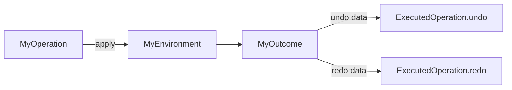
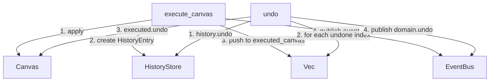
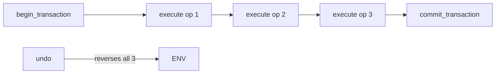

# Operations & Undo

Every environment follows the same value-type operation pattern: an `Operation` enum describes *what* to do, an `Outcome` enum carries *what happened* (with enough state to reverse it), and `apply()` connects the two.

---

## Operation Pattern



```rust
// Operation — value-type intent (Clone, Debug, PartialEq)
pub enum CanvasOperation {
    Create { transform: Transform },
    Move { id: ObjectId, translation: Vec2 },
    Remove { id: ObjectId },
    // ...
}

// Outcome — result with undo data (Clone, Debug, PartialEq)
pub enum CanvasOutcome {
    Created { id: ObjectId },
    Moved { id: ObjectId, previous: Transform },
    Removed { object: Object },
    // ...
}

// Apply — connects operation to environment
impl CanvasOperation {
    pub fn apply(self, canvas: &mut Canvas) -> Result<CanvasOutcome, CanvasError>;
}
```

### Design principles

1. **Operations are values** — they can be cloned, compared, serialized, stored, and replayed.
2. **Outcomes carry undo state** — each outcome variant includes enough data to construct the inverse operation.
3. **`apply()` is the only mutation path** — the environment can be mutated directly (e.g., `canvas.create_object()`) but the operation system is the undoable path.
4. **Operations don't execute infrastructure** — no history, no events, no signals. That's the DomainEngine's job.

---

## Undo Data per Outcome

Each outcome variant carries specific state needed to reverse the operation:

| Outcome | Undo data | Undo action |
|---|---|---|
| `Created { id }` | `id` | Remove the created object |
| `Moved { id, previous }` | `previous: Transform` | `set_transform(id, previous)` |
| `Transformed { id, previous }` | `previous: Transform` | `set_transform(id, previous)` |
| `Removed { object }` | `object: Object` | `insert_object(object)` (preserves original id) |
| `MovedToFront { id, previous_index }` | `previous_index: usize` | `reorder(id, previous_index)` |
| `MovedToBack { id, previous_index }` | `previous_index: usize` | `reorder(id, previous_index)` |
| `MovedForward { id, previous_index }` | `previous_index: usize` | `reorder(id, previous_index)` |
| `MovedBackward { id, previous_index }` | `previous_index: usize` | `reorder(id, previous_index)` |
| `Reordered { id, previous_index }` | `previous_index: usize` | `reorder(id, previous_index)` |
| `Duplicated { source, new_id }` | `new_id` | `remove_object(new_id)` |
| `Cleared { count }` | *(none)* | Cannot undo without storing all objects |

---

## ExecutedCanvasOperation

The `ExecutedCanvasOperation` pairs an operation with its outcome, providing `undo()` and `redo()` methods:

```rust
pub struct ExecutedCanvasOperation {
    operation: CanvasOperation,
    outcome: CanvasOutcome,
}

impl ExecutedCanvasOperation {
    pub fn execute(canvas: &mut Canvas, operation: CanvasOperation)
        -> Result<Self, CanvasError>;

    pub fn undo(&self, canvas: &mut Canvas) -> Result<(), CanvasError>;
    pub fn redo(&self, canvas: &mut Canvas) -> Result<CanvasOutcome, CanvasError>;

    pub fn history_entry(&self) -> HistoryEntry;
    pub fn event(&self) -> Event;
}
```

### Undo implementation

```rust
pub fn undo(&self, canvas: &mut Canvas) -> Result<(), CanvasError> {
    match &self.outcome {
        CanvasOutcome::Created { id } => {
            canvas.remove_object(*id)?;
        }
        CanvasOutcome::Moved { id, previous } => {
            canvas.set_transform(*id, *previous)?;
        }
        CanvasOutcome::Removed { object } => {
            canvas.insert_object(*object);  // Restores original id
        }
        CanvasOutcome::MovedToFront { id, previous_index } => {
            canvas.reorder(*id, *previous_index)?;
        }
        CanvasOutcome::Duplicated { new_id, .. } => {
            canvas.remove_object(*new_id)?;
        }
        CanvasOutcome::Cleared { .. } => {
            // Cannot undo without storing all objects
        }
        // ...
    }
    Ok(())
}
```

### Redo implementation

Redo re-applies the original operation. For most operations, this is just `self.operation.clone().apply(canvas)`. But `Create` is special:

```rust
pub fn redo(&self, canvas: &mut Canvas) -> Result<CanvasOutcome, CanvasError> {
    match &self.operation {
        CanvasOperation::Create { transform } => {
            // Use insert_object (not create_object) to preserve the original id
            let id = match &self.outcome {
                CanvasOutcome::Created { id } => *id,
                _ => unreachable!(),
            };
            canvas.insert_object(Object::new(id, *transform));
            Ok(self.outcome.clone())
        }
        _ => self.operation.clone().apply(canvas),
    }
}
```

**Why `insert_object` instead of `create_object`?** Because `create_object` assigns a new id from the counter. After undo (which removed the object but didn't reset the counter), `create_object` would give a different id. Any subsequent operations referencing the original id would fail. `insert_object` restores the object with its original id.

---

## Z-Order Undo

Z-order operations (`MoveToFront`, `MoveToBack`, `MoveForward`, `MoveBackward`, `Reorder`) carry `previous_index`:

```rust
// Apply captures the current index before moving
CanvasOperation::MoveToFront { id } => {
    let current = canvas.draw_order().iter()
        .position(|oid| *oid == id)
        .ok_or(CanvasError::ObjectNotFound { id })?;
    canvas.move_to_front(id)?;
    Ok(CanvasOutcome::MovedToFront { id, previous_index: current })
}

// Undo restores to the previous position
CanvasOutcome::MovedToFront { id, previous_index } => {
    canvas.reorder(*id, *previous_index)?;
}
```

All five z-order operations use `reorder(id, previous_index)` for undo.

---

## DomainEngine Undo/Redo

The DomainEngine maintains a parallel `Vec<ExecutedCanvasOperation>` synced with `HistoryStore::position()`:



### Undo algorithm

```rust
pub fn undo(&mut self) -> Result<usize, DomainError> {
    let pos_before = self.history.position();
    let result = self.history.undo();
    let count = result.count();
    let pos_after = self.history.position();

    // Reverse canvas operations from pos_after to pos_before
    for i in (pos_after..pos_before).rev() {
        if let Some(executed) = self.executed_canvas.get(i) {
            executed.undo(&mut self.canvas)?;
        }
    }

    self.publish("domain.undo", "domain.undo");
    Ok(count)
}
```

### Redo algorithm

```rust
pub fn redo(&mut self) -> Result<usize, DomainError> {
    let pos_before = self.history.position();
    let result = self.history.redo();
    let count = result.count();
    let pos_after = self.history.position();

    // Re-apply canvas operations from pos_before to pos_after
    for i in pos_before..pos_after {
        if let Some(executed) = self.executed_canvas.get(i) {
            executed.redo(&mut self.canvas)?;
        }
    }

    self.publish("domain.redo", "domain.redo");
    Ok(count)
}
```

### Truncation on new operation

When a new operation is executed after undo, the redo stack must be cleared:

```rust
pub fn execute_canvas(&mut self, operation: CanvasOperation) -> Result<CanvasOutcome, DomainError> {
    let pos = self.history.position();
    self.executed_canvas.truncate(pos);  // Clear redo stack
    // ...
}
```

The `HistoryStore::append()` also truncates its entries (if `position < entries.len()`), so both stay in sync.

---

## Transactions

Transactions group multiple operations into a single undoable unit via `HistoryEntry::with_transaction(tx_id)`:



### How it works

1. `begin_transaction()` calls `TransactionManager::begin()`, stores the `TransactionId`, and records `transaction_start_position`.
2. Each `execute_*` call creates a `HistoryEntry` with `.with_transaction(tx_id)`.
3. `commit_transaction()` calls `TransactionManager::commit()`. The entries stay in history but are linked.
4. `undo()` calls `HistoryStore::undo()` which checks `transaction_id` — if present, it undoes **all entries with the same id** in one call.

### Rollback

`rollback_transaction()` undoes all canvas operations from `transaction_start_position` to current position, then removes the entries from history:

```rust
pub fn rollback_transaction(&mut self) -> Option<TransactionId> {
    let tx_id = self.active_transaction;
    self.active_transaction = None;
    let result = self.transaction_manager.rollback();
    if let Some(tx_id) = tx_id {
        // Undo canvas operations
        let current_pos = self.history.position();
        for i in (self.transaction_start_position..current_pos).rev() {
            if let Some(executed) = self.executed_canvas.get(i) {
                let _ = executed.undo(&mut self.canvas);
            }
        }
        // Remove from history
        self.history.remove_transaction(tx_id);
        // Truncate executed list
        let new_pos = self.history.position();
        self.executed_canvas.truncate(new_pos);
    }
    result
}
```

---

## Compound Operations

Compound operations wrap transactions for cross-environment grouping:

```rust
let tx = engine.begin_compound();
engine.execute_canvas(Create { ... })?;
engine.execute_layers(CreateLayer { ... })?;
engine.execute_timeline(InsertClip { ... })?;
engine.commit_compound();

// Undo reverses all three as one unit
engine.undo()?;
```

| Method | Description |
|---|---|
| `begin_compound()` | Start (or nest deeper) a compound operation |
| `commit_compound()` | End (or unnest) — when depth reaches 0, commits the transaction |
| `rollback_compound()` | Roll back all operations in the compound |

Nesting: `compound_depth` counter supports nested compounds. The outermost commit triggers `commit_transaction()`.

---

## Known Limitations

| Limitation | Description |
|---|---|
| **Undo only reverses Canvas2D** | The `executed_canvas` parallel list only stores Canvas operations. Timeline, Layers, etc. record in `HistoryStore` but their state isn't reversed on undo. A real Domain Engine would extend this to all environments. |
| **`Cleared` outcome can't undo** | `Clear` operations don't store removed objects. Undo is a no-op. A real Domain Engine would store all objects in the outcome or an external list. |
| **`HistoryStore` can't truncate old** | The undo history limit checks but can't actually remove old entries (no `truncate_old` method on `HistoryStore`). |

---

## Next Steps

- [13-domain-engine-integration.md](13-domain-engine-integration.md) — How DomainEngine wraps operations.
- [14-app-engine-integration.md](14-app-engine-integration.md) — App Engine integration (commands, history).
- [16-serialization.md](16-serialization.md) — Serialization of operations and outcomes.
- [17-testing.md](17-testing.md) — Testing strategies for operations and undo.