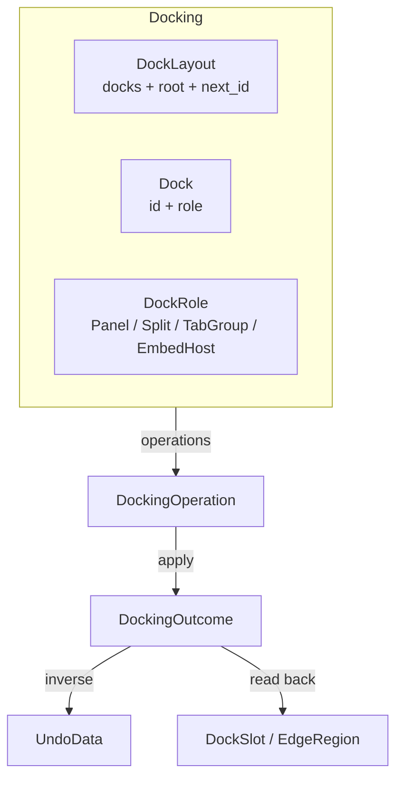

# Docking

Headless docking-layout model. Provides dock identity, four dock categories (panel, split container, tab group, embed host), placement slots, splitter/region/floating sizing, and whole-layout integrity checks — without imposing any UI, pointer input, drop overlays, windowing, or rendering.

---

## Overview



A layout is a hierarchical structure for ordinary split and tab relationships (a tree), plus explicit, non-tree placement collections for embed-host edge regions and floating docks (PRD §7.6). Every dock occupies **exactly one** placement; the root is the current top-level dock (`None` only for the explicit empty layout).

---

## Key Types

| Type | Fields | Purpose |
|---|---|---|
| `DockLayout` | `docks: HashMap<DockId, Dock>`, `root: Option<DockId>`, `next_id: u64` | Container owning all docks and the designated root |
| `Dock` | `id: DockId`, `role: DockRole` | One logical unit: identity paired with a category payload |
| `DockRole` | enum, 4 variants | `Panel`, `Split`, `TabGroup`, `EmbedHost` payloads |
| `DockKind` | enum, 4 variants | A dock's category without its payload (`Panel`, `Split`, `TabGroup`, `EmbedHost`) |
| `DockId` | `u64` (opaque) | Stable, opaque identifier — not an array index; ids never renumber |
| `ContentRef` | `String` (type alias) | Opaque, host-supplied reference to the dock's work-area content; never interpreted by the environment |
| `DockSlot` | enum, 5 variants | The placement a dock occupies (see below) |
| `EdgeRegion` | enum, 4 variants | `Top`, `Bottom`, `Left`, `Right` — a host's edge regions |
| `SplitSizes` | one relative weight per split child | Logical sizing state (finite, strictly positive) |
| `HostRegions` | occupancy + weight per edge | Which dock occupies which host region, at what region weight |
| `FloatingEntry` / `FloatingRect` | `dock + rect` / `x, y, w, h` | One floated subtree + its host-fraction body rect |
| `DockingOperation` | enum, 13 variants | Value-type operation intent |
| `DockingOutcome` | enum, 12 variants | Result with undo data (`Created`, `InsertedBeside`, `TabJoined`, `TabReordered`, `ActiveTabSelected`, `Removed`, `SiblingsResized`, `DockCollapsedSet`, `Embedded`, `HostPromoted`, `RegionResized`, `FloatingRectSet`) |
| `UndoData` | enum | Full inverse/replay payload carried on every outcome; consumed by the engine's undo/redo |
| `DockingError` | enum, 29 variants | Error type (see [19-error-reference.md](19-error-reference.md)) |

---

## Dock Categories (PRD §7.2)

| Category | Payload | Role |
|---|---|---|
| `Panel` | `content`, `collapsed` | An individual work area |
| `Split` | `orientation: Row/Column`, `children: Vec<DockId>`, `sizes: SplitSizes` | Ordered children along one direction, ≥ 2 children |
| `TabGroup` | `members: Vec<DockId>`, `active: usize` | Multiple docks sharing one position; one active member (v1 membership is panels only) |
| `EmbedHost` | `content`, `regions: HostRegions`, `floating: Vec<FloatingEntry>`, `persistent: bool` | Own work area **plus** edge regions and a floating collection |

**Host persistence (PRD §8.9):** `persistent: true` is an *explicitly configured* host (created via `CreateEmbedHost` or `PromoteHost`) — a host is a valid steady state even when its regions and floating collection are all empty. `persistent: false` is a *temporary promotion* (a panel auto-promoted by `Embed`): when the last embedded/floating dock leaves, the shared normalization pass demotes it back to a panel (identity and content preserved).

**Collapse (PRD §9.7):** `Panel.collapsed` is a persistent logical *presentation preference*. A collapsed dock keeps its placement, membership, and sizing exactly as if expanded — it stays placed, traversable, valid, and restorable (restoring is the flag clearing).

---

## DockLayout Methods

### Construction

| Method | Returns | Description |
|---|---|---|
| `new()` | `DockLayout` | The explicit empty layout (no docks, no root) |
| `create_panel(content)` | `DockId` | Create a panel dock (extant, unplaced until installed) |
| `create_embed_host(content)` | `DockId` | Create an embed host — empty regions and floating collection |
| `create_split(orientation, children, sizes)` | `Result<DockId, DockingError>` | Create an unplaced split container over ≥ 2 *unplaced* children; weights must match the child count |
| `create_tab_group(members, active)` | `Result<DockId, DockingError>` | Create an unplaced tab group over ≥ 1 member; `active` must index `members` |
| `set_root(id)` | `Result<(), DockingError>` | Designate (`Some`) or clear (`None`) the root; an existing root must be cleared first (`RootAlreadySet`) |
| `clear()` | `()` | Remove all docks + root (id counter preserved, ids stay unique) |

### Access

| Method | Returns | Description |
|---|---|---|
| `len()` / `is_empty()` | `usize` / `bool` | Total dock count / emptiness |
| `root()` | `Option<DockId>` | The designated root's id |
| `root_dock()` | `Option<&Dock>` | The designated root dock |
| `contains(id)` | `bool` | Existence check |
| `get(id)` | `Option<&Dock>` | Read access |
| `iter()` | `impl Iterator<Item = &Dock>` | Iterate all docks (map order) |
| `all_docks()` | `Vec<DockId>` | All dock ids |

### Placement & discovery

| Method | Returns | Description |
|---|---|---|
| `placement(id)` | `Option<DockSlot>` | The slot a dock currently occupies (`None` = unknown dock; an existing dock without a slot is an orphan — only valid mid-operation) |
| `kind_of(id)` | `Option<DockKind>` | A dock's category |
| `is_descendant(maybe_descendant, ancestor)` | `bool` | Self-inclusive containment check — the cycle guard for embed/insert targets |
| `descendants(id)` | `Vec<DockId>` | All descendants (not including self) |
| `path(id)` | `Vec<DockId>` | Path from the root down to this dock |
| `depth()` | `usize` | Maximum hierarchy depth |

### Integrity (imported-state gate, PRD §7.7)

| Method | Returns | Description |
|---|---|---|
| `validate()` | `Result<(), DockingError>` | Whole-layout invariant check: orphans, duplicate placements, root rules, cycles, sizing/region/rect state |
| `normalize()` | `Result<(), DockingError>` | Deterministic structural normalization (below); idempotent |

---

## Placements

Every dock occupies exactly one of five slots (`DockLayout::placement`):

| Slot | Meaning |
|---|---|
| `Root` | The designated root — the only parentless placement |
| `SplitChild { parent, index }` | Ordered child position in a split container (row/column order) |
| `TabMember { parent, index }` | Membership in a tab group |
| `HostEdge { host, edge }` | An occupied edge region of an embed host |
| `Floating { host, index }` | An entry in a host's floating-dock collection |

Slots are constructed and changed **only** by docking operations — there is no public constructor, so ad-hoc external mutation cannot bypass operation validation (PRD §15.3).

---

## Operations

Operations are value-type enums applied either directly (`DockingOperation::apply(&mut layout) -> Result<DockingOutcome, DockingError>`) or through the engine (`DomainEngine::execute_docking`). Every operation is **candidate-validated and atomic**: the operation builds a cloned candidate and commits only if the whole pipeline succeeds — a rejected request leaves the layout untouched, records no history entry, and emits no event (PRD §8.2, §10.5).

| Operation | Outcome | Undo |
|---|---|---|
| `CreatePanel { content }` | `Created { dock, is_root }` | Remove the panel (`is_root`: the panel was auto-rooted on the empty layout) |
| `CreateEmbedHost { content }` | `Created { dock, is_root }` | Remove the host (root rule as `CreatePanel`) |
| `InsertBeside { source, target, direction }` | `InsertedBeside { source, target, container }` | Remove the source / restore its former placement |
| `TabJoin { source, target }` | `TabJoined { source, target, group }` | Detach the source from the group |
| `ReorderTab { group, from, to }` | `TabReordered { group, from, to }` | Reverse the move (Layers reorder convention: `to` is the insertion index after removal) |
| `SetActiveTab { group, index }` | `ActiveTabSelected { group, active }` | Restore the previous active index |
| `Remove { dock }` | `Removed { docks }` | Re-insert the removed dock + subtree |
| `ResizeSiblings { container, first, requested, first_min, second_min }` | `SiblingsResized { container, first, previous }` | Restore the previous pair weights |
| `SetDockCollapsed { dock, collapsed }` | `DockCollapsedSet { dock, collapsed }` | Restore the previous preference |
| `Embed { source, host, slot }` | `Embedded { source, host, slot, promoted }` | Detach + restore demotion/promotion as performed |
| `PromoteHost { dock }` | `HostPromoted { dock, promoted }` | Demote back (a no-op request when already a host) |
| `ResizeRegion { host, edge, requested, min }` | `RegionResized { host, edge, previous }` | Restore the previous region weight |
| `SetFloatingRect { host, index, rect, min_w, min_h }` | `FloatingRectSet { host, index, previous }` | Restore the previous rect |

`source` in `InsertBeside` / `TabJoin` / `Embed` is an `InsertSource`: `Existing(DockId)` moves a dock (identity and whole subtree intact) or `NewPanel { content }` creates a panel dock and places it in one step.

### Insert-beside semantics (PRD §8.6)

`direction` is `Left` / `Right` (row order) or `Top` / `Bottom` (column order). When the resolved target sits in a *compatible* container (its split orientation matches the direction), the source is inserted into that container; otherwise a new container is created around the target and the source, inheriting the target's slot.

### Tab semantics (PRD §8.7)

`TabJoin` makes the source a member of the target's group — or wraps both in a new group inheriting the target's slot; the joined dock becomes the active member. Joining a panel already in the target's group is a no-op success. v1 membership is panels only.

### Splitter resize semantics (PRD §9.2–§9.4)

`ResizeSiblings` rewrites the **adjacent pair** at child indices `first` and `first + 1`: the first region's weight becomes `requested` and the second absorbs the difference, so the pair's total — and every other child's share — is conserved. The frontend sends per-frame **absolute** requested weights derived from gesture start + total displacement (frames compose drift-free). Minimums (`first_min` / `second_min`) are frontend-translated logical weights.

**Constraint policy: rejection.** A request violating a carried minimum or the sizing invariant (finite, strictly positive) is refused (`SizeBoundViolation`) — never silently clamped, never invalid state stored. A bound endpoint is honored inclusively.

### Embedding semantics (PRD §8.8–§8.9)

`Embed` places `source` into `host`'s edge region (`EmbedSlot::Region(edge)`) or floating collection (`EmbedSlot::Floating { rect }`). The host keeps its own work area. A panel host auto-promotes to a **temporary** host (identity and content preserved; regions and floating start empty; the outcome's `promoted: true` names the promotion). Splits and tab groups can neither host nor promote (`IneligibleDock`). An occupied region rejects (`RegionOccupied`) — an occupant is never silently replaced; floating accepts any number of entries, appended last.

`PromoteHost` is the *explicit, persistent* promotion: the panel stays a host even when empty. Both promotions preserve identity and content; promoting an existing host (persistent or temporary) is a no-op success.

**Region sizing (PRD §9.5):** each occupied edge region carries a verbatim slot-attached weight; a fresh occupant starts at `1.0`. `ResizeRegion` resizes against the region's inner boundary — exactly one stored weight is rewritten.

### Floating semantics (PRD §9.6)

Floating is host-anchored: one `FloatingEntry` per floated subtree root, internal structure preserved (never flattened). A `FloatingRect` is the entry's **dock body rectangle in host-fraction coordinates** (`x + w ≤ 1`, `y + h ≤ 1`); `EmbedSlot::Floating { rect: None }` starts at the baseline (`0, 0, ½, ½`). Re-docking a floater is the source side of the same operations (`Embed` region, `InsertBeside`, `TabJoin`); a floating dock as a *directional* target is rejected (`NotSplittable`). `SetFloatingRect` rewrites position and dimensions in one non-structural write.

---

## Structural Normalization & Validation (PRD §7.7, §8.12)

Every operation runs the shared pipeline: **mutate → normalize → validate → commit**.

- **`normalize()`** resolves containers whose membership fell below their steady-state minimum along documented, deterministic rules — a split down to a single child unwraps (the child inherits the container's slot), an emptied temporary host demotes back to a panel, single-member tab groups unwrap. It never removes the root and it is idempotent.
- **`validate()`** refuses to commit a candidate that violates a committed-state invariant: orphan docks, duplicate placements, root rules, containment cycles, invalid sizing/region/floating state.

Undo/redo replay the *recorded* structural history through the same pipeline, so historical states are normalized commits, never mid-operation snapshots.

---

## Frontend Handoff — the Interaction Contract (PRD §10–§11)

The environment implements no drag-and-drop. A frontend drives it with **intent + eligibility + commit** and never pointer coordinates: hit-testing, pointer tracking, drop overlays, previews, animations, and window management stay with the frontend. A drag is only ever observed here as the one confirmed request it commits.

| Docking mode | Edge intent | Center intent |
|---|---|---|
| Split/insert | `InsertBeside` + `SplitDirection` | not a split intent — use tab or embed |
| Tab grouping | not a tab intent | `TabJoin` |
| Embedding | `Embed` + `EmbedSlot::Region(edge)` | `Embed` + `EmbedSlot::Floating { rect }` (a drop on the host's body) |

Eligibility discovery is advisory, from the public read side:

| Question | Read-side answer |
|---|---|
| Embed-capable target (host or promotable panel)? | `layout.kind_of(id)` is `EmbedHost` or `Panel` |
| Edge region free? | `dock.host_regions().map(|r| r.on(edge)).flatten().is_none()` |
| Directional insert defined (not floated)? | `layout.placement(id)` is not `DockSlot::Floating` |
| Tab source/target joinable? | `layout.kind_of(..)` is `Panel` for both |
| Cycle guard (target inside subtree)? | `layout.is_descendant(target, source)` |

The commit re-validates every precondition: whatever escapes the pre-filter is still rejected by the operation, and a rejected request is the *whole* consequence — layout untouched, no history entry, no event.

Resize / floating-move gestures commit per operation with the absolute-request contract; the frontend chooses its commit boundary at gesture end — per-frame rollback (each frame is one history entry) or a gesture-span `begin_transaction()` / `commit_transaction()` (the span undoes as one unit). Cancellation *before* a commit is simply not submitting; there is no domain-side "abort".

---

## Domain Engine Integration

```rust
let outcome = engine.execute_docking(DockingOperation::TabJoin { ... }).unwrap();
engine.undo().unwrap(); // UndoData replays the recorded inverse
```

| Concern | Behavior |
|---|---|
| Execution | `DomainEngine::execute_docking(op) -> Result<DockingOutcome, DomainError>` — real undo/redo, transactions, per-operation events |
| Auto-rollback | A failure inside an active transaction rolls back the transaction automatically |
| Events | `docking.dock.created`, `docking.dock.inserted_beside`, `docking.tab.joined`, `docking.tab.reordered`, `docking.tab.active_selected`, `docking.dock.removed`, `docking.split.resized`, `docking.panel.collapsed_set`, `docking.dock.embedded`, `docking.host.promoted`, `docking.region.resized`, `docking.floating.rect_set` |
| Signals | The same names on the signal bus |
| External data | Domain engines attach their own data externally, keyed by `DockId` (precedent: Canvas2D / Layers) |

Serde: all state types serialize behind the `serde` feature; ids ship verbatim; an imported layout is gated through `validate()` before it becomes engine-visible.

---

## Example

A full walkthrough — split a work area, tab panels, resize, embed hosts, float, re-dock:

```rust
use app_shell::domain_foundation::environments::docking::*;

let mut layout = DockLayout::new();

// Panels first (extant and unplaced until installed by an operation).
let editor = layout.create_panel(Some("editor".into()));
let inspector = layout.create_panel(Some("inspector".into()));
let output = layout.create_panel(Some("output".into()));
let notes = layout.create_panel(Some("notes".into()));

// A horizontal work area, made the root.
let work = layout
    .create_split(
        SplitOrientation::Row,
        vec![editor, inspector],
        SplitSizes::uniform(2).unwrap(),   // [1.0, 1.0]
    )
    .unwrap();
layout.set_root(Some(work)).unwrap();

// Dock a panel right of the inspector: a same-row target reuses its
// container, and the new child copies the target's weight ([1.0, 1.0, 1.0]).
layout.apply(DockingOperation::InsertBeside {
    source: InsertSource::Existing(output),
    target: inspector,
    direction: SplitDirection::Right,
}).unwrap();
assert_eq!(layout.placement(output),
    Some(DockSlot::SplitChild { parent: work, index: 2 }));

// Tab the notes panel with the editor: a new group wraps both and
// inherits the editor's slot; the joined dock becomes the active member.
let joined = layout.apply(DockingOperation::TabJoin {
    source: InsertSource::Existing(notes),
    target: editor,
}).unwrap();
let DockingOutcome::TabJoined { group: tab_group, .. } = joined else {
    unreachable!("TabJoin always yields TabJoined on success")
};
assert_eq!(layout.placement(notes),
    Some(DockSlot::TabMember { parent: tab_group, index: 1 }));
assert_eq!(layout.get(tab_group).unwrap().active().unwrap(), 1);

// Activate the editor again, then resize the first splitter pair:
// pair total 1.0 + 1.0 = 2.0 is conserved → [1.5, 0.5]; the third
// child's weight is untouched.
layout.apply(DockingOperation::SetActiveTab {
    group: tab_group,
    index: 0,
}).unwrap();
layout.apply(DockingOperation::ResizeSiblings {
    container: work,
    first: 0,
    requested: 1.5,
    first_min: Some(0.25),
    second_min: Some(0.25),
}).unwrap();

// A tools host on the layout's right edge (the fresh root container
// around [work, tools] inherits the root slot).
let tools = layout.create_embed_host(Some("tools".into()));
layout.apply(DockingOperation::InsertBeside {
    source: InsertSource::Existing(tools),
    target: work,
    direction: SplitDirection::Right,
}).unwrap();

// Float the notes panel above the tools host — the member detach
// (PRD §8.11 "float from tab group"). Floating never flattens the
// floated structure; a `None` rect starts at the floating baseline.
layout.apply(DockingOperation::Embed {
    source: InsertSource::Existing(notes),
    host: tools,
    slot: EmbedSlot::Floating { rect: None },
}).unwrap();
assert_eq!(layout.placement(notes),
    Some(DockSlot::Floating { host: tools, index: 0 }));

// The single-member tab group was unwrapped by normalization: the
// editor inherited the former group's slot; the first pair keeps its
// resized weights verbatim.

// Move the floated panel: position + dimensions in one absolute write.
layout.apply(DockingOperation::SetFloatingRect {
    host: tools,
    index: 0,
    rect: FloatingRect::new(0.25, 0.25, 0.5, 0.5).unwrap(),
    min_w: Some(0.2),
    min_h: Some(0.2),
}).unwrap();

// Re-dock it (a floating dock as a directional target is rejected):
// TabJoin puts it back beside the editor; the tools host was created
// via CreateEmbedHost, so it stays a (persistent) host even when its
// floating collection empties.
layout.apply(DockingOperation::TabJoin {
    source: InsertSource::Existing(notes),
    target: editor,
}).unwrap();

// Whole-layout integrity holds after every commit:
layout.validate().unwrap();
```

Notes on the walkthrough:

- The walkthrough reads `group` out of the `TabJoined` outcome rather than guessing the container id — outcomes always carry the realized ids and slots.
- A 2-child split can never reach arbitrary weight pairs: pair-total conservation ties both regions together. Ask for a reachable, bound-respecting pairing (`[1.5, 0.5]`), and the request is either honored exactly or rejected — never clamped.

And the engine path with undo:

```rust
use app_shell::domain_engine::DomainEngine;

let mut engine = DomainEngine::new();

// On the empty layout, creation auto-roots.
let outcome = engine.execute_docking(DockingOperation::CreatePanel {
    content: Some("editor".into()),
}).unwrap();
let created = match outcome {
    DockingOutcome::Created { dock, is_root, .. } => { assert!(is_root); dock }
    _ => unreachable!(),
};

engine.execute_docking(DockingOperation::SetDockCollapsed { dock: created, collapsed: true })
    .unwrap();
engine.undo().unwrap(); // the outcome's UndoData restores the previous state

assert!(!engine.docking().get(created).unwrap().collapsed().unwrap());
```

---

## What Docking Does NOT Own

| Concern | Owner |
|---|---|
| Application panel content | Host application (docks carry opaque `ContentRef`s; content lifetime survives docking changes, PRD §8.11) |
| Hit-testing, pointer tracking, drop overlays, visual previews | Frontend (PRD §10) |
| Floating-dock window decoration and visual stacking (z-order) | Frontend (derived from the stored `FloatingRect`, PRD §9.6, §11.3) |
| Splitter *rendering* / grab-area geometry | Frontend (`ResizeSiblings` carries logical weights in pair units only) |
| Pixel measurements | The environment stores host-fraction logical state, never pixels |
| Execution infrastructure (commands, history, events) | Domain Engine / App Engine |
| Rendering | UI Layer |

---

## Testing

Coverage lives in three layers:

| Suite | Focus |
|---|---|
| `tests/domain_foundation_tests/docking_*_test.rs` | Identity, creation, placements, traversal, validation, operations, sizing, normalization, embedding, floating, serde round-trips |
| `tests/app_engine_tests/docking_*_test.rs` | Engine execution, undo/redo, transactions, events, persistence, interaction contract, history registry |
| `tests/app_engine_tests/docking_sequence_test.rs` | Operation-sequence composition: split → move → tab group → remove; promotion/demotion; float + re-dock nested structures; rejection isolation |

---

## Next Steps

- [03-environments.md](03-environments.md) — Docking among the other environments.
- [13-domain-engine-integration.md](13-domain-engine-integration.md) — How DomainEngine wraps Docking.
- [15-operations-and-undo.md](15-operations-and-undo.md) — Operations, transactions, and undo/redo patterns.
- [16-serialization.md](16-serialization.md) — Persisting and restoring layouts.
- [19-error-reference.md](19-error-reference.md) — All 29 `DockingError` variants.
