# Creating a New Environment

This guide walks through creating a complete environment from scratch — types, operations, outcomes, errors, methods, serde, tests, and DomainEngine integration.

We'll build a **Measurement** environment: simple distance annotations with a start point, end point, and label.

---

## Overview

```mermaid
flowchart LR
    A[1. Directory structure] --> B[2. Types: Id, Model, Error]
    B --> C[3. Operations & Outcomes]
    C --> D[4. apply method]
    D --> E[5. Methods & Queries]
    E --> F[6. Derives & Traits]
    F --> G[7. Serde]
    G --> H[8. Tests]
    H --> I[9. DomainEngine]
    I --> J[10. Command Handler]
```



---

## Step 1: Directory Structure

```text
src/domain_foundation/environments/
└── measurement/
    ├── mod.rs          # Module declarations and re-exports
    ├── error.rs       # MeasurementError
    ├── measurement.rs # Measurement model
    ├── annotation.rs  # Annotation struct
    └── operations.rs  # MeasurementOperation + MeasurementOutcome
```

### Update `environments/mod.rs`

```rust
// src/domain_foundation/environments/mod.rs

pub mod canvas_2d;
pub mod timeline;
pub mod layers;
pub mod node_graph;
pub mod viewport_3d;
pub mod table;
pub mod text_editor;
pub mod measurement;  // ← ADD

// ...
```

---

## Step 2: Types

### `measurement.rs` — Id and Model

```rust
//! Measurement environment: distance annotations on a 2D plane.

use super::annotation::Annotation;
use super::error::MeasurementError;
use crate::domain_foundation::environments::canvas_2d::Vec2;
use std::collections::HashMap;
use std::fmt;

/// Stable, opaque identifier for a measurement annotation.
#[cfg_attr(feature = "serde", derive(serde::Serialize, serde::Deserialize))]
#[cfg_attr(feature = "serde", serde(transparent))]
#[derive(Debug, Clone, Copy, PartialEq, Eq, Hash, PartialOrd, Ord)]
pub struct MeasurementId(u64);

impl MeasurementId {
    pub fn from_raw(raw: u64) -> Self {
        Self(raw)
    }

    pub fn as_raw(self) -> u64 {
        self.0
    }
}

impl fmt::Display for MeasurementId {
    fn fmt(&self, f: &mut fmt::Formatter<'_>) -> fmt::Result {
        write!(f, "measurement#{}", self.0)
    }
}

/// Headless measurement environment.
///
/// Stores distance annotations keyed by stable [`MeasurementId`]s.
#[cfg_attr(feature = "serde", derive(serde::Serialize, serde::Deserialize))]
#[derive(Debug, Clone, PartialEq, Default)]
pub struct Measurement {
    annotations: HashMap<MeasurementId, Annotation>,
    next_id: u64,
}

impl Measurement {
    pub fn new() -> Self {
        Self::default()
    }

    pub fn len(&self) -> usize {
        self.annotations.len()
    }

    pub fn is_empty(&self) -> bool {
        self.annotations.is_empty()
    }

    pub fn contains(&self, id: MeasurementId) -> bool {
        self.annotations.contains_key(&id)
    }

    pub fn get(&self, id: MeasurementId) -> Option<&Annotation> {
        self.annotations.get(&id)
    }

    pub fn get_mut(&mut self, id: MeasurementId) -> Option<&mut Annotation> {
        self.annotations.get_mut(&id)
    }

    pub fn iter(&self) -> impl Iterator<Item = &Annotation> {
        self.annotations.values()
    }

    pub fn create(&mut self, start: Vec2, end: Vec2, label: String) -> MeasurementId {
        let id = MeasurementId::from_raw(self.next_id);
        self.next_id += 1;
        self.annotations.insert(id, Annotation::new(id, start, end, label));
        id
    }

    pub fn insert(&mut self, annotation: Annotation) -> MeasurementId {
        let id = annotation.id;
        if id.as_raw() >= self.next_id {
            self.next_id = id.as_raw() + 1;
        }
        self.annotations.insert(id, annotation);
        id
    }

    pub fn remove(&mut self, id: MeasurementId) -> Result<Annotation, MeasurementError> {
        self.annotations
            .remove(&id)
            .ok_or(MeasurementError::NotFound { id })
    }

    pub fn rename(&mut self, id: MeasurementId, label: String) -> Result<String, MeasurementError> {
        let ann = self.annotations
            .get_mut(&id)
            .ok_or(MeasurementError::NotFound { id })?;
        let previous = ann.label.clone();
        ann.label = label;
        Ok(previous)
    }

    pub fn move_endpoints(
        &mut self,
        id: MeasurementId,
        start: Vec2,
        end: Vec2,
    ) -> Result<(Vec2, Vec2), MeasurementError> {
        let ann = self.annotations
            .get_mut(&id)
            .ok_or(MeasurementError::NotFound { id })?;
        let prev = (ann.start, ann.end);
        ann.start = start;
        ann.end = end;
        Ok(prev)
    }

    pub fn clear(&mut self) {
        self.annotations.clear();
    }
}

/// Iterate over annotations.
impl<'a> IntoIterator for &'a Measurement {
    type Item = &'a Annotation;
    type IntoIter = std::collections::hash_map::Values<'a, MeasurementId, Annotation>;

    fn into_iter(self) -> Self::IntoIter {
        self.annotations.values()
    }
}
```

### `annotation.rs` — Data Model

```rust
//! Annotation: a distance measurement on a 2D plane.

use super::measurement::MeasurementId;
use crate::domain_foundation::environments::canvas_2d::Vec2;

/// A measurement annotation with start/end points and a label.
#[cfg_attr(feature = "serde", derive(serde::Serialize, serde::Deserialize))]
#[derive(Debug, Clone, PartialEq)]
pub struct Annotation {
    pub id: MeasurementId,
    pub start: Vec2,
    pub end: Vec2,
    pub label: String,
}

impl Annotation {
    pub fn new(id: MeasurementId, start: Vec2, end: Vec2, label: String) -> Self {
        Self { id, start, end, label }
    }

    /// Euclidean distance between start and end.
    pub fn distance(&self) -> f64 {
        (self.end - self.start).length()
    }
}
```

### `error.rs`

```rust
//! Measurement-specific errors.

use super::measurement::MeasurementId;
use std::fmt;

#[cfg_attr(feature = "serde", derive(serde::Serialize, serde::Deserialize))]
#[derive(Debug, Clone, PartialEq, Eq)]
pub enum MeasurementError {
    NotFound { id: MeasurementId },
}

impl fmt::Display for MeasurementError {
    fn fmt(&self, f: &mut fmt::Formatter<'_>) -> fmt::Result {
        match self {
            MeasurementError::NotFound { id } => write!(f, "measurement {id} not found"),
        }
    }
}

impl std::error::Error for MeasurementError {}
```

---

## Step 3: Operations & Outcomes

### `operations.rs`

```rust
//! Measurement operations: value-type intents with undo data.

use super::annotation::Annotation;
use super::error::MeasurementError;
use super::measurement::{Measurement, MeasurementId};
use crate::domain_foundation::environments::canvas_2d::Vec2;

/// A measurement operation.
#[cfg_attr(feature = "serde", derive(serde::Serialize, serde::Deserialize))]
#[derive(Debug, Clone, PartialEq)]
pub enum MeasurementOperation {
    Create { start: Vec2, end: Vec2, label: String },
    Remove { id: MeasurementId },
    Rename { id: MeasurementId, label: String },
    MoveEndpoints { id: MeasurementId, start: Vec2, end: Vec2 },
    Clear,
}

/// Outcome of a successful operation.
#[cfg_attr(feature = "serde", derive(serde::Serialize, serde::Deserialize))]
#[derive(Debug, Clone, PartialEq)]
pub enum MeasurementOutcome {
    Created { id: MeasurementId },
    Removed { annotation: Annotation },
    Renamed { id: MeasurementId, previous_label: String },
    Moved { id: MeasurementId, previous_start: Vec2, previous_end: Vec2 },
    Cleared { count: usize },
}

impl MeasurementOperation {
    pub fn apply(self, env: &mut Measurement) -> Result<MeasurementOutcome, MeasurementError> {
        match self {
            MeasurementOperation::Create { start, end, label } => {
                let id = env.create(start, end, label);
                Ok(MeasurementOutcome::Created { id })
            }
            MeasurementOperation::Remove { id } => {
                let annotation = env.remove(id)?;
                Ok(MeasurementOutcome::Removed { annotation })
            }
            MeasurementOperation::Rename { id, label } => {
                let previous_label = env.rename(id, label)?;
                Ok(MeasurementOutcome::Renamed { id, previous_label })
            }
            MeasurementOperation::MoveEndpoints { id, start, end } => {
                let (prev_start, prev_end) = env.move_endpoints(id, start, end)?;
                Ok(MeasurementOutcome::Moved {
                    id,
                    previous_start: prev_start,
                    previous_end: prev_end,
                })
            }
            MeasurementOperation::Clear => {
                let count = env.len();
                env.clear();
                Ok(MeasurementOutcome::Cleared { count })
            }
        }
    }
}
```

---

## Step 4: `mod.rs` — Re-exports

```rust
//! # Measurement Environment
//!
//! Headless distance annotation model.

pub mod annotation;
pub mod error;
pub mod measurement;
pub mod operations;

pub use annotation::Annotation;
pub use error::MeasurementError;
pub use measurement::{Measurement, MeasurementId};
pub use operations::{MeasurementOperation, MeasurementOutcome};
```

---

## Step 5: Tests

Create `tests/domain_foundation_tests/measurement_test.rs`:

```rust
//! Model tests for the Measurement environment.

use app_shell::domain_foundation::environments::measurement::*;
use app_shell::domain_foundation::environments::canvas_2d::Vec2;

#[test]
fn new_measurement_is_empty() {
    let m = Measurement::new();
    assert!(m.is_empty());
    assert_eq!(m.len(), 0);
}

#[test]
fn create_returns_unique_ids() {
    let mut m = Measurement::new();
    let a = m.create(Vec2::new(0.0, 0.0), Vec2::new(10.0, 0.0), "A".into());
    let b = m.create(Vec2::new(0.0, 0.0), Vec2::new(20.0, 0.0), "B".into());
    assert_ne!(a, b);
    assert_eq!(m.len(), 2);
}

#[test]
fn annotation_distance() {
    let ann = Annotation::new(
        MeasurementId::from_raw(0),
        Vec2::new(0.0, 0.0),
        Vec2::new(3.0, 4.0),
        "test".into(),
    );
    assert_eq!(ann.distance(), 5.0);
}

#[test]
fn remove_returns_annotation() {
    let mut m = Measurement::new();
    let id = m.create(Vec2::zero(), Vec2::new(10.0, 0.0), "A".into());
    let removed = m.remove(id).unwrap();
    assert_eq!(removed.id, id);
    assert!(!m.contains(id));
}

#[test]
fn partial_eq_works() {
    let mut a = Measurement::new();
    let mut b = Measurement::new();
    a.create(Vec2::zero(), Vec2::new(1.0, 0.0), "x".into());
    b.create(Vec2::zero(), Vec2::new(1.0, 0.0), "x".into());
    assert_eq!(a, b);
}
```

Create `tests/domain_foundation_tests/measurement_operations_test.rs`:

```rust
//! Operation tests for the Measurement environment.

use app_shell::domain_foundation::environments::measurement::*;
use app_shell::domain_foundation::environments::canvas_2d::Vec2;

#[test]
fn create_operation() {
    let mut env = Measurement::new();
    let outcome = MeasurementOperation::Create {
        start: Vec2::new(0.0, 0.0),
        end: Vec2::new(10.0, 0.0),
        label: "Distance A".into(),
    }
    .apply(&mut env)
    .unwrap();
    assert!(matches!(outcome, MeasurementOutcome::Created { .. }));
    assert_eq!(env.len(), 1);
}

#[test]
fn remove_operation_returns_annotation() {
    let mut env = Measurement::new();
    let id = env.create(Vec2::zero(), Vec2::new(5.0, 0.0), "test".into());
    let outcome = MeasurementOperation::Remove { id }
        .apply(&mut env)
        .unwrap();
    match outcome {
        MeasurementOutcome::Removed { annotation } => {
            assert_eq!(annotation.id, id);
        }
        other => panic!("expected Removed, got {other:?}"),
    }
}

#[test]
fn operations_on_missing_id_fail() {
    let mut env = Measurement::new();
    let fake = MeasurementId::from_raw(999);
    let err = MeasurementOperation::Remove { id: fake }
        .apply(&mut env)
        .unwrap_err();
    assert!(matches!(err, MeasurementError::NotFound { .. }));
}
```

### Update `tests/domain_foundation_tests/main.rs`

```rust
mod measurement_test;
mod measurement_operations_test;
```

---

## Step 6: DomainEngine Integration

Add to `src/domain_engine/mod.rs`:

```rust
use crate::domain_foundation::environments::measurement::{
    Measurement, MeasurementError, MeasurementOperation, MeasurementOutcome,
};

// Add field:
pub struct DomainEngine {
    // ... existing fields ...
    measurement: Measurement,  // ← ADD
}

// In new():
measurement: Measurement::new(),

// Add getter:
pub fn measurement(&self) -> &Measurement { &self.measurement }

// Add execute method:
pub fn execute_measurement(
    &mut self,
    operation: MeasurementOperation,
) -> Result<MeasurementOutcome, DomainError> {
    let outcome = operation.clone().apply(&mut self.measurement)
        .map_err(|e| {
            let err: DomainError = e.into();
            self.check_auto_rollback(&err);
            err
        })?;

    let name = match &operation {
        MeasurementOperation::Create { .. } => "measurement.create",
        MeasurementOperation::Remove { .. } => "measurement.remove",
        MeasurementOperation::Rename { .. } => "measurement.rename",
        MeasurementOperation::MoveEndpoints { .. } => "measurement.move",
        MeasurementOperation::Clear => "measurement.clear",
    };
    let mut entry = HistoryEntry::new(name).undoable();
    if let Some(tx_id) = self.active_transaction {
        entry = entry.with_transaction(tx_id);
    }
    self.history.append(entry);

    let event_name = match &outcome {
        MeasurementOutcome::Created { .. } => "measurement.created",
        MeasurementOutcome::Removed { .. } => "measurement.removed",
        MeasurementOutcome::Renamed { .. } => "measurement.renamed",
        MeasurementOutcome::Moved { .. } => "measurement.moved",
        MeasurementOutcome::Cleared { .. } => "measurement.cleared",
    };
    let signal_name = match &outcome {
        MeasurementOutcome::Created { .. } => "measurement.created",
        MeasurementOutcome::Removed { .. } => "measurement.removed",
        _ => "measurement.changed",
    };
    self.publish(event_name, signal_name);

    Ok(outcome)
}
```

Add to `DomainError`:

```rust
pub enum DomainError {
    // ... existing variants ...
    Measurement(MeasurementError),  // ← ADD
}

impl From<MeasurementError> for DomainError {
    fn from(e: MeasurementError) -> Self { Self::Measurement(e) }
}
```

---

## Step 7: Command Handler (Optional)

Create `src/domain_engine/operations/measurement_command_handler.rs`:

```rust
use crate::app_engine::capabilities::engine_ref::EngineRef;
use crate::app_engine::commands::command::CommandInput;
use crate::app_engine::commands::command_context::CommandContext;
use crate::app_engine::commands::command_definition::CommandDefinition;
use crate::app_engine::commands::command_executor::CommandHandler;
use crate::app_engine::commands::command_result::CommandResult;
use crate::app_engine::errors::command_error::CommandError;
use crate::app_engine::events::event::Event;
use crate::app_engine::history::history_entry::HistoryEntry;
use crate::domain_foundation::environments::measurement::{
    Measurement, MeasurementOperation,
};
use std::sync::{Arc, Mutex};

pub struct MeasurementCommandHandler {
    measurement: Arc<Mutex<Measurement>>,
}

impl MeasurementCommandHandler {
    pub fn new(measurement: Arc<Mutex<Measurement>>) -> Self {
        Self { measurement }
    }

    pub fn definition() -> CommandDefinition {
        CommandDefinition::new(
            "measurement.operation",
            "Measurement Operation",
            "Applies a MeasurementOperation to the measurement environment.",
        )
    }
}

impl CommandHandler for MeasurementCommandHandler {
    fn execute(
        &self,
        input: &CommandInput,
        _ctx: &CommandContext,
        engine: &EngineRef,
    ) -> Result<CommandResult, CommandError> {
        let op = input
            .get::<MeasurementOperation>()
            .ok_or_else(|| {
                CommandError::ExecutionFailed("expected MeasurementOperation".into())
            })?
            .clone();

        let outcome = {
            let mut env = self.measurement.lock()
                .map_err(|e| CommandError::ExecutionFailed(format!("lock: {e}")))?;
            op.clone()
                .apply(&mut env)
                .map_err(|e| CommandError::ExecutionFailed(e.to_string()))?
        };

        engine.history_store.append(
            HistoryEntry::new("measurement.operation").undoable(),
        );
        engine.event_bus.publish(
            &Event::new("measurement.operation").with_source("measurement_handler"),
        );

        Ok(CommandResult::success_with(outcome))
    }
}
```

Update `src/domain_engine/operations/mod.rs`:

```rust
pub mod measurement_command_handler;
pub use measurement_command_handler::MeasurementCommandHandler;
```

---

## Checklist

- [ ] Directory structure created (`environments/measurement/`)
- [ ] `environments/mod.rs` updated with `pub mod measurement;`
- [ ] Types: `MeasurementId`, `Annotation`, `Measurement`
- [ ] Error: `MeasurementError`
- [ ] Operations: `MeasurementOperation` + `MeasurementOutcome` + `apply()`
- [ ] `mod.rs` re-exports all public types
- [ ] Derives: `Debug`, `Clone`, `PartialEq`, `Default` on `Measurement`
- [ ] `IntoIterator for &Measurement`
- [ ] Serde attributes on all types
- [ ] Tests: model + operations
- [ ] `main.rs` updated with test modules
- [ ] `DomainEngine`: field + getter + `execute_measurement()`
- [ ] `DomainError`: variant + `From` impl
- [ ] Command handler (optional)
- [ ] `operations/mod.rs` updated

---

## Next Steps

- [02-adding-operations.md](02-adding-operations.md) — How to add new operations to an existing environment.
- [03-creating-utility.md](03-creating-utility.md) — How to create a new utility.
- [09-domain-engine-integration.md](09-domain-engine-integration.md) — Full DomainEngine integration guide.
- [08-writing-tests.md](08-writing-tests.md) — Testing patterns.