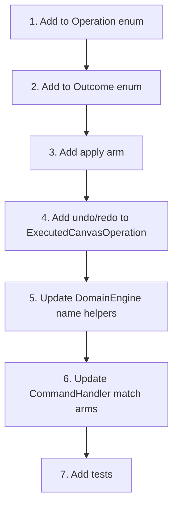

# Adding Operations & Undo

This guide shows how to add new `Operation`/`Outcome` variant pairs to an existing environment, update all dependent code, and ensure undo/redo works correctly.

We'll add a **`SetColor`** operation to Canvas2D as a concrete example.

---

## Overview



---

## Step 1: Add to Operation Enum

In `src/domain_foundation/environments/canvas_2d/operations.rs`, add the new variant:

```rust
pub enum CanvasOperation {
    // ... existing variants ...
    MoveToFront { id: ObjectId },
    MoveToBack { id: ObjectId },
    // ...
    Clear,

    // ↓ NEW
    /// Set the color of an object.
    SetColor { id: ObjectId, color: String },
}
```

---

## Step 2: Add to Outcome Enum

Add the corresponding outcome variant with undo data:

```rust
pub enum CanvasOutcome {
    // ... existing variants ...
    Cleared { count: usize },

    // ↓ NEW
    /// Color was set. `previous_color` is the old color (empty string if none).
    ColorSet { id: ObjectId, previous_color: String },
}
```

### Undo data checklist

Ask yourself: "What does undo need to restore?"

| Operation | What changed | What undo needs | Outcome field |
|---|---|---|---|
| `SetColor` | Object's color | Previous color | `previous_color: String` |
| `Move` | Translation | Previous transform | `previous: Transform` |
| `Remove` | Object deleted | The object itself | `object: Object` |
| `Create` | Object created | The id to remove | `id: ObjectId` |

**Rule:** Every outcome variant must carry enough state to construct the inverse operation.

---

## Step 3: Add `apply` Arm

In the `impl CanvasOperation` block, add the match arm:

```rust
impl CanvasOperation {
    pub fn apply(self, canvas: &mut Canvas) -> Result<CanvasOutcome, CanvasError> {
        match self {
            // ... existing arms ...

            // ↓ NEW
            CanvasOperation::SetColor { id, color } => {
                // Need to get the previous color before setting the new one.
                // This requires a method on Canvas or Object.
                let obj = canvas.get_mut(id)
                    .ok_or(CanvasError::ObjectNotFound { id })?;
                let previous_color = obj.color.clone();  // Assuming Object has a color field
                obj.color = color;
                Ok(CanvasOutcome::ColorSet { id, previous_color })
            }
        }
    }
}
```

!!! note "Object needs the field"
    If `Object` doesn't have a `color` field, you need to add it first:
    ```rust
    pub struct Object {
        pub id: ObjectId,
        pub transform: Transform,
        pub color: String,  // ← ADD
    }
    ```
    And update `Object::new` to initialize it.

---

## Step 4: Update `ExecutedCanvasOperation`

In `src/domain_engine/operations/canvas_operations.rs`, update the `undo`, `redo`, `history_entry`, and `event` methods.

### Undo

```rust
pub fn undo(&self, canvas: &mut Canvas) -> Result<(), CanvasError> {
    match &self.outcome {
        // ... existing arms ...

        // ↓ NEW
        CanvasOutcome::ColorSet { id, previous_color } => {
            let obj = canvas.get_mut(*id)
                .ok_or(CanvasError::ObjectNotFound { id: *id })?;
            obj.color = previous_color.clone();
        }
    }
    Ok(())
}
```

### Redo

For most operations, redo re-applies the original operation. `SetColor` is simple enough:

```rust
pub fn redo(&self, canvas: &mut Canvas) -> Result<CanvasOutcome, CanvasError> {
    match &self.operation {
        CanvasOperation::Create { transform } => {
            // Special case: use insert_object to preserve id
            // ...
        }

        // ↓ NEW (falls through to default)
        _ => self.operation.clone().apply(canvas),
    }
}
```

If `SetColor` is in the `_` arm, it's handled automatically. Only `Create` needs special redo handling (via `insert_object`).

### History entry name

```rust
pub fn history_entry(&self) -> HistoryEntry {
    let name = match &self.operation {
        // ... existing arms ...

        // ↓ NEW
        CanvasOperation::SetColor { .. } => "canvas.set_color",
    };
    HistoryEntry::new(name).undoable()
}
```

### Event name

```rust
pub fn event(&self) -> Event {
    let event_name = match &self.operation {
        // ... existing arms ...

        // ↓ NEW
        CanvasOperation::SetColor { .. } => "canvas.object.color_set",
    };
    Event::new(event_name)
}
```

---

## Step 5: Update DomainEngine Name Helpers

In `src/domain_engine/mod.rs`, update the name helper functions:

### `event_name_for_canvas_outcome`

```rust
fn event_name_for_canvas_outcome(outcome: &CanvasOutcome) -> &'static str {
    match outcome {
        // ... existing arms ...

        // ↓ NEW
        CanvasOutcome::ColorSet { .. } => "canvas.object.color_set",
    }
}
```

### `signal_name_for_canvas_outcome`

```rust
fn signal_name_for_canvas_outcome(outcome: &CanvasOutcome) -> &'static str {
    match outcome {
        // ... existing arms ...

        // ↓ NEW
        CanvasOutcome::ColorSet { .. } => "canvas.object.color_set",
    }
}
```

---

## Step 6: Update CommandHandler

In `src/domain_engine/operations/canvas_command_handler.rs`, update the two match statements:

### Entry name

```rust
let entry_name = match &operation {
    // ... existing arms ...

    // ↓ NEW
    CanvasOperation::SetColor { .. } => "canvas.set_color",
};
```

### Event name

```rust
let event_name = match &outcome {
    // ... existing arms ...

    // ↓ NEW
    CanvasOutcome::ColorSet { .. } => "canvas.object.color_set",
};
```

---

## Step 7: Tests

Add to `tests/domain_foundation_tests/canvas_2d_operations_test.rs`:

```rust
#[test]
fn set_color_operation() {
    let mut canvas = Canvas::new();
    let id = canvas.create_object(Transform::identity());

    let outcome = CanvasOperation::SetColor {
        id,
        color: "#FF0000".to_string(),
    }
    .apply(&mut canvas)
    .unwrap();

    match outcome {
        CanvasOutcome::ColorSet { id: oid, previous_color } => {
            assert_eq!(oid, id);
            assert_eq!(previous_color, "");  // Default color was empty
        }
        other => panic!("expected ColorSet, got {other:?}"),
    }

    // Verify the color was set
    assert_eq!(canvas.get(id).unwrap().color, "#FF0000");
}

#[test]
fn set_color_undo_restores_previous() {
    use app_shell::domain_engine::operations::canvas_operations::ExecutedCanvasOperation;

    let mut canvas = Canvas::new();
    let id = canvas.create_object(Transform::identity());

    // Set initial color
    canvas.get_mut(id).unwrap().color = "#00FF00".to_string();

    // Execute SetColor via ExecutedCanvasOperation
    let executed = ExecutedCanvasOperation::execute(
        &mut canvas,
        CanvasOperation::SetColor {
            id,
            color: "#FF0000".to_string(),
        },
    ).unwrap();

    assert_eq!(canvas.get(id).unwrap().color, "#FF0000");

    // Undo — restores previous color
    executed.undo(&mut canvas).unwrap();
    assert_eq!(canvas.get(id).unwrap().color, "#00FF00");
}

#[test]
fn set_color_on_missing_id_fails() {
    let mut canvas = Canvas::new();
    let fake_id = ObjectId::from_raw(999);

    let err = CanvasOperation::SetColor {
        id: fake_id,
        color: "#000000".to_string(),
    }
    .apply(&mut canvas)
    .unwrap_err();

    assert!(matches!(err, CanvasError::ObjectNotFound { .. }));
}
```

---

## Files to Update — Summary

When adding a new operation, these files need updates:

| # | File | What to add |
|---|---|---|
| 1 | `environments/xxx/operations.rs` | `Operation` variant + `Outcome` variant + `apply` arm |
| 2 | `environments/xxx/object.rs` (or model file) | New field on the data struct (if needed) |
| 3 | `domain_engine/operations/canvas_operations.rs` | `undo` arm + check `redo` (usually falls through to `_`) + `history_entry` arm + `event` arm |
| 4 | `domain_engine/mod.rs` | `event_name_for_canvas_outcome` arm + `signal_name_for_canvas_outcome` arm |
| 5 | `domain_engine/operations/canvas_command_handler.rs` | `entry_name` match arm + `event_name` match arm |
| 6 | `tests/.../canvas_2d_operations_test.rs` | Operation test + undo test + error test |

---

## Undo Data Patterns

| Pattern | When to use | Example |
|---|---|---|
| **Return previous value** | Property mutation | `Moved { previous: Transform }` |
| **Return removed entity** | Deletion | `Removed { object: Object }` |
| **Return created id** | Creation | `Created { id: ObjectId }` |
| **Return previous index** | Reordering | `Reordered { previous_index: usize }` |
| **Return count** | Clear/bulk | `Cleared { count: usize }` |
| **No undo data** | When undo isn't possible | `Cleared { count }` (can't restore without storing all objects) |

---

## Redo Patterns

| Pattern | When to use | Example |
|---|---|---|
| **Re-apply original operation** | Most operations | `_ => self.operation.clone().apply(canvas)` |
| **Use insert (not create)** | `Create` operations | `canvas.insert_object(Object::new(id, transform))` |
| **No-op** | Operations that can't be redone | `Cleared` (no stored objects) |

---

## Common Pitfalls

### 1. Forgetting a match arm

Rust's exhaustive match will catch this — but only in files that match on the enum. Check:
- `apply()` in `operations.rs`
- `undo()` in `canvas_operations.rs`
- `history_entry()` in `canvas_operations.rs`
- `event()` in `canvas_operations.rs`
- Name helpers in `domain_engine/mod.rs`
- Match arms in `canvas_command_handler.rs`

### 2. Not returning enough undo data

If undo can't fully reverse the operation, the outcome doesn't carry enough state. Ask: "What was the state BEFORE the operation?"

### 3. Struct literal in match scrutinee

Never write `match Foo::Variant { fields }.method() { ... }`. Bind to a variable first:

```rust
// WRONG
let id = match CanvasOperation::SetColor { id, color }.apply(&mut canvas).unwrap() { ... };

// CORRECT
let outcome = CanvasOperation::SetColor { id, color }.apply(&mut canvas).unwrap();
let id = match outcome { ... };
```

---

## Next Steps

- [01-creating-environment.md](01-creating-environment.md) — Creating a complete new environment.
- [03-creating-utility.md](03-creating-utility.md) — Creating a new utility.
- [05-command-handlers.md](05-command-handlers.md) — Creating command handlers.
- [15-operations-and-undo.md](../15-operations-and-undo.md) — Operations and undo/redo patterns (reference)