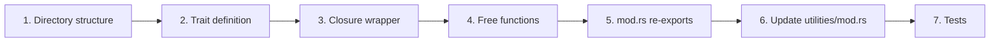

# Creating a New Utility

This guide walks through creating a complete utility from scratch — trait, closure wrapper, free functions, re-exports, and tests.

We'll build a **Mapping** utility: transforms items from one type to another via a developer-supplied function.

---

## Overview



---

## Orthogonality Rules

Before creating a utility, ensure it follows these rules:

1. **Operates over generic `T`** — no imports from `environments` or `relations`.
2. **Environments do not import utilities** — a Canvas2D doesn't know mapping exists.
3. **Does not own data meaning** — it processes data supplied to it.
4. **Individually usable** — a Domain Engine chooses whether to compose it.
5. **No mandatory dependencies** — importing the utility module must not make it required by any environment.

If your utility needs to know about Canvas2D objects, it's not a utility — it's domain logic that belongs in a Domain Engine.

---

## Step 1: Directory Structure

```text
src/domain_foundation/utilities/
└── mapping/
    ├── mod.rs          # Module declarations and re-exports
    └── mapper.rs      # Mapper trait, FnMapper, free functions
```

---

## Step 2: Trait Definition

### `mapper.rs`

```rust
//! Mapping utility: transform items from one type to another.

/// A criterion that transforms an item of type `T` into type `U`.
///
/// Implementations are composable. The Domain Engine provides
/// the mapping function; the utility provides the mechanism.
pub trait Mapper<T, U> {
    /// Transform `item` into a new value.
    fn map(&self, item: &T) -> U;
}
```

---

## Step 3: Closure Wrapper

Add to `mapper.rs`:

```rust
/// Closure-based mapper.
pub struct FnMapper<F, P = (), R = ()> {
    f: F,
    _marker: std::marker::PhantomData<fn(&P) -> R>,
}

impl<F, P, R> FnMapper<F, P, R>
where
    F: Fn(&P) -> R,
{
    pub fn new(f: F) -> Self {
        Self {
            f,
            _marker: std::marker::PhantomData,
        }
    }
}

impl<T, U, F> Mapper<T, U> for FnMapper<F, T, U>
where
    T: ?Sized,
    F: Fn(&T) -> U,
{
    fn map(&self, item: &T) -> U {
        (self.f)(item)
    }
}

impl<F, P, R> std::fmt::Debug for FnMapper<F, P, R> {
    fn fmt(&self, f: &mut std::fmt::Formatter<'_>) -> std::fmt::Result {
        write!(f, "FnMapper(..)")
    }
}
```

---

## Step 4: Free Functions

Add to `mapper.rs`:

```rust
/// Create a mapper from a closure.
pub fn mapper<T, U, F: Fn(&T) -> U>(f: F) -> FnMapper<F, T, U> {
    FnMapper::new(f)
}

/// Map all items in a slice, returning owned values.
pub fn map_all<T, U, M: Mapper<T, U>>(items: &[T], mapper: &M) -> Vec<U> {
    items.iter().map(|item| mapper.map(item)).collect()
}

/// Map a single item.
pub fn map_one<T, U, M: Mapper<T, U>>(item: &T, mapper: &M) -> U {
    mapper.map(item)
}

/// Map and filter: only keep non-None results.
pub fn map_filter<T, U, M: Mapper<T, Option<U>>>(items: &[T], mapper: &M) -> Vec<U> {
    items
        .iter()
        .filter_map(|item| mapper.map(item))
        .collect()
}
```

---

## Step 5: `mod.rs` Re-exports

### `mapping/mod.rs`

```rust
//! # Mapping
//!
//! Optional utility for transforming items from one type to another.

pub mod mapper;

pub use mapper::{
    map_all, map_filter, map_one, mapper, FnMapper, Mapper,
};
```

---

## Step 6: Update `utilities/mod.rs`

In `src/domain_foundation/utilities/mod.rs`, add:

```rust
pub mod batch;
pub mod filtering;
pub mod grouping;
pub mod mapping;  // ← ADD
pub mod querying;
pub mod sorting;
pub mod tagging;
pub mod validation;
```

---

## Step 7: Tests

Create `tests/domain_foundation_tests/mapping_test.rs`:

```rust
//! Tests for the mapping utility.

use app_shell::domain_foundation::utilities::mapping::*;

#[test]
fn map_all_doubles_integers() {
    let items = vec![1, 2, 3, 4, 5];
    let result = map_all(&items, &mapper(|x: &i32| x * 2));
    assert_eq!(result, vec![2, 4, 6, 8, 10]);
}

#[test]
fn map_one_transforms_single_item() {
    let result = map_one(&42, &mapper(|x: &i32| format!("value: {}", x)));
    assert_eq!(result, "value: 42");
}

#[test]
fn map_filter_keeps_only_some() {
    let items = vec![1, 2, 3, 4, 5];
    let result = map_filter(&items, &mapper(|x: &i32| {
        if *x % 2 == 0 { Some(*x * 10) } else { None }
    }));
    assert_eq!(result, vec![20, 40]);
}

#[test]
fn map_all_with_struct_type() {
    #[derive(Debug, Clone)]
    struct Item { name: String, value: i32 }

    let items = vec![
        Item { name: "A".into(), value: 10 },
        Item { name: "B".into(), value: 20 },
    ];

    let result = map_all(&items, &mapper(|item: &Item| {
        format!("{}={}", item.name, item.value)
    }));
    assert_eq!(result, vec!["A=10".to_string(), "B=20".to_string()]);
}

#[test]
fn mapper_works_with_environment_data() {
    use app_shell::domain_foundation::environments::canvas_2d::{
        Canvas, Object, Transform, Vec2,
    };

    let mut canvas = Canvas::new();
    canvas.create_object(Transform::from_translation(Vec2::new(10.0, 20.0)));
    canvas.create_object(Transform::from_translation(Vec2::new(30.0, 40.0)));

    // Map Canvas2D objects to position strings — without importing mapping into Canvas2D
    let objects: Vec<Object> = canvas.iter().copied().collect();
    let positions = map_all(&objects, &mapper(|obj: &Object| {
        format!("{:.1}, {:.1}", obj.transform.translation.x, obj.transform.translation.y)
    }));

    assert_eq!(positions.len(), 2);
    assert!(positions.contains(&"10.0, 20.0".to_string()));
    assert!(positions.contains(&"30.0, 40.0".to_string()));
}
```

### Update `tests/domain_foundation_tests/main.rs`

```rust
mod mapping_test;
```

---

## Using the Utility with Environment Data

The key pattern: the **Domain Engine** bridges environments and utilities:

```rust
// Domain Engine code (not foundation code)

use app_shell::domain_foundation::environments::canvas_2d::Object;
use app_shell::domain_foundation::utilities::mapping::*;

fn collect_positions(canvas: &Canvas) -> Vec<String> {
    let objects: Vec<Object> = canvas.iter().copied().collect();
    map_all(&objects, &mapper(|obj: &Object| {
        format!("{}, {}", obj.transform.translation.x, obj.transform.translation.y)
    }))
}
```

The Canvas2D environment doesn't know `mapping` exists. The `mapping` utility doesn't know `Canvas2D` exists. The Domain Engine bridges them.

---

## When to Create a Utility vs Domain Engine Code

| Criterion | Utility | Domain Engine code |
|---|---|---|
| Works with any `T` | ✅ | ❌ (specific types) |
| No imports from environments | ✅ | ❌ (imports environment types) |
| Reusable across applications | ✅ | ❌ (application-specific) |
| Generic trait + closure wrapper | ✅ | ❌ (concrete logic) |
| Could be published as a separate crate | ✅ | ❌ |

If your code only makes sense for one application (e.g., "format Canvas2D objects for display"), it's Domain Engine code, not a utility.

---

## Checklist

- [ ] Directory structure created (`utilities/mapping/`)
- [ ] `utilities/mod.rs` updated with `pub mod mapping;`
- [ ] Trait: `Mapper<T, U>`
- [ ] Closure wrapper: `FnMapper<F>`
- [ ] Free functions: `mapper()`, `map_all()`, `map_one()`, `map_filter()`
- [ ] `mod.rs` re-exports
- [ ] Tests: basic + struct + environment data
- [ ] `main.rs` updated with test module
- [ ] No imports from `environments` or `relations` in utility code

---

## Next Steps

- [01-creating-environment.md](01-creating-environment.md) — Creating a new environment.
- [04-creating-relations.md](04-creating-relations.md) — Creating relation definitions.
- [12-utilities.md](../12-utilities.md) — All utilities reference.
- [08-writing-tests.md](08-writing-tests.md) — Testing patterns.