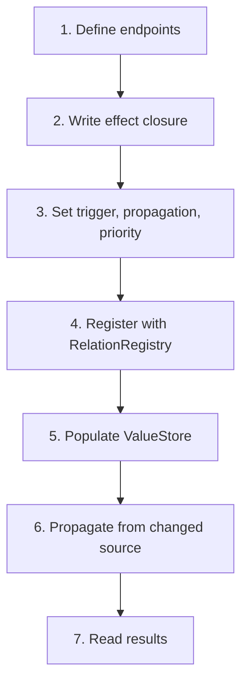

# Creating Relation Definitions

This guide shows how to define relations between properties, write effect closures, set priorities and propagation modes, register them, and evaluate changes.

We'll define a **"width affects position"** relation: when object A's width changes, object B's x-position updates to stay aligned.

---

## Overview



---

## Key Concept: Mechanism vs Meaning

| Layer | Responsibility |
|---|---|
| **Foundation** | Store, find, evaluate, propagate relations |
| **Domain Engine** | Define which relations exist, what changes, what effect occurs |

The relation system never inspects what an effect closure does. It calls the closure and applies the outcome.

---

## Step 1: Define Endpoints

Endpoints identify *which property on which object* is the source and target:

```rust
use app_shell::domain_foundation::relations::*;
use app_shell::domain_foundation::relations::definition::*;

// Object A, property 0 (e.g., "width")
let source = Endpoint::source(PropertyId::new(ObjectId::new(1), 0));

// Object B, property 0 (e.g., "x_position")
let target = Endpoint::target(PropertyId::new(ObjectId::new(2), 0));
```

`PropertyId` is opaque — the foundation doesn't know what "width" or "x_position" means. The Domain Engine maps its environment's properties to `PropertyId` values.

### Mapping environment objects to PropertyIds

```rust
// Domain Engine code: map Canvas2D objects to relation properties
fn width_property(obj_id: ObjectId) -> PropertyId {
    PropertyId::new(obj_id, 0)   // property index 0 = "width"
}

fn x_position_property(obj_id: ObjectId) -> PropertyId {
    PropertyId::new(obj_id, 1)   // property index 1 = "x_position"
}
```

The foundation doesn't know these mappings. The Domain Engine maintains them.

---

## Step 2: Write the Effect Closure

The effect closure receives an `EffectContext` and returns an `EffectOutcome`:

```rust
use std::sync::Arc;

let effect: EffectFn = Arc::new(|ctx: &EffectContext| {
    // ctx.source_value is the new value of the source property
    // ctx.target_value is the current value of the target property

    // "When width changes, set B's x_position to the same value"
    EffectOutcome::Apply(ctx.source_value.clone())
});
```

### What the closure receives

```rust
pub struct EffectContext<'a> {
    pub relation_id: RelationId,
    pub source: &'a PropertyId,
    pub target: &'a PropertyId,
    pub source_value: &'a PropertyValue,   // New source value
    pub target_value: &'a PropertyValue,   // Current target value
}
```

### Effect outcomes

| Outcome | When to use | Behavior |
|---|---|---|
| `Apply(value)` | Compute and write a new target value | Value written to store, cascade if Cascading |
| `NoChange` | Decide not to change the target | Nothing happens, no cascade |
| `Invalidate` | Mark target as dirty without computing | Step recorded, cascade if Cascading |

### Example: conditional effect

```rust
// Only propagate if the source value is positive
let effect = Arc::new(|ctx: &EffectContext| {
    if let PropertyValue::Int(v) = ctx.source_value {
        if *v > 0 {
            EffectOutcome::Apply(PropertyValue::Int(*v + 10))
        } else {
            EffectOutcome::NoChange
        }
    } else {
        EffectOutcome::NoChange
    }
});
```

### Example: derived value

```rust
// Target = source * 2 + target's current value
let effect = Arc::new(|ctx: &EffectContext| {
    match (ctx.source_value, ctx.target_value) {
        (PropertyValue::Int(src), PropertyValue::Int(tgt)) => {
            EffectOutcome::Apply(PropertyValue::Int(src * 2 + tgt))
        }
        _ => EffectOutcome::NoChange,
    }
});
```

### Example: invalidation (lazy recomputation)

```rust
// Don't compute the new value — just mark the target as dirty
let effect = Arc::new(|_ctx: &EffectContext| {
    EffectOutcome::Invalidate
});
```

A later relation with `Trigger::OnInvalidation` can compute the actual value.

---

## Step 3: Set Trigger, Propagation, Priority

Use the builder:

```rust
let definition = RelationDefinitionBuilder::new(source, target)
    .trigger(Trigger::OnChange)           // Fire when source changes
    .propagation(PropagationMode::Direct)  // Don't cascade
    .priority(10)                          // Fire before priority-0 relations
    .effect(effect)
    .build();
```

### Trigger options

| Trigger | When the relation fires |
|---|---|
| `OnChange` | Any time the source property value changes |
| `OnInitialSet` | Only the first time the source is set |
| `OnInvalidation` | When the source is marked dirty (via `Invalidate` outcome) |

### Propagation options

| Mode | Behavior |
|---|---|
| `Direct` | Apply effect to target, stop |
| `Cascading` | Apply effect, then re-evaluate relations whose source is the target |

Use `Cascading` when changing the target should trigger further relations. Use `Direct` when the target is a leaf (no relations read from it).

### Priority

Higher priority fires first when multiple relations share the same source:

```rust
// Priority 100 fires before priority 0
// If both write to the same target, the lower priority (last to fire) wins
.priority(100)
```

---

## Step 4: Register

```rust
let mut registry = RelationRegistry::new();
let relation_id = registry.register(definition);

// The registry stores the definition and indexes it by source/target
// for fast lookup during evaluation
assert!(registry.contains(relation_id));
assert_eq!(registry.len(), 1);
```

---

## Step 5: Populate the Value Store

The `EvaluationContext` owns a `ValueStore`. Set the current property values before propagating:

```rust
let mut ctx = EvaluationContext::new(&registry);

// Set the source's new value
ctx.set_value(
    PropertyId::new(ObjectId::new(1), 0),  // Object A, property 0
    PropertyValue::Int(42),                // New width
);

// Set the target's current value (needed for the effect closure)
ctx.set_value(
    PropertyId::new(ObjectId::new(2), 0),  // Object B, property 0
    PropertyValue::Int(0),                // Current x_position
);
```

---

## Step 6: Propagate

```rust
let steps = ctx.propagate_from(
    PropertyId::new(ObjectId::new(1), 0),  // The changed source
).unwrap();

// steps: Vec<PropagationStep>
// Each step has: relation_id, target, outcome
assert_eq!(steps.len(), 1);
assert!(matches!(steps[0].outcome, EffectOutcome::Apply(_)));
```

---

## Step 7: Read Results

After propagation, read the updated target value:

```rust
let target_value = ctx.get_value(
    PropertyId::new(ObjectId::new(2), 0),
);
assert_eq!(target_value, &PropertyValue::Int(42));
```

If you implement `PropertyValueSink`, the evaluation engine can write results directly back to your Domain Engine state:

```rust
impl PropertyValueSink for MyDomainState {
    fn set_property_value(&mut self, property: PropertyId, value: PropertyValue) {
        // Write to actual environment state
        if property.property == 0 {
            // It's the "width" property — update the canvas object
        }
    }
}
```

---

## Cascading Example

Define a chain: A → B → C:

```rust
// A.p0 → B.p0 (cascading, copy value)
registry.register(
    RelationDefinitionBuilder::new(
        Endpoint::source(PropertyId::new(ObjectId::new(1), 0)),
        Endpoint::target(PropertyId::new(ObjectId::new(2), 0)),
    )
    .propagation(PropagationMode::Cascading)
    .effect(Arc::new(|ctx| EffectOutcome::Apply(ctx.source_value.clone())))
    .build(),
);

// B.p0 → C.p0 (cascading, add 1)
registry.register(
    RelationDefinitionBuilder::new(
        Endpoint::source(PropertyId::new(ObjectId::new(2), 0)),
        Endpoint::target(PropertyId::new(ObjectId::new(3), 0)),
    )
    .propagation(PropagationMode::Cascading)
    .effect(Arc::new(|ctx| {
        if let PropertyValue::Int(v) = ctx.source_value {
            EffectOutcome::Apply(PropertyValue::Int(*v + 1))
        } else {
            EffectOutcome::NoChange
        }
    }))
    .build(),
);

// Propagate: A=100 → B=100 → C=101
ctx.set_value(PropertyId::new(ObjectId::new(1), 0), PropertyValue::Int(100));
ctx.set_value(PropertyId::new(ObjectId::new(2), 0), PropertyValue::Int(0));
ctx.set_value(PropertyId::new(ObjectId::new(3), 0), PropertyValue::Int(0));

let steps = ctx.propagate_from(PropertyId::new(ObjectId::new(1), 0)).unwrap();
assert_eq!(steps.len(), 2);
assert_eq!(ctx.get_value(PropertyId::new(ObjectId::new(2), 0)), &PropertyValue::Int(100));
assert_eq!(ctx.get_value(PropertyId::new(ObjectId::new(3), 0)), &PropertyValue::Int(101));
```

---

## Batch Propagation

When multiple properties change at once, batch them:

```rust
ctx.begin_batch();
ctx.set_value(prop_a, PropertyValue::Int(42));
ctx.set_value(prop_b, PropertyValue::Text("hello".into()));

let steps = ctx.commit_batch().unwrap();
// Both changes propagated, deduplicated (each source fires once)
```

Use `rollback_batch()` to discard accumulated changes without propagating.

---

## Bridging Environment State

For tight integration, implement `PropertyValueSource` on your Domain Engine state:

```rust
use app_shell::domain_foundation::relations::evaluation::PropertyValueSource;

struct DomainState {
    canvas: Canvas,
}

impl PropertyValueSource for DomainState {
    fn get_property_value(&self, property: PropertyId) -> PropertyValue {
        // Map PropertyId to actual environment state
        let obj = self.canvas.get(/* map to ObjectId */);
        match property.property {
            0 => PropertyValue::Float(/* obj width */),
            1 => PropertyValue::Float(/* obj x_position */),
            _ => PropertyValue::None,
        }
    }
}
```

Use `SourcedValueStore` to let the evaluation engine read from your state:

```rust
use app_shell::domain_foundation::relations::evaluation::SourcedValueStore;

let store = SourcedValueStore::new(domain_state);
let value = store.get(PropertyId::new(ObjectId::new(1), 0));
// Reads from domain_state.get_property_value(...)
```

---

## Serialization Note

`RelationDefinition`'s `effect` field is `#[serde(skip, default = "default_effect")]`. When deserializing, the effect is a no-op closure. The Domain Engine must re-register the real effect after loading:

```rust
// After deserialization
let mut registry: RelationRegistry = serde_json::from_str(&json).unwrap();

// Re-register effects (the definitions are there, but effects are no-ops)
for id in registry.relations_ids() {
    let def = registry.get_definition(id).unwrap();
    let real_effect = my_effect_for(def.source, def.target);
    registry.update_effect(id, real_effect);  // Hypothetical method
}
```

---

## Checklist

- [ ] Endpoints defined (`Endpoint::source` / `Endpoint::target`)
- [ ] Effect closure written (returns `EffectOutcome`)
- [ ] Trigger set (`OnChange`, `OnInitialSet`, `OnInvalidation`)
- [ ] Propagation mode set (`Direct` or `Cascading`)
- [ ] Priority set (if multiple relations share a source)
- [ ] Definition built via `RelationDefinitionBuilder`
- [ ] Registered with `RelationRegistry`
- [ ] Values populated in `EvaluationContext`
- [ ] `propagate_from()` called
- [ ] Results read from `get_value()`
- [ ] Tests written (propagation, cascade, cycle, batch)

---

## Next Steps

- [01-creating-environment.md](01-creating-environment.md) — Creating a new environment.
- [03-creating-utility.md](03-creating-utility.md) — Creating a new utility.
- [11-relations.md](../11-relations.md) — Relations system reference.
- [15-operations-and-undo.md](../15-operations-and-undo.md) — Operations and undo/redo patterns