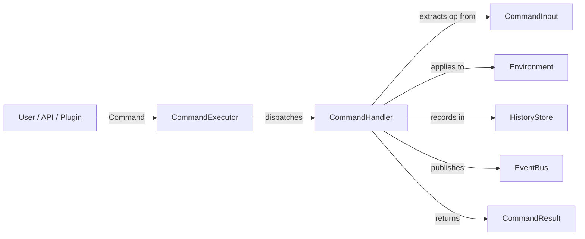

# Creating Command Handlers

This guide shows how to create an App Engine `CommandHandler` for a new environment, bridging domain operations to the App Engine's command execution, history, and event systems.

We'll create a **TableCommandHandler** as a concrete example.

---

## Overview



---

## What is a Command Handler?

A `CommandHandler` is the bridge between the App Engine's generic command system and a specific environment. It:

1. Receives a `CommandInput` containing a type-erased operation
2. Extracts the operation (e.g., `TableOperation`)
3. Applies it to the environment (via `Arc<Mutex<Env>>`)
4. Records a `HistoryEntry` via `EngineRef`
5. Publishes an `Event` via `EngineRef`
6. Returns a `CommandResult` with the outcome

The App Engine's `CommandExecutor` dispatches commands by name to registered handlers. The App Engine never inspects the operation — it passes the `CommandInput` opaquely.

---

## The `CommandHandler` Trait

```rust
pub trait CommandHandler: Send + Sync {
    fn execute(
        &self,
        input: &CommandInput,
        context: &CommandContext,
        engine: &EngineRef,
    ) -> Result<CommandResult, CommandError>;
}
```

| Parameter | Type | Purpose |
|---|---|---|
| `input` | `&CommandInput` | Type-erased operation payload |
| `context` | `&CommandContext` | Execution context (session, etc.) |
| `engine` | `&EngineRef` | Read-only access to App Engine subsystems |

The trait takes `&self` (immutable), so handlers must use interior mutability (`Arc<Mutex<Env>>`) to mutate the environment.

---

## Step 1: Create the Handler Struct

```rust
// src/domain_engine/operations/table_command_handler.rs

use crate::app_engine::capabilities::engine_ref::EngineRef;
use crate::app_engine::commands::command::CommandInput;
use crate::app_engine::commands::command_context::CommandContext;
use crate::app_engine::commands::command_definition::CommandDefinition;
use crate::app_engine::commands::command_executor::CommandHandler;
use crate::app_engine::commands::command_result::CommandResult;
use crate::app_engine::errors::command_error::CommandError;
use crate::app_engine::events::event::Event;
use crate::app_engine::history::history_entry::HistoryEntry;
use crate::domain_foundation::environments::table::{
    Table, TableOperation, TableOutcome,
};
use std::sync::{Arc, Mutex};

pub struct TableCommandHandler {
    table: Arc<Mutex<Table>>,
}

impl TableCommandHandler {
    pub fn new(table: Arc<Mutex<Table>>) -> Self {
        Self { table }
    }

    pub fn definition() -> CommandDefinition {
        CommandDefinition::new(
            "table.operation",
            "Table Operation",
            "Applies a TableOperation to the table environment.",
        )
    }
}
```

---

## Step 2: Implement `CommandHandler`

```rust
impl CommandHandler for TableCommandHandler {
    fn execute(
        &self,
        input: &CommandInput,
        _context: &CommandContext,
        engine: &EngineRef,
    ) -> Result<CommandResult, CommandError> {
        // 1. Extract the operation from typed input
        let operation = input
            .get::<TableOperation>()
            .ok_or_else(|| {
                CommandError::ExecutionFailed(
                    "expected TableOperation in CommandInput".to_string(),
                )
            })?
            .clone();

        // 2. Apply to the shared table (lock + mutate)
        let outcome = {
            let mut table = self
                .table
                .lock()
                .map_err(|e| CommandError::ExecutionFailed(format!("table lock: {e}")))?;
            operation
                .clone()
                .apply(&mut table)
                .map_err(|e| CommandError::ExecutionFailed(e.to_string()))?
        };

        // 3. Record in history via EngineRef
        let entry_name = match &operation {
            TableOperation::InsertRow { .. } => "table.insert_row",
            TableOperation::InsertColumn { .. } => "table.insert_column",
            TableOperation::RemoveRow { .. } => "table.remove_row",
            TableOperation::RemoveColumn { .. } => "table.remove_column",
            TableOperation::SetCellValue { .. } => "table.set_cell_value",
            TableOperation::ClearCell { .. } => "table.clear_cell",
            TableOperation::MoveRow { .. } => "table.move_row",
            TableOperation::MoveColumn { .. } => "table.move_column",
            TableOperation::RenameRow { .. } => "table.rename_row",
            TableOperation::RenameColumn { .. } => "table.rename_column",
            TableOperation::MergeCells { .. } => "table.merge_cells",
            TableOperation::UnmergeCells { .. } => "table.unmerge_cells",
            TableOperation::ClearTable => "table.clear",
        };
        engine
            .history_store
            .append(HistoryEntry::new(entry_name).undoable());

        // 4. Publish event via EngineRef
        let event_name = match &outcome {
            TableOutcome::RowInserted { .. } => "table.row.inserted",
            TableOutcome::ColumnInserted { .. } => "table.column.inserted",
            TableOutcome::RowRemoved { .. } => "table.row.removed",
            TableOutcome::ColumnRemoved { .. } => "table.column.removed",
            TableOutcome::CellValueSet { .. } => "table.cell.value_set",
            TableOutcome::CellCleared { .. } => "table.cell.cleared",
            TableOutcome::RowMoved { .. } => "table.row.moved",
            TableOutcome::ColumnMoved { .. } => "table.column.moved",
            TableOutcome::RowRenamed { .. } => "table.row.renamed",
            TableOutcome::ColumnRenamed { .. } => "table.column.renamed",
            TableOutcome::CellsMerged => "table.cells.merged",
            TableOutcome::CellsUnmerged => "table.cells.unmerged",
            TableOutcome::TableCleared => "table.cleared",
        };
        engine
            .event_bus
            .publish(&Event::new(event_name).with_source("table_command_handler"));

        // 5. Return the outcome as the command result
        Ok(CommandResult::success_with(outcome))
    }
}
```

---

## Step 3: Register the Handler

```rust
use std::sync::{Arc, Mutex};
use app_shell::app_engine::*;
use app_shell::domain_engine::operations::TableCommandHandler;
use app_shell::domain_foundation::environments::table::Table;

// 1. Create shared environment state
let table = Arc::new(Mutex::new(Table::new()));

// 2. Create handler
let handler = TableCommandHandler::new(Arc::clone(&table));

// 3. Register with the App Engine's command executor
let mut engine: AppEngine = AppEngine::new()?;
engine.command_executor_mut().register(
    TableCommandHandler::definition(),
    Box::new(handler),
)?;

// 4. Start the engine
engine.initialize()?;
engine.start()?;

// 5. Execute a command
let cmd = Command::new(
    "table.operation",
    CommandContext::new(ExecutionId::new()),
    CommandInput::new(TableOperation::InsertRow { name: Some("Header".to_string()) }),
);
let result = engine.execute_command(&cmd)?;
assert!(result.is_success());

// 6. Verify
let table_guard = table.lock().unwrap();
assert_eq!(table_guard.row_count(), 1);
```

---

## Step 4: Update `operations/mod.rs`

```rust
// src/domain_engine/operations/mod.rs

pub mod canvas_command_handler;
pub mod layers_command_handler;
pub mod table_command_handler;           // ← ADD
pub mod timeline_command_handler;

pub use canvas_command_handler::CanvasCommandHandler;
pub use layers_command_handler::LayersCommandHandler;
pub use table_command_handler::TableCommandHandler;  // ← ADD
pub use timeline_command_handler::TimelineCommandHandler;
```

---

## EngineRef Capabilities

The `EngineRef` passed to `execute()` provides read-only access to:

| Subsystem | Access | What handlers can do |
|---|---|---|
| `history_store` | `&HistoryStore` | Append entries (`&self` method via Mutex) |
| `event_bus` | `&EventBus` | Publish events (`&self` method) |
| `signal_bus` | `&SignalBus` | Emit signals (`&self` method) |
| `resource_manager` | `&ResourceManager` | Load resources |
| `config_store` | `&ConfigStore` | Read configuration |
| `preferences` | `&Preferences` | Read user preferences |
| `state_manager` | `&StateManager<LifecycleState>` | Read state |
| `command_executor` | `&CommandExecutor` | Check definitions (can't register new — `&` not `&mut`) |
| `scheduler` | `&Scheduler` | Submit tasks |

Handlers **cannot**:
- Register new commands (executor is `&`, not `&mut`)
- Modify state directly (state manager is read-only)
- Access the Domain Engine (App Engine doesn't know about it)

---

## Shared State Pattern

The handler wraps `Arc<Mutex<Environment>>`. The same `Arc` must be shared with the DomainEngine (if used) so both see the same state:

```rust
// Create shared state
let table = Arc::new(Mutex::new(Table::new()));

// Register handler with the App Engine
let handler = TableCommandHandler::new(Arc::clone(&table));
engine.command_executor_mut().register(
    TableCommandHandler::definition(),
    Box::new(handler),
)?;

// The DomainEngine can also use the same Arc (if needed)
// Or the handler can be the sole access point
```

### Lock error handling

If the Mutex is poisoned (a previous thread panicked while holding the lock), `lock()` returns `Err`:

```rust
let mut table = self.table.lock()
    .map_err(|e| CommandError::ExecutionFailed(format!("table lock: {e}")))?;
```

The App Engine's panic isolation (`catch_unwind`) prevents panics from propagating, but a handler's panic inside the lock would still poison it. Convert to a `CommandError` and return it.

---

## Testing

```rust
#[test]
fn table_command_handler_executes_insert() {
    use std::sync::{Arc, Mutex};
    use app_shell::app_engine::commands::command::*;
    use app_shell::app_engine::commands::command_executor::CommandExecutor;
    use app_shell::app_engine::*;
    use app_shell::domain_engine::operations::TableCommandHandler;
    use app_shell::domain_foundation::environments::table::*;

    let table = Arc::new(Mutex::new(Table::new()));
    let handler = TableCommandHandler::new(Arc::clone(&table));

    let mut executor = CommandExecutor::new();
    executor
        .register(TableCommandHandler::definition(), Box::new(handler))
        .unwrap();

    // Verify definition
    assert_eq!(TableCommandHandler::definition().id().as_str(), "table.operation");
    assert_eq!(TableCommandHandler::definition().name(), "Table Operation");

    // Apply operation directly (bypassing command executor for simplicity)
    let mut table_guard = table.lock().unwrap();
    let outcome = TableOperation::InsertRow { name: Some("Test".to_string()) }
        .apply(&mut table_guard)
        .unwrap();
    drop(table_guard);

    let table_guard = table.lock().unwrap();
    assert_eq!(table_guard.row_count(), 1);
}
```

---

## Available Command Handlers

| Handler | Definition ID | Environment |
|---|---|---|
| `CanvasCommandHandler` | `"canvas.operation"` | Canvas2D |
| `TimelineCommandHandler` | `"timeline.operation"` | Timeline |
| `LayersCommandHandler` | `"layers.operation"` | Layers |

Follow the same pattern to create handlers for NodeGraph, Viewport3D, Table, and TextEditor.

---

## Checklist

- [ ] Handler struct created with `Arc<Mutex<Env>>` field
- [ ] `definition()` returns `CommandDefinition` with unique id
- [ ] `CommandHandler::execute()` implemented
- [ ] Operation extracted from `CommandInput::get::<Operation>()`
- [ ] Environment locked and operation applied
- [ ] `HistoryEntry` appended via `engine.history_store`
- [ ] `Event` published via `engine.event_bus`
- [ ] `CommandResult::success_with(outcome)` returned
- [ ] `operations/mod.rs` updated with module + re-export
- [ ] Handler tested (definition + execution)
- [ ] All operation/outcome variants covered in match arms

---

## Next Steps

- [01-creating-environment.md](01-creating-environment.md) — Creating a new environment (do this first).
- [09-domain-engine-integration.md](09-domain-engine-integration.md) — Integrating with DomainEngine.
- [14-app-engine-integration.md](../14-app-engine-integration.md) — App Engine integration reference.
- [18-public-api-reference.md](../18-public-api-reference.md) — Complete type listing.