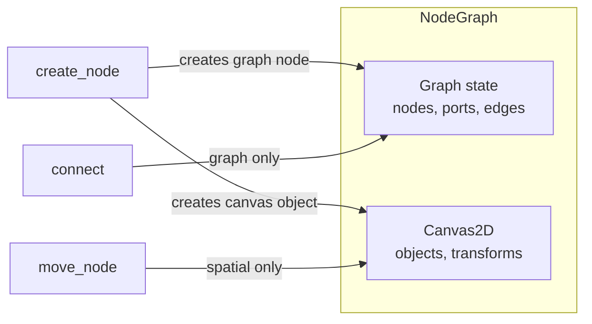

# Composition Patterns

This guide explains how to compose environments — when to do it, how to do it, and what to avoid. The only composition in the foundation is `NodeGraph` owning a `Canvas2D`, but the pattern generalizes.

---

## What Composition Is

**Composition** means one environment owns an instance of another environment and delegates some operations to it. The composing environment handles its own domain semantics; the composed environment handles a separate concern.



---

## What Composition Is NOT

| Pattern | Why not |
|---|---|
| Shared base trait | Environments don't share a base. Each owns its types. |
| Interface inheritance | No `Environment` trait to implement. |
| Mixin / trait composition | Environments are concrete structs, not trait-based. |
| Dynamic dispatch | Composition is static (owned fields), not dynamic. |
| Universal `ObjectId` | Each environment has its own id type (`ObjectId`, `TrackId`, `LayerId`, etc.). |

---

## When to Compose

Compose when:

1. **Two genuinely separate concerns exist** — e.g., graph connectivity and spatial placement are different problems.
2. **One concern naturally owns the other** — NodeGraph needs spatial placement; it owns a Canvas.
3. **Operations on one don't affect the other** — moving a node doesn't change edges; connecting ports doesn't change positions.
4. **The composed environment is useful on its own** — Canvas2D works independently of NodeGraph.

**Don't compose when:**

- The "composition" is just sharing types (use the same types directly).
- The two environments are always used together (consider merging).
- One environment is just a helper (it's a utility, not a composition).

---

## The NodeGraph → Canvas2D Pattern

### Step 1: Own the Composed Environment

```rust
pub struct NodeGraph {
    nodes: HashMap<NodeId, Node>,
    ports: HashMap<PortId, Port>,
    edges: HashMap<EdgeId, Edge>,

    // ← COMPOSED: NodeGraph owns a Canvas2D instance
    canvas: Canvas,

    next_node_id: u64,
    next_port_id: u64,
    next_edge_id: u64,
}
```

### Step 2: Link Identities

Each node in the composing environment stores a reference to its spatial representation:

```rust
pub struct Node {
    pub id: NodeId,
    pub name: String,

    // ← LINK: references a Canvas2D ObjectId
    pub canvas_object: Option<ObjectId>,

    pub(crate) input_ports: Vec<PortId>,
    pub(crate) output_ports: Vec<PortId>,
}
```

The link is `Option<ObjectId>` because a node might not have spatial placement (purely logical node).

### Step 3: Delegate Operations

When creating a node, create both the graph entity and the spatial entity:

```rust
pub fn create_node(&mut self, name: String, transform: Transform) -> NodeId {
    let id = NodeId::from_raw(self.next_node_id);
    self.next_node_id += 1;

    // Create spatial representation (delegated to Canvas2D)
    let canvas_id = self.canvas.create_object(transform);

    // Create graph entity (owned by NodeGraph)
    let node = Node::new(id, name, Some(canvas_id));
    self.nodes.insert(id, node);
    id
}
```

When moving a node, delegate to Canvas2D:

```rust
pub fn move_node(&mut self, id: NodeId, translation: Vec2) -> Result<Transform, NodeGraphError> {
    let node = self.nodes.get(&id)
        .ok_or(NodeGraphError::NodeNotFound { id })?;

    // Delegate spatial operation to Canvas2D
    let obj_id = node.canvas_object
        .ok_or(NodeGraphError::NoCanvasObject { id })?;

    Ok(self.canvas.set_translation(obj_id, translation)?)
}
```

### Step 4: Separate Concerns

Graph operations don't touch the canvas; spatial operations don't touch the graph:

```rust
// Graph-only: connect ports — doesn't touch canvas
pub fn connect(&mut self, source: PortId, target: PortId) -> Result<EdgeId, NodeGraphError> {
    // ... validation ...
    let id = EdgeId::from_raw(self.next_edge_id);
    self.edges.insert(id, Edge::new(id, source, target));
    Ok(id)
    // No canvas involvement
}

// Spatial-only: move node — doesn't touch edges
pub fn move_node(&mut self, id: NodeId, translation: Vec2) -> Result<Transform, NodeGraphError> {
    // Only touches canvas, never touches edges or ports
}
```

### Step 5: Cascade Removes

When removing a node, cascade to both concerns:

```rust
pub fn remove_node(&mut self, id: NodeId) -> Result<NodeRemovedData, NodeGraphError> {
    let node = self.nodes.get(&id)
        .ok_or(NodeGraphError::NodeNotFound { id })?;

    // 1. Collect ports (graph concern)
    let port_ids: Vec<PortId> = node.input_ports.iter()
        .chain(node.output_ports.iter())
        .copied()
        .collect();

    // 2. Collect connected edges (graph concern)
    let edge_ids: Vec<EdgeId> = self.edges.iter()
        .filter(|(_, e)| port_ids.contains(&e.source) || port_ids.contains(&e.target))
        .map(|(eid, _)| *eid)
        .collect();

    // 3. Remove canvas object (spatial concern — delegated to Canvas2D)
    let canvas_object = match node.canvas_object {
        Some(obj_id) => Some(self.canvas.remove_object(obj_id)?),
        None => None,
    };

    // 4. Remove edges (graph concern)
    let mut removed_edges = Vec::new();
    for eid in &edge_ids {
        if let Some(e) = self.edges.remove(eid) {
            removed_edges.push(e);
        }
    }

    // 5. Remove ports (graph concern)
    let mut removed_ports = Vec::new();
    for pid in &port_ids {
        if let Some(p) = self.ports.remove(pid) {
            removed_ports.push(p);
        }
    }

    // 6. Remove node (graph concern)
    let removed_node = self.nodes.remove(&id)
        .ok_or(NodeGraphError::NodeNotFound { id })?;

    Ok(NodeRemovedData {
        node: removed_node,
        ports: removed_ports,
        edges: removed_edges,
        canvas_object,
    })
}
```

### Step 6: Expose the Composed Environment

Provide a getter so external code can inspect spatial state:

```rust
/// Borrow the internal Canvas2D (read-only).
pub fn canvas(&self) -> &Canvas {
    &self.canvas
}
```

This allows tests and Domain Engines to verify spatial state without going through NodeGraph methods.

### Step 7: Clear Both

```rust
pub fn clear(&mut self) {
    self.nodes.clear();
    self.ports.clear();
    self.edges.clear();
    self.canvas.clear();  // ← Clear composed environment too
}
```

---

## Example: Composing Timeline into a New Environment

Suppose you want a `Storyboard` environment that composes `Timeline` for temporal editing plus its own panel layout:

```rust
pub struct Storyboard {
    panels: HashMap<PanelId, Panel>,
    timeline: Timeline,  // ← Composed

    next_panel_id: u64,
}

pub struct Panel {
    pub id: PanelId,
    pub name: String,
    pub clip_id: Option<ClipId>,  // ← Link to Timeline
}

impl Storyboard {
    pub fn create_panel(&mut self, name: String) -> PanelId {
        let id = PanelId::from_raw(self.next_panel_id);
        self.next_panel_id += 1;
        self.panels.insert(id, Panel::new(id, name));
        id
    }

    pub fn link_to_clip(&mut self, panel_id: PanelId, clip_id: ClipId) -> Result<(), StoryboardError> {
        let panel = self.panels.get_mut(&panel_id)
            .ok_or(StoryboardError::PanelNotFound { id: panel_id })?;
        panel.clip_id = Some(clip_id);
        Ok(())
    }

    pub fn timeline(&self) -> &Timeline {
        &self.timeline  // ← Expose composed environment
    }

    pub fn timeline_mut(&mut self) -> &mut Timeline {
        &mut self.timeline
    }
}
```

The `Storyboard` handles panel layout; the `Timeline` handles temporal organization. They're separate concerns linked by `clip_id`.

---

## Anti-Patterns to Avoid

### 1. Shared base trait

```rust
// ❌ DON'T
pub trait Environment {
    fn len(&self) -> usize;
    fn clear(&mut self);
}

impl Environment for Canvas { ... }
impl Environment for Timeline { ... }
```

Canvas2D's `len()` counts objects; Timeline's counts tracks. Forcing them into a shared trait creates a meaningless abstraction.

### 2. Universal identity

```rust
// ❌ DON'T
pub struct UniversalObjectId(u64);

// Canvas, Timeline, Layers all use UniversalObjectId
```

Each environment has different identity semantics. `ObjectId` and `TrackId` are different types on purpose.

### 3. Coupled operations

```rust
// ❌ DON'T
// Moving a node also changes graph connectivity
pub fn move_node_and_reconnect(&mut self, id: NodeId, pos: Vec2) {
    self.canvas.set_translation(id.canvas_object, pos);
    self.edges.reconnect_based_on_proximity(pos);  // ← Coupling!
}
```

Spatial and graph operations should be separate. Coupling them makes the composition fragile.

### 4. Importing the composed environment's types externally

```rust
// ❌ DON'T
// External code needs to know NodeGraph uses Canvas2D internally
let transform = graph.canvas().get(obj_id).unwrap().transform;
```

Instead, provide dedicated methods:

```rust
// ✅ DO
let transform = graph.node_transform(node_id)?;
```

---

## Testing Composition

Test that spatial and graph operations are independent:

```rust
#[test]
fn move_node_doesnt_affect_graph() {
    let mut graph = NodeGraph::new();
    let a = graph.create_node("A".into(), Transform::identity());
    let b = graph.create_node("B".into(), Transform::identity());
    let out_a = graph.add_output_port(a, "out".into(), "f".into()).unwrap();
    let in_b = graph.add_input_port(b, "in".into(), "f".into()).unwrap();
    graph.connect(out_a, in_b).unwrap();

    let edge_count_before = graph.edge_count();

    // Move a node — should NOT affect edges
    graph.move_node(a, Vec2::new(100.0, 100.0)).unwrap();

    assert_eq!(graph.edge_count(), edge_count_before);
}

#[test]
fn connect_doesnt_affect_spatial() {
    let mut graph = NodeGraph::new();
    let a = graph.create_node("A".into(), Transform::identity());
    let b = graph.create_node("B".into(), Transform::identity());

    let transform_before = graph.node_transform(a).unwrap();

    let out_a = graph.add_output_port(a, "out".into(), "f".into()).unwrap();
    let in_b = graph.add_input_port(b, "in".into(), "f".into()).unwrap();
    graph.connect(out_a, in_b).unwrap();

    // Connecting should NOT change spatial state
    assert_eq!(graph.node_transform(a).unwrap(), transform_before);
}
```

---

## Checklist

- [ ] Owning environment has a field of the composed type
- [ ] Linking field on the composing type (`Option<ComposedId>`)
- [ ] Create operation delegates to composed environment
- [ ] Spatial operations delegate to composed environment
- [ ] Graph/domain operations don't touch composed environment
- [ ] Remove cascades to both concerns
- [ ] Clear cascades to both concerns
- [ ] Getter exposes composed environment (`pub fn composed(&self) -> &Composed`)
- [ ] Tests verify independence of concerns

---

## Next Steps

- [01-creating-environment.md](01-creating-environment.md) — Creating a new environment.
- [02-adding-operations.md](02-adding-operations.md) — Adding operations to an existing environment.
- [07-node-graph.md](../07-node-graph.md) — NodeGraph reference (the composition example).
- [02-architecture.md](../02-architecture.md) — Architecture and composition rules.