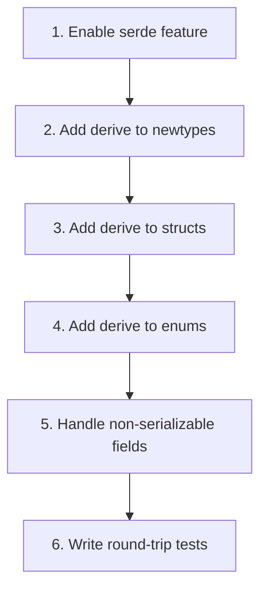

# Adding Serde Support

This guide shows how to add serialization support to new or existing types in the Domain Foundation, including newtypes, structs, enums, and non-serializable fields.

---

## Overview



---

## Enabling the Serde Feature

The Domain Foundation uses a Cargo feature flag for optional serde support:

```toml
# Cargo.toml
[features]
serde = ["dep:serde"]

[dependencies]
serde = { version = "1", features = ["derive"], optional = true }
```

When the `serde` feature is enabled, all types with conditional derives gain `Serialize` and `Deserialize`. When disabled, serde is not compiled — zero overhead.

---

## Conditional Derive Pattern

All serde derives use `#[cfg_attr]` so they're only active with the feature:

```rust
#[cfg_attr(feature = "serde", derive(serde::Serialize, serde::Deserialize))]
#[derive(Debug, Clone, PartialEq)]
pub struct MyType {
    pub field: i32,
}
```

Without the feature: only `Debug`, `Clone`, `PartialEq` are derived.
With the feature: all four are derived.

---

## Step 1: Newtypes — `serde(transparent)`

Newtypes wrap a single value. Use `transparent` to serialize the inner value directly (not as a struct with one field):

```rust
#[cfg_attr(feature = "serde", derive(serde::Serialize, serde::Deserialize))]
#[cfg_attr(feature = "serde", serde(transparent))]
#[derive(Debug, Clone, Copy, PartialEq, Eq, Hash)]
pub struct MyId(u64);
```

### JSON before and after

```json
// Without transparent (treats as struct):
{"0": 42}

// With transparent (treats as inner value):
42
```

### When to use `transparent`

| Type | Use `transparent`? | Reason |
|---|---|---|
| `ObjectId(u64)` | ✅ | Single field, serialize as `u64` |
| `TrackId(u64)` | ✅ | Same |
| `Position(u32)` | ✅ | Same |
| `Time(f64)` | ✅ | Same |
| `ClipId { raw: u64, track: TrackId }` | ❌ | Multiple fields, serialize as struct |
| `CellId { row: RowId, column: ColumnId }` | ❌ | Multiple fields |

---

## Step 2: Structs — Derive on the Struct

For structs with public or private fields:

```rust
#[cfg_attr(feature = "serde", derive(serde::Serialize, serde::Deserialize))]
#[derive(Debug, Clone, PartialEq, Default)]
pub struct MyEnvironment {
    objects: HashMap<MyId, MyObject>,  // Private field — serde accesses within module
    order: Vec<MyId>,
    next_id: u64,
}
```

Serde can access private fields within the same module (it generates code inside the module). No special attributes needed for private fields.

---

## Step 3: Enums — Derive on the Enum

```rust
#[cfg_attr(feature = "serde", derive(serde::Serialize, serde::Deserialize))]
#[derive(Debug, Clone, PartialEq)]
pub enum MyOperation {
    Create { transform: MyTransform },
    Remove { id: MyId },
    Clear,
}
```

Each variant serializes as a struct with a tag:

```json
// Create
{"Create": {"transform": {"translation": {"x": 1.0, "y": 2.0}, "rotation": 0.0, "scale": {"x": 1.0, "y": 1.0}}}}

// Remove
{"Remove": {"id": 0}}

// Clear
"Clear"
```

---

## Step 4: Non-Serializable Fields

Some fields can't be serialized. Use `#[serde(skip)]` or `#[serde(skip, default = "function")]`:

### Closures (`Arc<dyn Fn...>`)

Closures can't be serialized. Skip the field and provide a custom default:

```rust
#[cfg(feature = "serde")]
fn default_effect() -> EffectFn {
    Arc::new(|_| EffectOutcome::NoChange)
}

#[cfg_attr(feature = "serde", derive(serde::Serialize, serde::Deserialize))]
#[derive(Clone)]
pub struct RelationDefinition {
    pub source: Endpoint,
    pub target: Endpoint,
    pub trigger: Trigger,
    pub propagation: PropagationMode,
    pub priority: i32,

    // ← Skip on serialize, use no-op on deserialize
    #[cfg_attr(feature = "serde", serde(skip, default = "default_effect"))]
    pub effect: EffectFn,
}
```

### `AtomicU64`

`AtomicU64` doesn't implement `Serialize` or `Deserialize`. Skip it:

```rust
#[cfg_attr(feature = "serde", derive(serde::Serialize, serde::Deserialize))]
#[derive(Debug, Default)]
pub struct RelationRegistry {
    #[cfg_attr(feature = "serde", serde(skip))]
    next_id: AtomicU64,  // ← Not serialized; deserializes as default (0)

    definitions: HashMap<RelationId, RelationDefinition>,
    by_source: HashMap<PropertyId, Vec<RelationId>>,
    by_target: HashMap<PropertyId, Vec<RelationId>>,
    graph: DependencyGraph,
}
```

After deserialization, `next_id` is 0. If existing definitions have ids >= 0, the next `register()` call will advance `next_id` past them. This works as long as you register new relations after deserialization.

### `Mutex`

`Mutex<T>` doesn't implement `Serialize`/`Deserialize`. Types containing `Mutex` (like `HistoryStore`, `EventBus`, `SignalBus`) are **not serializable**. Don't add serde derives to them.

---

## Step 5: Field-Level Attributes

| Attribute | When to use | Effect |
|---|---|---|
| `#[serde(skip)]` | Field can't be serialized | Field uses `Default` on deserialize |
| `#[serde(skip, default = "fn")]` | Field can't be serialized and `Default` isn't suitable | Field uses custom function on deserialize |
| `#[serde(rename = "name")]` | JSON field name should differ from Rust name | Renames in JSON |
| `#[serde(skip_serializing_if = "Option::is_none")]` | Optional field, omit from JSON when `None` | Smaller JSON output |

---

## Known Limitations

### `HashMap<CellId, CellValue>` in Table

`serde_json` requires string keys. `CellId` is a struct (`{ row: RowId, column: ColumnId }`), not a string:

```rust
// This fails with serde_json:
let json = serde_json::to_string(&table).unwrap();
// Error: "key must be a string"
```

**Workarounds:**

1. **Use `bincode`** (binary format, supports struct keys):

```toml
[dev-dependencies]
bincode = "1"
```

```rust
let bytes = bincode::serialize(&table).unwrap();
let restored: Table = bincode::deserialize(&bytes).unwrap();
assert_eq!(table, restored);
```

2. **Custom serializer** (convert `CellId` to a string like `"r1c2"`)

3. **Skip the field** (serialize only structure, not cells):

```rust
#[cfg_attr(feature = "serde", serde(skip))]
cells: HashMap<CellId, CellValue>,
```

### `RelationDefinition::effect` deserializes as no-op

Closures can't be serialized. After deserialization, `effect` is `Arc::new(|_| EffectOutcome::NoChange)`. The Domain Engine must re-register the real effect:

```rust
// After deserializing a RelationRegistry
for id in registry.relation_ids() {
    let def = registry.get_definition(id).unwrap();
    let real_effect = my_effect_for(&def.source, &def.target);
    // Re-register with the real effect
    registry.unregister(id);
    registry.register(
        RelationDefinitionBuilder::new(def.source, def.target)
            .trigger(def.trigger)
            .propagation(def.propagation)
            .priority(def.priority)
            .effect(real_effect)
            .build(),
    );
}
```

---

## Step 6: Round-Trip Tests

Add `serde_json` as a dev-dependency:

```toml
[dev-dependencies]
serde_json = "1"
```

Create `tests/domain_foundation_tests/serde_roundtrip_test.rs`:

```rust
#[cfg(feature = "serde")]
#[test]
fn my_type_roundtrip() {
    let original = MyType { /* ... */ };

    let json = serde_json::to_string(&original).unwrap();
    let restored: MyType = serde_json::from_str(&json).unwrap();

    assert_eq!(original, restored);
}
```

### Update `main.rs`

```rust
#[cfg(feature = "serde")]
mod serde_roundtrip_test;
```

### What to test

| Type | What survives round-trip |
|---|---|
| Environment container | All fields (objects, order, next_id) |
| Operation enum | All variants |
| Outcome enum | All variants with undo data |
| Id newtypes | The inner value |
| Transform / Vec2 | All components |
| Error enum | All variants |

### Test with `PartialEq`

Round-trip tests rely on `PartialEq` to verify equality. Ensure the type derives `PartialEq`:

```rust
#[derive(Debug, Clone, PartialEq)]  // ← Required for assert_eq!
#[cfg_attr(feature = "serde", derive(serde::Serialize, serde::Deserialize))]
pub struct MyType { ... }
```

---

## Complete Example

```rust
// Id newtype
#[cfg_attr(feature = "serde", derive(serde::Serialize, serde::Deserialize))]
#[cfg_attr(feature = "serde", serde(transparent))]
#[derive(Debug, Clone, Copy, PartialEq, Eq, Hash)]
pub struct MyId(u64);

// Data struct
#[cfg_attr(feature = "serde", derive(serde::Serialize, serde::Deserialize))]
#[derive(Debug, Clone, PartialEq)]
pub struct MyObject {
    pub id: MyId,
    pub name: String,
    pub value: f64,
}

// Operation enum
#[cfg_attr(feature = "serde", derive(serde::Serialize, serde::Deserialize))]
#[derive(Debug, Clone, PartialEq)]
pub enum MyOperation {
    Create { name: String, value: f64 },
    Remove { id: MyId },
    Clear,
}

// Outcome enum
#[cfg_attr(feature = "serde", derive(serde::Serialize, serde::Deserialize))]
#[derive(Debug, Clone, PartialEq)]
pub enum MyOutcome {
    Created { id: MyId },
    Removed { object: MyObject },
    Cleared { count: usize },
}

// Container with non-serializable field
#[cfg_attr(feature = "serde", derive(serde::Serialize, serde::Deserialize))]
#[derive(Debug, Clone, PartialEq, Default)]
pub struct MyEnvironment {
    objects: HashMap<MyId, MyObject>,
    next_id: u64,
    // No Mutex, no AtomicU64, no closures — all serializable
}

// Error enum
#[cfg_attr(feature = "serde", derive(serde::Serialize, serde::Deserialize))]
#[derive(Debug, Clone, PartialEq, Eq)]
pub enum MyError {
    NotFound { id: MyId },
}
```

---

## Checklist

- [ ] `serde` feature added to `Cargo.toml` (if new crate/module)
- [ ] `#[cfg_attr(feature = "serde", derive(...))]` on every serializable type
- [ ] `#[cfg_attr(feature = "serde", serde(transparent))]` on newtypes with single field
- [ ] `#[cfg_attr(feature = "serde", serde(skip))]` on `AtomicU64` fields
- [ ] `#[cfg_attr(feature = "serde", serde(skip, default = "fn"))]` on closure fields
- [ ] `PartialEq` derived on all types (for round-trip tests)
- [ ] `serde_json` added as dev-dependency
- [ ] Round-trip test added to `serde_roundtrip_test.rs`
- [ ] `main.rs` updated with `#[cfg(feature = "serde")] mod serde_roundtrip_test;`
- [ ] Known limitations documented (HashMap with struct keys, closure fields)

---

## Next Steps

- [01-creating-environment.md](01-creating-environment.md) — Creating a new environment (includes serde).
- [08-writing-tests.md](08-writing-tests.md) — Writing tests (includes serde round-trip).
- [16-serialization.md](../16-serialization.md) — Serialization reference.
- [18-public-api-reference.md](../18-public-api-reference.md) — Complete type listing with serde attributes.