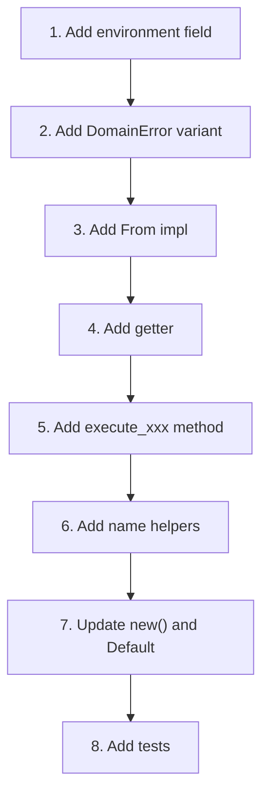

# Integrating with DomainEngine

This guide shows how to add a new environment to the `DomainEngine` — adding the field, getter, `execute_*` method, name helpers, error variant, and tests.

We'll use the **Measurement** environment from [01-creating-environment.md](01-creating-environment.md) as a concrete example.

---

## Overview



---

## What the DomainEngine Does

The `DomainEngine` wraps each environment with:

1. **History recording** — every operation creates a `HistoryEntry`
2. **Event publication** — every operation publishes an `Event` via `EventBus`
3. **Signal emission** — every operation emits a `Signal` via `SignalBus` (if configured)
4. **Transaction support** — entries marked with `TransactionId` for compound undo
5. **Auto-rollback** — if `execute_*` fails during a transaction, the transaction is rolled back
6. **Dirty tracking** — `mark_saved()` / `is_dirty()` based on history position

The DomainEngine **does not** define what operations mean — that's the environment's job via `operation.apply(&mut env)`.

---

## Step 1: Add Environment Field

In `src/domain_engine/mod.rs`, add the field to the `DomainEngine` struct:

```rust
pub struct DomainEngine {
    // ... existing environments ...
    canvas: Canvas,
    timeline: Timeline,
    layers: Layers,
    node_graph: NodeGraph,
    table: Table,
    document: Document,
    scene: Scene,

    measurement: Measurement,  // ← ADD

    // ... App Engine integration ...
    history: HistoryStore,
    transaction_manager: TransactionManager,
    event_bus: EventBus,
    signal_bus: Option<Arc<SignalBus>>,
    active_transaction: Option<TransactionId>,
    transaction_start_position: usize,
    executed_canvas: Vec<ExecutedCanvasOperation>,
    saved_position: usize,
    max_history: usize,
    compound_depth: usize,
    events: Vec<Event>,
}
```

Add the import at the top of the file:

```rust
use crate::domain_foundation::environments::measurement::{
    Measurement, MeasurementError, MeasurementOperation, MeasurementOutcome,
};
```

---

## Step 2: Add DomainError Variant

```rust
#[derive(Debug)]
pub enum DomainError {
    Canvas(CanvasError),
    Timeline(TimelineError),
    Layers(LayersError),
    NodeGraph(NodeGraphError),
    Table(TableError),
    TextEditor(TextEditorError),
    Viewport3D(Viewport3DError),

    Measurement(MeasurementError),  // ← ADD
}
```

---

## Step 3: Add `From` Impl

```rust
impl From<MeasurementError> for DomainError {
    fn from(e: MeasurementError) -> Self {
        Self::Measurement(e)
    }
}
```

Update the `Display` impl:

```rust
impl std::fmt::Display for DomainError {
    fn fmt(&self, f: &mut std::fmt::Formatter<'_>) -> std::fmt::Result {
        match self {
            DomainError::Canvas(e) => write!(f, "canvas: {e}"),
            DomainError::Timeline(e) => write!(f, "timeline: {e}"),
            // ... existing ...
            DomainError::Measurement(e) => write!(f, "measurement: {e}"),  // ← ADD
        }
    }
}
```

---

## Step 4: Add Getter

```rust
impl DomainEngine {
    // ... existing getters ...

    /// Measurement environment access.
    pub fn measurement(&self) -> &Measurement {
        &self.measurement
    }
}
```

---

## Step 5: Add `execute_measurement` Method

This is the core integration. Follow the same pattern as all other `execute_*` methods:

```rust
impl DomainEngine {
    // ... existing execute_* methods ...

    /// Execute a measurement operation with history, events, and signals.
    pub fn execute_measurement(
        &mut self,
        operation: MeasurementOperation,
    ) -> Result<MeasurementOutcome, DomainError> {
        // 1. Apply the operation to the environment
        let outcome = operation.clone().apply(&mut self.measurement)
            .map_err(|e| {
                let err: DomainError = e.into();
                self.check_auto_rollback(&err);  // Auto-rollback if in transaction
                err
            })?;

        // 2. Create a history entry
        let name = measurement_op_name(&operation);
        let mut entry = HistoryEntry::new(name).undoable();

        // 3. Mark with transaction id if active
        if let Some(tx_id) = self.active_transaction {
            entry = entry.with_transaction(tx_id);
        }
        self.history.append(entry);

        // 4. Publish event and emit signal
        self.publish(
            measurement_outcome_event(&outcome),
            measurement_outcome_signal(&outcome),
        );

        Ok(outcome)
    }
}
```

### What each step does

| Step | What | Why |
|---|---|---|
| 1. Apply | `operation.apply(&mut env)` | Execute the operation on the environment |
| 1b. Error | `map_err` + `check_auto_rollback` | If in transaction, rollback on failure |
| 2. History | `HistoryEntry::new(name).undoable()` | Record for undo/redo |
| 3. Transaction | `.with_transaction(tx_id)` | Group entries for compound undo |
| 4. Publish | `self.publish(event_name, signal_name)` | Notify EventBus + SignalBus + accumulate |

---

## Step 6: Add Name Helpers

Add private functions that map operations and outcomes to event/signal name strings:

```rust
fn measurement_op_name(op: &MeasurementOperation) -> &'static str {
    match op {
        MeasurementOperation::Create { .. } => "measurement.create",
        MeasurementOperation::Remove { .. } => "measurement.remove",
        MeasurementOperation::Rename { .. } => "measurement.rename",
        MeasurementOperation::MoveEndpoints { .. } => "measurement.move",
        MeasurementOperation::Clear => "measurement.clear",
    }
}

fn measurement_outcome_event(outcome: &MeasurementOutcome) -> &'static str {
    match outcome {
        MeasurementOutcome::Created { .. } => "measurement.created",
        MeasurementOutcome::Removed { .. } => "measurement.removed",
        MeasurementOutcome::Renamed { .. } => "measurement.renamed",
        MeasurementOutcome::Moved { .. } => "measurement.moved",
        MeasurementOutcome::Cleared { .. } => "measurement.cleared",
    }
}

fn measurement_outcome_signal(outcome: &MeasurementOutcome) -> &'static str {
    match outcome {
        MeasurementOutcome::Created { .. } => "measurement.created",
        MeasurementOutcome::Removed { .. } => "measurement.removed",
        _ => "measurement.changed",
    }
}
```

### Naming conventions

| Level | Format | Example |
|---|---|---|
| History entry | `<env>.<action>` | `measurement.create` |
| Event | `<env>.<entity>.<action>` | `measurement.created` |
| Signal | Same as event (or `<env>.changed`) | `measurement.created` |

---

## Step 7: Update `new()` and `Default`

```rust
impl DomainEngine {
    pub fn new() -> Self {
        Self {
            // ... existing ...
            canvas: Canvas::new(),
            timeline: Timeline::new(),
            // ... etc ...

            measurement: Measurement::new(),  // ← ADD

            // ... App Engine integration ...
            history: HistoryStore::new(),
            // ... etc ...
        }
    }
}
```

---

## Step 8: Tests

Add to `tests/domain_foundation_tests/domain_operation_integration_test.rs`:

```rust
#[test]
fn execute_measurement_through_domain_engine() {
    use app_shell::domain_foundation::environments::measurement::*;
    use app_shell::domain_foundation::environments::canvas_2d::Vec2;

    let mut engine = DomainEngine::new();

    let outcome = engine.execute_measurement(MeasurementOperation::Create {
        start: Vec2::new(0.0, 0.0),
        end: Vec2::new(10.0, 0.0),
        label: "Distance A".to_string(),
    }).unwrap();

    match outcome {
        MeasurementOutcome::Created { id } => {
            assert!(engine.measurement().contains(id));
        }
        other => panic!("expected Created, got {other:?}"),
    }

    // Event was published
    assert_eq!(engine.events().len(), 1);

    // History was recorded
    assert_eq!(engine.history().position(), 1);

    // Undo removes the measurement
    engine.undo().unwrap();
    assert_eq!(engine.measurement().len(), 0);
}

#[test]
fn execute_measurement_error_auto_rollback() {
    use app_shell::domain_foundation::environments::measurement::*;

    let mut engine = DomainEngine::new();

    engine.begin_transaction();
    engine.execute_measurement(MeasurementOperation::Create {
        start: Vec2::new(0.0, 0.0),
        end: Vec2::new(5.0, 0.0),
        label: "Test".to_string(),
    }).unwrap();

    // This fails — measurement doesn't exist
    let err = engine.execute_measurement(MeasurementOperation::Remove {
        id: MeasurementId::from_raw(999),
    }).unwrap_err();

    assert!(matches!(err, DomainError::Measurement(MeasurementError::NotFound { .. })));

    // Transaction was auto-rolled back
    assert!(!engine.in_transaction());
    assert_eq!(engine.measurement().len(), 0);
}

#[test]
fn measurement_dirty_tracking() {
    use app_shell::domain_foundation::environments::measurement::*;
    use app_shell::domain_foundation::environments::canvas_2d::Vec2;

    let mut engine = DomainEngine::new();
    engine.mark_saved();
    assert!(!engine.is_dirty());

    engine.execute_measurement(MeasurementOperation::Create {
        start: Vec2::zero(),
        end: Vec2::new(1.0, 0.0),
        label: "x".to_string(),
    }).unwrap();

    assert!(engine.is_dirty());

    engine.mark_saved();
    assert!(!engine.is_dirty());
}
```

---

## What the DomainEngine Does NOT Do

| Concern | Owner |
|---|---|
| Undo state reversal for non-Canvas environments | Domain Engine (the real one) — currently only Canvas2D state is reversed on undo |
| Define what operations mean | The environment's `apply()` method |
| Persist to files | App Engine (HistoryStore backend) |
| Handle UI refresh | UI Layer (subscribes to signals) |

### Undo limitation

The current `DomainEngine` only reverses **Canvas2D** state on undo (via the `executed_canvas` parallel list). For other environments, the `HistoryStore` position changes but the environment state isn't reversed. A real Domain Engine would extend this pattern to all environments.

---

## Checklist

- [ ] Environment field added to `DomainEngine` struct
- [ ] Import added at top of file
- [ ] `DomainError` variant added
- [ ] `From<EnvError> for DomainError` impl added
- [ ] `Display` impl updated
- [ ] Getter method added (`pub fn measurement(&self) -> &Measurement`)
- [ ] `execute_measurement()` method added (with history, events, signals, auto-rollback)
- [ ] Name helper functions added (`op_name`, `outcome_event`, `outcome_signal`)
- [ ] `new()` updated with `measurement: Measurement::new()`
- [ ] Integration tests added (execute, undo, error, dirty tracking)
- [ ] `main.rs` updated with test modules

---

## Next Steps

- [01-creating-environment.md](01-creating-environment.md) — Create the environment first.
- [05-command-handlers.md](05-command-handlers.md) — Create a command handler for the App Engine.
- [10-cross-environment-ops.md](10-cross-environment-ops.md) — Cross-environment compound operations.
- [13-domain-engine-integration.md](../13-domain-engine-integration.md) — DomainEngine reference.