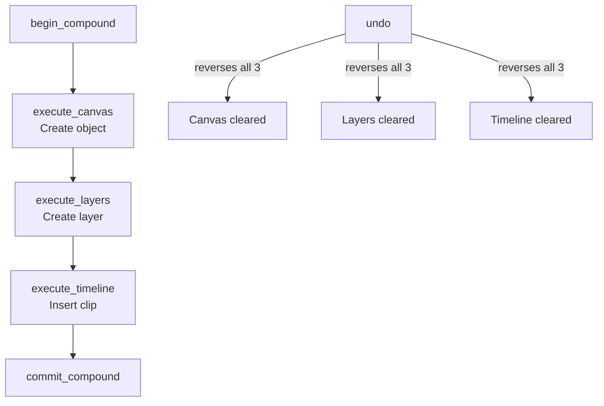

# Cross-Environment Operations

This guide shows how to group operations across multiple environments into a single undoable unit using compound operations.

---

## Overview



A **compound operation** groups multiple `execute_*` calls across different environments. Undo reverses all of them as a single unit. This is useful when a user action logically spans multiple environments — e.g., "create a shape" might create a canvas object, a layer, and a timeline keyframe.

---

## Transactions vs Compound Operations

| Feature | Transaction | Compound |
|---|---|---|
| Purpose | Group operations for undo | Same, with nesting |
| API | `begin_transaction()` / `commit_transaction()` | `begin_compound()` / `commit_compound()` |
| Nesting | Not supported | Supported (`compound_depth` counter) |
| Rollback | `rollback_transaction()` | `rollback_compound()` |
| Implementation | Uses `TransactionManager` directly | Wraps transactions with depth counter |

Compound operations use transactions internally. The `compound_depth` counter allows nesting: the outermost `commit_compound` triggers the actual `commit_transaction`.

---

## Basic Usage

```rust
use app_shell::domain_engine::DomainEngine;
use app_shell::domain_foundation::environments::canvas_2d::*;
use app_shell::domain_foundation::environments::layers::*;
use app_shell::domain_foundation::environments::timeline::*;

let mut engine = DomainEngine::new();

// Start a compound operation
engine.begin_compound();

// Execute across multiple environments
engine.execute_canvas(CanvasOperation::Create {
    transform: Transform::identity(),
}).unwrap();

engine.execute_layers(LayersOperation::CreateLayer {
    name: "Shape Layer".to_string(),
}).unwrap();

engine.execute_timeline(TimelineOperation::CreateTrack).unwrap();

// Commit — all three are now one undoable unit
engine.commit_compound();

// Verify state
assert_eq!(engine.canvas().len(), 1);
assert_eq!(engine.layers().len(), 1);
assert_eq!(engine.timeline().track_count(), 1);

// One undo reverses ALL three
engine.undo().unwrap();

assert_eq!(engine.canvas().len(), 0);
assert_eq!(engine.layers().len(), 0);
assert_eq!(engine.timeline().track_count(), 0);
```

---

## How It Works Internally

### `begin_compound`

```rust
pub fn begin_compound(&mut self) -> TransactionId {
    self.compound_depth += 1;
    if self.compound_depth == 1 {
        // Outermost compound — start a transaction
        self.begin_transaction();
    }
    self.active_transaction.unwrap()
}
```

Each `execute_*` call during the compound creates a `HistoryEntry` with `.with_transaction(tx_id)`.

### `commit_compound`

```rust
pub fn commit_compound(&mut self) -> Option<TransactionId> {
    if self.compound_depth > 0 {
        self.compound_depth -= 1;
        if self.compound_depth == 0 {
            // Outermost compound — commit the transaction
            self.commit_transaction()
        } else {
            // Nested — just return the active tx id
            self.active_transaction
        }
    } else {
        None
    }
}
```

### Undo

When `undo()` is called, the `HistoryStore` checks the `transaction_id` on entries. If present, it undoes **all entries with the same id** in one call.

```rust
// HistoryStore::undo() behavior:
// - If entry has transaction_id → undo all entries with that id
// - If entry has no transaction_id → undo just that one entry
```

---

## Nested Compounds

```rust
let mut engine = DomainEngine::new();

// Outer compound
engine.begin_compound();

engine.execute_canvas(CanvasOperation::Create {
    transform: Transform::identity(),
}).unwrap();

// Inner compound (nested)
engine.begin_compound();

engine.execute_layers(LayersOperation::CreateLayer {
    name: "Inner 1".to_string(),
}).unwrap();

engine.execute_layers(LayersOperation::CreateLayer {
    name: "Inner 2".to_string(),
}).unwrap();

engine.commit_compound();  // Inner compound ends (depth back to 1)

engine.execute_timeline(TimelineOperation::CreateTrack).unwrap();

engine.commit_compound();  // Outer compound ends (depth back to 0)

// All operations (canvas + 2 layers + timeline) undo as one unit
engine.undo().unwrap();

assert_eq!(engine.canvas().len(), 0);
assert_eq!(engine.layers().len(), 0);
assert_eq!(engine.timeline().track_count(), 0);
```

---

## Rollback

`rollback_compound()` discards all operations in the compound:

```rust
engine.begin_compound();

engine.execute_canvas(Create { ... }).unwrap();
engine.execute_layers(CreateLayer { ... }).unwrap();

// Something went wrong — rollback
engine.rollback_compound();

assert_eq!(engine.canvas().len(), 0);
assert_eq!(engine.layers().len(), 0);
assert!(!engine.in_transaction());
```

`rollback_compound()`:
1. Sets `compound_depth = 0`
2. Calls `rollback_transaction()` which:
   - Undoes canvas operations from `transaction_start_position` to current position
   - Removes transaction entries from `HistoryStore`
   - Truncates `executed_canvas` to the new position

---

## Auto-Rollback on Error

If any `execute_*` fails during a compound, the entire compound is auto-rolled back:

```rust
engine.begin_compound();

engine.execute_canvas(Create { ... }).unwrap();  // Succeeds
engine.execute_layers(CreateLayer { ... }).unwrap();  // Succeeds

// This fails — layer doesn't exist
let err = engine.execute_layers(LayersOperation::SetVisibility {
    id: LayerId::from_raw(999),
    visible: false,
}).unwrap_err();

// Auto-rollback happened
assert!(!engine.in_transaction());
assert_eq!(engine.canvas().len(), 0);  // Canvas was undone
assert_eq!(engine.layers().len(), 0);  // Layers were undone
```

The `check_auto_rollback()` method is called inside every `execute_*` on error:

```rust
fn check_auto_rollback(&mut self, _error: &DomainError) {
    if self.active_transaction.is_some() {
        let _ = self.rollback_transaction();
    }
}
```

This also rolls back compounds (since compounds use transactions internally).

---

## Dirty Tracking with Compounds

```rust
engine.mark_saved();
assert!(!engine.is_dirty());

engine.begin_compound();
engine.execute_canvas(Create { ... }).unwrap();
engine.execute_layers(CreateLayer { ... }).unwrap();
engine.commit_compound();

assert!(engine.is_dirty());  // Compound created unsaved changes

// Undo the compound
engine.undo().unwrap();
assert!(engine.is_dirty());  // Undo also creates unsaved state (back to saved position)
```

`is_dirty()` compares `saved_position` with `history.position()`. A compound undo changes the position, so the document becomes dirty.

---

## Events with Compounds

Each `execute_*` call publishes an event immediately — there's no batching:

```rust
engine.begin_compound();
engine.execute_canvas(Create { ... }).unwrap();    // Event: canvas.object.created
engine.execute_layers(CreateLayer { ... }).unwrap();  // Event: layers.layer.created
engine.commit_compound();

assert_eq!(engine.events().len(), 2);  // Two events, one per operation
```

Undo publishes one additional event:

```rust
engine.undo().unwrap();  // Event: domain.undo
assert_eq!(engine.events().len(), 3);  // 2 execute + 1 undo
```

---

## When to Use Compounds

| Scenario | Use compound? | Why |
|---|---|---|
| User drags a shape (move + update layer + record keyframe) | ✅ | One user action, multiple environment changes |
| User creates a new project (many operations) | ✅ | Initialize multiple environments atomically |
| User deletes an object (remove from canvas + remove layer + remove timeline clip) | ✅ | Related removals should undo together |
| User types text | ❌ | Single environment, use regular `execute_text_editor()` |
| User moves a single canvas object | ❌ | Single operation, no compound needed |
| Importing a file (many operations) | ✅ | All-or-nothing — if import fails, rollback everything |

---

## Testing Cross-Environment Operations

```rust
#[test]
fn compound_undoes_across_environments() {
    let mut engine = DomainEngine::new();

    engine.begin_compound();
    engine.execute_canvas(CanvasOperation::Create {
        transform: Transform::identity(),
    }).unwrap();
    engine.execute_layers(LayersOperation::CreateLayer {
        name: "Test".to_string(),
    }).unwrap();
    engine.execute_timeline(TimelineOperation::CreateTrack).unwrap();
    engine.commit_compound();

    assert_eq!(engine.canvas().len(), 1);
    assert_eq!(engine.layers().len(), 1);
    assert_eq!(engine.timeline().track_count(), 1);

    // Undo all three as one unit
    engine.undo().unwrap();

    assert_eq!(engine.canvas().len(), 0);
    assert_eq!(engine.layers().len(), 0);
    assert_eq!(engine.timeline().track_count(), 0);
}

#[test]
fn compound_rollback_discards_all() {
    let mut engine = DomainEngine::new();

    engine.begin_compound();
    engine.execute_canvas(Create { ... }).unwrap();
    engine.execute_layers(CreateLayer { ... }).unwrap();
    engine.rollback_compound();

    assert_eq!(engine.canvas().len(), 0);
    assert_eq!(engine.layers().len(), 0);
}

#[test]
fn nested_compounds_undo_as_one() {
    let mut engine = DomainEngine::new();

    engine.begin_compound();
    engine.execute_canvas(Create { ... }).unwrap();

    engine.begin_compound();
    engine.execute_layers(CreateLayer { ... }).unwrap();
    engine.execute_layers(CreateLayer { ... }).unwrap();
    engine.commit_compound();  // Inner

    engine.execute_timeline(CreateTrack).unwrap();
    engine.commit_compound();  // Outer

    // Undo everything as one unit
    engine.undo().unwrap();
    assert_eq!(engine.canvas().len(), 0);
    assert_eq!(engine.layers().len(), 0);
    assert_eq!(engine.timeline().track_count(), 0);
}

#[test]
fn auto_rollback_on_error_in_compound() {
    let mut engine = DomainEngine::new();

    engine.begin_compound();
    engine.execute_canvas(Create { ... }).unwrap();

    // Fail — triggers auto-rollback
    let _err = engine.execute_canvas(CanvasOperation::Remove {
        id: ObjectId::from_raw(999),
    }).unwrap_err();

    assert!(!engine.in_transaction());
    assert_eq!(engine.canvas().len(), 0);
}
```

---

## Known Limitations

| Limitation | Description |
|---|---|
| **Undo only reverses Canvas2D state** | The `executed_canvas` parallel list only tracks Canvas operations. Timeline, Layers, etc. record in `HistoryStore` but their state isn't reversed. A real Domain Engine would extend this. |
| **No event batching** | Each `execute_*` publishes immediately. There's no "collect events and publish at compound commit." |
| **Compound depth not queryable** | No `pub fn compound_depth(&self) -> usize` method. Could be added if needed. |

---

## Checklist

- [ ] `begin_compound()` called before the first `execute_*`
- [ ] `commit_compound()` called after the last `execute_*`
- [ ] Error handling: auto-rollback is automatic, but errors should be handled gracefully
- [ ] Test: compound undo reverses all environments
- [ ] Test: rollback discards all changes
- [ ] Test: auto-rollback on error
- [ ] Test: nested compounds undo as one unit

---

## Next Steps

- [09-domain-engine-integration.md](09-domain-engine-integration.md) — Integrating environments with DomainEngine.
- [13-domain-engine-integration.md](../13-domain-engine-integration.md) — DomainEngine reference.
- [15-operations-and-undo.md](../15-operations-and-undo.md) — Operations and undo/redo patterns.
- [02-adding-operations.md](02-adding-operations.md) — Adding operations to environments.